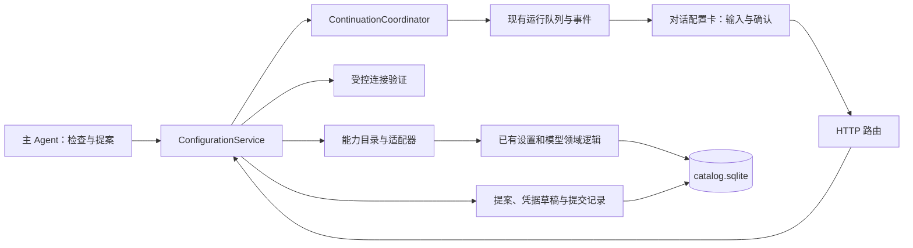

# 对话内按需配置 · 开发文档 v1

| 项目 | 内容 |
|---|---|
| 状态 | 可用于开发拆分和技术评审；本文描述目标实现，功能尚未开发 |
| 日期 | 2026-10-12 |
| 产品依据 | [对话内按需配置 · 设计 v1](conversational-settings.v1.md)，CFG-01～CFG-06、CFG-T01～CFG-T15 |
| 本地代码基线 | `9cacbe68`；本次未同步远程，不代表 GitHub 最新版本 |
| 本次交付 | 开发规格、接口契约、存储与运行接续方案、开发顺序和验收清单 |
| 版本规则 | 本文单独版本化；不覆盖产品设计 v1。后续改变范围、状态语义或接口兼容性的决策另建 v2 |

## 1. 开发目标与范围

用户以默认设置开始任务。确实需要配置时，在对话中填写最少信息并确认；系统验证、应用配置，保留已完成工作后接续任务。设置页与对话入口读写同一份配置。

### 1.1 首版交付

| 能力 ID（拟新增） | 用户操作 | 实际变更 |
|---|---|---|
| `model.select` | 选择已配置模型，确认切换 | 更新目标范围的任务模型选择 |
| `model.connect` | 提供受支持协议的地址、必要凭据和模型 ID，或从发现结果选择 | 新建 provider、模型 profile，并绑定到用户确认的范围 |
| `model.repair_credential` | 补充凭据，验证后继续 | 默认新建独立连接并重新绑定，避免修改共享 provider 的密钥影响其他会话 |
| `connector.enable` | 选择已经安装、配置完整的连接器并确认 | 在有效连接器集合中添加所选项，保存到明确的范围 |

同时交付无模型启动引导、结构化错误触发、提案卡片、凭据输入、刷新恢复、撤销预览及关联后续运行。

范围默认是当前会话。已有继承能力允许用户明确选择项目或全局，但必须展示受影响对象、当前会话的最终有效值；新增全局资源不自动修改全局默认。设置页仍可直接管理共享 provider；首版对话工具不提供原地修改共享 provider 地址/密钥的动作。

第二阶段再接入新增 HTTP/SSE MCP、OAuth、代理、超时、配置文件/环境变量导入。STDIO 启动、部署端口、存储根目录、任意 REST API 接入不在本版开发范围。

### 1.2 必须保持的约束

- 不重置现有默认值；新安装也不猜测用户的外部服务账号、地址或密钥。
- Agent 只能检查状态、提出变更，不能批准自己的提案。
- 预览不触发外部请求；用户确认绑定具体提案版本、地址、验证动作和作用范围。
- 配置写入成功、配置对任务生效、任务接续成功是三个不同结果。
- 保存新配置不改写历史或已排队运行的快照。
- 配置连接器不代替工具执行权限；既有权限卡和策略继续有效。
- 明文密钥不进入普通消息、模型输入、SSE、工具轨迹或日志。

## 2. 已核对的代码基础

下面是现有能力，不是本次新增实现。代码链接以本地基线为准。

| 位置 | 已有机制 | 本功能的使用方式 |
|---|---|---|
| [runtime-settings.ts](../../../packages/schema/src/runtime-settings.ts) | effective 值、来源、Global/Project/Session overrides | 沿用解析和规范化；显示真实来源 |
| [store.ts](../../../services/api/src/store.ts) | `replaceGlobalSettings`、`replaceProjectSettings`、`replaceSessionSettings`、`withSettingsMutation` | 接入共用的条件写入边界，保留现有路由 |
| [store/providers.ts](../../../services/api/src/store/providers.ts) | provider 校验、预设、密钥命名规则 | 草稿和正式保存共用校验 |
| [store/secrets.ts](../../../services/api/src/store/secrets.ts) | 加密凭据机制 | 新增提案草稿凭据，不自行设计加密算法 |
| [plugins/control.ts](../../../services/api/src/plugins/control.ts) | 组合 revision、候选项、预览和条件应用模式 | 复用规范化和版本比较原则，不把新提案伪装成 plugin candidate |
| [model-connectivity.ts](../../../services/api/src/model-connectivity.ts) | 有限大小响应、10 秒默认超时、失败分类 | 拆出支持草稿、协议与无密钥端点的验证接口 |
| [runs/index.ts](../../../services/api/src/runs/index.ts) | 排队、调度、事件、取消和恢复 | 增加配置等待、后续运行创建与恢复协调 |
| [native-agent/index.ts](../../../services/api/src/native-agent/index.ts) | 工具装配、external wait、turn lifecycle | 注入主 Agent 配置工具和安全边界处理 |
| [runtime-core.md](../developer-docs/runtime-core.md) | Core 保持领域无关 | 配置逻辑放在 API 服务；Core 不依赖配置 DTO 或 HTTP |
| [session/run-activity.ts](../../../apps/web/src/session/run-activity.ts) | 活动按 run 分组、卡片展开状态 | 加入 configuration 卡片种类 |
| [App.tsx](../../../apps/web/src/App.tsx) | 会话切换、事件订阅、快照加载 | 按 session/run/request 更新配置视图 |

### 2.1 实现前必须知道的差异

1. `catalog_state` 是 SQLite 中的一份目录 JSON，凭据位于独立加密表；`SessionRun` 列表使用会话文件和 `mutateArray`。不能把配置提交与创建 run 视为一个 SQLite 事务。
2. `createProvider` 会写凭据并保存目录，`materializeProviderModel`、`replaceSessionSettings` 又各自保存。顺序调用三个现有方法不能满足原子提交，需要抽取无独立提交的内部操作。
3. 已有 `commitPluginSettings` 提供“比较版本、写目录、写 receipt”的事务模式，但只覆盖 plugin 候选项；不能宣称它已经支持本功能。
4. 创建会话的 HTTP 路由在未显式指定模型时已经允许 `allowUnconfiguredModel`。首次引导可以使用已有空会话，不需要先配置好模型才能进入对话。
5. 当前连接测试会在缺少 token 时直接失败，且请求构造未完整按 `apiProtocol`/`apiVariant` 分派。新验证必须支持真实运行已经支持的协议及 `tokenOptional`，不得假造 token 绕过检查。
6. `SessionRun.settingsSnapshot` 不保证提供方端点与密钥的所有依赖已经不可变。接续还须记录资源版本和生效前置条件，不能只检查模型 profile ID。
7. 配置相关模块中已有未完成或其他任务的本地修改时，实施应在隔离分支/工作树进行；本次仅新增文档。

## 3. 模块与依赖设计



### 3.1 拟新增目录

```text
packages/schema/src/configuration.ts                 # 用户可见契约，无内部密钥引用
services/api/src/configuration/
  types.ts                                          # 内部端口和持久实体
  registry.ts                                       # 明确注册的能力目录
  diagnostics.ts                                    # 结构化诊断与触发规则
  service.ts                                        # 提案、预览、确认和应用
  tools.ts                                          # inspect_configuration / propose_configuration
  adapters/model.ts                                 # 选择、连接、凭据修复
  adapters/connector.ts                             # 启用已配置连接器
  verification.ts                                   # 草稿验证、探测预算和结果
  continuation.ts                                   # 接续任务及恢复
services/api/src/store/configuration.ts              # SQLite 仓储，复用同一个连接
services/api/src/http/configuration.ts               # 鉴权、输入校验、DTO 投影
apps/web/src/api/configuration.ts                    # 前端客户端
apps/web/src/configuration/ConfigurationCard.tsx     # 卡片与表单
apps/web/src/configuration/configuration-state.ts    # 快照/事件合并
apps/web/src/styles/configuration.css
```

这些路径是拟新增文件，不能写成已经存在。首版不额外建立通用“大配置框架”包；服务通过窄端口复用现有领域模块。

### 3.2 现有文件的改动责任

| 文件/模块 | 改动 |
|---|---|
| `packages/schema/src/index.ts`、`session.ts` | 导出配置 DTO；增加配置事件、等待原因和接续关联字段 |
| `services/api/src/store.ts`、`store/providers.ts` | 事务内配置变更；资源 revision；幂等创建后续 run；取消、归档、删除联动 |
| `services/api/src/bootstrap/platform.ts` | 装配仓储、适配器、验证器及协调器 |
| `services/api/src/http/index.ts` | 注册配置路由；原设置/模型写入也走统一版本更新；运行预检失败返回配置入口 |
| `services/api/src/agent-run/create-agent-run.ts`、`native-agent/index.ts` | 主 Agent 注入工具；组合已有 lifecycle，不覆盖版本记录钩子 |
| `services/api/src/runs/index.ts` | 等待/终态映射、接续队列、恢复顺序、Stop 竞态 |
| `apps/web/src/App.tsx`、`session/run-activity.ts`、`run-stream/`、`timeline/` | 卡片归位、会话隔离、配置终态与后续 run 展示 |
| `apps/web/src/i18n/messages.ts` | 完整中英文文案和错误映射 |

不向 `packages/runtime-core` 引入配置、provider、权限或 UI 类型。后述通用 `yield` 仅表达宿主要求在完整步骤结束后交回控制权。

## 4. 能力目录和适配器

每个能力声明 `id`、schema 版本、允许范围、字段定义、敏感字段、验证计划、生效方式和撤销能力。Registry 是显式注册的有限集合；模型不能提交新的适配器、任意 JSON Patch、代码或文件写入路径。

建议内部接口（签名示意，辅助类型在实现时补全）：

```ts
interface ConfigurationAdapter<Input, Plan> {
  readonly id: ConfigurationCapabilityId;
  readonly version: number;
  inspect(context: ReadonlyConfigurationContext): Promise<SafeCapabilityState>;
  normalize(input: unknown): Input;
  preview(input: Input, snapshot: ConfigurationSnapshot): Plan;
  verify(plan: Plan, context: ApprovedVerificationContext): Promise<VerificationResult>;
  apply(plan: Plan, transaction: ConfigurationTransaction): ApplyReceipt;
  previewReversal(receipt: ApplyReceipt, snapshot: ConfigurationSnapshot): Plan;
}
```

- `inspect` 仅返回已有资源 ID、能力状态和缺项，不主动探测网络、不读取明文凭据。
- `preview` 必须为确定性操作，无网络、无激活；验证计划中列出目标主机、请求种类、次数上限、是否可能计费。
- `verify` 只能拿到已确认计划对应的凭据访问器，不能遍历凭据库。
- `apply` 是同步事务内操作，不执行网络、文件安装或重启，不自行 `COMMIT`。
- `connector.enable` 在读取最新有效集合后添加目标 ID，生成完整目标集合并保留其他项；既有连接器列表是整表替换，不能只传新增 ID 导致其他项被删除。
- 项目/全局变更若被当前会话覆盖，预览必须明确列出附加会话变更或说明不会解决当前任务，禁止隐藏覆盖。

诊断代码至少包括 `MODEL_MISSING`、`CREDENTIAL_REQUIRED`、`MODEL_CAPABILITY_MISMATCH`、`CONNECTOR_NOT_ENABLED`。网络超时、限流和额度不足不能自动归为凭据错误。启用连接器前同时检查安装、配置与依赖可用性；缺失依赖不能静默连带启用。

## 5. 领域实体与状态

### 5.1 对外 DTO

以下类型是新增契约的骨架；前后端共用 schema 校验，禁止通过 `as` 绕过未知字段检查。

```ts
type ConfigurationCapabilityId =
  | "model.select" | "model.connect"
  | "model.repair_credential" | "connector.enable";

type ConfigurationScope =
  | { kind: "session"; id: string }
  | { kind: "project"; id: string }
  | { kind: "global" };

type ConfigurationRequestState =
  | "collecting_input" | "awaiting_confirmation"
  | "validating" | "applying" | "applied"
  | "needs_fix" | "stale" | "failed"
  | "dismissed" | "cancelled" | "expired";

type ContinuationState =
  | "not_requested" | "waiting_boundary" | "pending"
  | "queued" | "started" | "suppressed" | "needs_user_action";

interface ConfigurationRequestView {
  id: string;
  sessionId: string;
  projectId: string;
  runId?: string;
  toolCallId?: string;
  revision: number;                 // 用户确认的内容版本
  stateVersion: number;             // 每次实体变化递增，用于事件合并
  capabilityId: ConfigurationCapabilityId;
  state: ConfigurationRequestState;
  reason: { code: string; message: string };
  scope: ConfigurationScope;
  fields: ConfigurationFieldView[];
  changes: RedactedConfigurationChange[];
  impact: ConfigurationImpactView;
  verificationPlan: VerificationPlanView;
  previewDigest?: string;
  credentialStatus: "not_required" | "missing" | "provided" | "expired";
  continuation: { state: ContinuationState; runId?: string; message?: string };
  error?: { code: string; message: string; field?: string; retryable: boolean };
  allowedActions: ConfigurationAction[];
  createdAt: string;
  updatedAt: string;
  expiresAt: string;
}
```

`fields` 仅包含受支持的文本、URL、数字、布尔、枚举和专用 credential 输入描述。DTO、SSE 和 Agent 工具结果不带 ciphertext、secretRef、内部计划、原始响应体或 credential handle。

浏览器独占的凭据上传响应可以返回一次性 handle，供随后 preview 使用；该响应不得并入卡片快照、聊天状态或日志。浏览器保存提案 ID，不能保存密钥明文。

### 5.2 内部实体

除 DTO 字段外，后端保存以下内容；显式投影为 DTO，禁止对象展开后再靠黑名单删字段：

- `schemaVersion`、适配器版本、触发诊断依据、去重 fingerprint。
- 源 submission ID 或 run ID、原任务引用、artifact/reference IDs。
- 规范化输入、基线 overrides（含字段缺失）、资源版本向量、计划和 preview digest。
- 绑定请求/字段/目标的凭据草稿引用，不是明文。
- 确认记录、验证 attempt/结果、应用 receipt、反向变更计划。
- continuation ID、候选 run ID、安全边界引用、取消 generation。

`revision` 在输入、scope、目标、验证动作或基线改变时递增，并使旧确认失效；`stateVersion` 在任何状态变化时递增。单纯验证进度不改变 revision。

### 5.3 状态流转

| 起点 | 事件 | 终点 | 关键条件 |
|---|---|---|---|
| 无 | 创建提案 | `collecting_input` / `awaiting_confirmation` | 有真实诊断或用户请求；按 fingerprint 去重 |
| 可编辑状态 | preview | `collecting_input` / `awaiting_confirmation` | 规范化成功；未联网 |
| `awaiting_confirmation` | 用户确认 | `validating` | revision/digest、范围、权限和凭据有效 |
| `validating` | 验证通过、安全边界就绪 | `applying` | 版本仍匹配，未取消 |
| `validating` | 输入/连接错误 | `needs_fix` | 旧配置不变；反馈字段级错误 |
| `validating` / `applying` | 基线改变 | `stale` | 不执行覆盖，重新预览 |
| `applying` | 原子提交 | `applied` | 配置、receipt、接续意图一起持久化 |
| 未提交状态 | 拒绝 / Stop / 过期 | `dismissed` / `cancelled` / `expired` | 清理未引用草稿；不应用 |
| `applying` | 确定未提交的存储错误 | `failed` | 回滚数据库与内存目录 |

结果不明时先查 receipt，不能直接改成 failed 或重试。已 applied 的提案保持 applied；撤销创建新的反向提案，原记录通过 `reversalRequestId` 关联，保留历史。

配置 applied 之后接续失败只改 continuation 状态，不把配置伪装成未保存。相同请求每个 revision 最多有一次正式应用。

## 6. 持久化、事务与版本

### 6.1 新增表（逻辑设计）

全部使用现有 `catalog.sqlite` 和同一数据库连接，不另建包含正式配置值的配置库。建表迁移应幂等，版本记录使用本功能独立的 schema metadata，避免占用未经核对的全库 `user_version`。

| 表 | 核心字段与约束 |
|---|---|
| `configuration_requests` | `id PK`、session/project/run、source_submission_id、revision、state_version、state、expires_at、private_json；活动请求按 fingerprint 去重 |
| `configuration_request_revisions` | `(request_id, revision) PK`，不可变规范化计划、脱敏预览、基线和 digest |
| `configuration_secret_drafts` | `id PK`、request_id、field_id、binding、ciphertext、expires_at、credential_version；不存明文 |
| `configuration_operations` | `id PK`、request_id/revision、operation_kind、idempotency_key、payload_digest、status、验证结果或应用 receipt；幂等键唯一 |
| `configuration_resource_versions` | `resource_key PK`、单调递增 revision；旧资源首次读取视为 0 |
| `configuration_outbox` | `id PK`、request_id/revision、kind、state、payload、候选 run ID；`(request_id, revision, kind)` 唯一 |
| `configuration_session_controls` | `session_id PK`、stop_generation；为重启后的停止语义提供持久依据 |

请求内部可保存阻塞的原始任务草稿，但不得把它当成“用户已经再次发送的消息”。`(session_id, source_submission_id)` 对有 submission ID 的请求加唯一索引；草稿内容沿用消息级存储权限、大小限制与引用验证。

草稿凭据空闲有效期默认 30 分钟，提案最长等待 24 小时；有效期不因 SSE 重连自动延长。凭据过期后卡片要求重新输入并重新预览。已确认的验证/应用操作持有有界的执行租约，清理器不得删除其正在使用的凭据；操作完成后转正式密钥或清理草稿。

### 6.2 统一条件写入

不能只为新卡片增加 revision。旧设置页、provider/model 更新与删除、plugin 配置以及会话覆盖写入，也必须更新相关版本。否则用户在另一窗口修改配置后，旧卡片仍会误判基线有效。

资源版本向量包含：目标 overrides、会影响继承结果的父级、选定 provider/model、凭据 generation，以及连接器安装/配置状态。非数据库管理的 registry/策略使用确定性指纹并在提交前再检查；指纹不包含密钥明文或明文 hash。

写入使用白名单操作，在最新 overrides 上变更目标字段；不把 Agent 看见的旧完整对象 `PUT` 回去。保留未涉及字段、插件配置和 `inherit` 语义。版本冲突返回新预览，不自动合并后继续使用旧确认。

### 6.3 原子提交算法

```text
1. 网络验证在事务外执行，持久化验证 attempt 与结果。
2. 等待对应运行安全边界；检查会话/项目未归档、未删除。
3. 进入共用的 settings/model 写入串行边界，等待已有 saveQueue。
4. 在事务外准备新的不可变候选目录；BEGIN IMMEDIATE 后不再 await。
5. 重新比较 revision、资源版本、stop_generation、验证计划和有效期。
6. 同一事务写入：正式 provider/model/密钥、overrides、资源版本、
   applied 状态、应用 receipt、事件 outbox 和 continuation outbox。
7. COMMIT 后更新内存目录，并触发已有配置变化通知。
8. 事务外发布脱敏事件及处理接续；失败可从 receipt/outbox 恢复。
```

候选目录必须基于进入串行边界后的最新状态构造；若构造需要异步步骤，回到事务前重新读取并比较。事务中只执行同步 DB 操作。现有 mutator 要拆出不独立持久化的内部操作，不能在本事务内调用会排队/提交的公共 mutator。

实现必须核对所有正式目录/凭据写入入口是否遵守相同的写入边界。事务失败恢复内存原对象，且 saveQueue/锁队列不能因一次失败永久卡死。首版沿用单 API 进程写入模型，不宣称支持多个进程同时修改同一数据目录。

### 6.4 撤销

从原 receipt 生成反向提案，展示差异并经过同一确认/条件提交链路。保留原来字段“不存在”的信息，才能恢复继承；不要把旧 effective 值写成新 override。

默认撤销选择/绑定，保留新建共享资源。只有资源未被引用且另有明确删除确认时才删除；首版卡片不顺带删除 provider。外部测试请求和已经完成的业务动作不能撤销。由于首版凭据修复默认建立新连接，撤销无需在历史记录中保留旧密钥明文。

## 7. HTTP 与 Agent 工具契约

以下均为拟新增接口。所有用户接口沿用现有 bearer 鉴权，验证 route 中的 session/project 归属和可写状态；全局配置遵循当前部署的配置管理权限。当前认证模型不提供独立用户身份时，审计记录“已认证客户端”，不得伪造 userId 或声称具备多租户隔离。

### 7.1 路由

前缀 `S = /api/sessions/:sessionId`，`R = S/configuration-requests/:requestId`。

| 方法与路径 | 语义 | 响应 |
|---|---|---|
| `POST S/configuration/preflight` | 确定性检查任务所需基础配置；不足时保存阻塞任务草稿并生成卡片 | `200 ready` 或 `200 configuration_required`，不启动 Agent |
| `GET S/configuration-requests` | 分页获取脱敏快照，默认待处理项及近期结果 | `200 {items, nextCursor?}` |
| `GET R` | 获取单张卡片，恢复验证/应用进度 | `200 ConfigurationRequestView` |
| `POST R/credentials` | 提交指定 credential 字段到加密草稿 | `201 {handle, expiresAt}`，只返回给浏览器 |
| `POST R/preview` | 合并用户字段与凭据 handle，生成确定性新版本 | `200` 卡片 DTO；不联网 |
| `POST R/decisions` | 确认应用、仅探测模型列表或拒绝 | 首次接受异步操作 `202`；重复提交返回原操作 |
| `POST R/continue` | 已 applied 后单独重试/启动接续，不再次写配置 | `202`，或已存在接续的 `200` |
| `POST R/reversal` | 基于 receipt 创建反向提案 | `201` 新卡片；仍须确认 |

所有写请求携带 `Idempotency-Key`。同键同规范化载荷返回同一结果，同键不同载荷返回 `409 IDEMPOTENCY_MISMATCH`。不同键也不能绕过同一 revision 的应用唯一约束。

`preflight` 只检查确定性前置条件，不为了猜测用户意图额外调用模型或探测网络。正常 `/runs` 创建也执行同样的基础检查，防止预检后配置变化；不足时返回结构化 `409 CONFIGURATION_REQUIRED` 和可重用 request ID，而不是普通字符串错误。复用客户端 submission ID，避免预检与正式提交产生两张卡。

### 7.2 请求示例

```json
{
  "expectedRevision": 3,
  "input": {
    "providerPresetId": "<已注册预设 ID>",
    "baseUrl": "https://models.example.invalid/v1",
    "model": "vision-demo"
  },
  "credentialHandles": { "apiToken": "<浏览器收到的不透明 handle>" },
  "scope": { "kind": "session", "id": "<当前会话 ID>" }
}
```

上例用于 `/preview`，其中 provider preset ID 必须来自 Registry/现有预设，不能照抄占位值。

```json
{
  "expectedRevision": 4,
  "previewDigest": "<后端返回的摘要标识>",
  "decision": "approve",
  "action": "apply",
  "continuation": "apply_and_continue"
}
```

`decision` 为 `approve | dismiss`。approve 时 `action` 为 `apply | discover_models`；探测授权不能自动升级为保存授权。`apply` 时 continuation 为 `apply_only | apply_and_continue`；dismiss 不携带执行动作。

用户输入后可自动刷新无副作用预览，按钮只批准最后展示的版本。提交时若规范化导致用户未见过的地址、范围、额外变更或测试计划，先展示更新，不能自动确认新版本。已完整展示的表单无需再加一次相同确认弹窗。

### 7.3 统一错误

| HTTP | code | 前端行为 |
|---|---|---|
| 400 | `INVALID_CONFIGURATION_INPUT` | 定位具体字段，不丢弃其他输入 |
| 401 / 403 | `UNAUTHENTICATED` / `CONFIGURATION_FORBIDDEN` | 沿用应用鉴权处理，不变成“API Key 错误” |
| 404 | `CONFIGURATION_REQUEST_NOT_FOUND` | 移除无效入口，不切换到别的会话 |
| 409 | `STALE_CONFIGURATION_PREVIEW` / `RESOURCE_VERSION_CONFLICT` | 展示最新差异并重新确认 |
| 409 | `SESSION_NOT_WRITABLE` / `CONTINUATION_STOPPED` | 显示停止/归档原因，禁止自动恢复 |
| 409 | `IDEMPOTENCY_MISMATCH` | 保留原操作，拒绝用同键改参数 |
| 410 | `CONFIGURATION_EXPIRED` / `CREDENTIAL_DRAFT_EXPIRED` | 重新输入或重建提案 |
| 429 | `CONFIGURATION_RATE_LIMITED` | 显示重试时间，不自动密集验证 |

验证失败通常是异步操作结果：卡片进入 `needs_fix`，附 `AUTHORIZATION_FAILED`、`MODEL_NOT_FOUND`、`NETWORK_UNREACHABLE`、`RATE_OR_QUOTA_LIMITED`、`UNSUPPORTED_PROTOCOL`、`CAPABILITY_UNVERIFIED` 等领域代码。未知 provider 错误只返回脱敏摘要。

### 7.4 Agent 工具

`inspect_configuration` 输入限制为当前任务相关能力和资源 ID，返回脱敏有效值、来源、缺项和支持的操作。`propose_configuration` 接收 capability ID、已知非敏感字段、原因/诊断引用和建议范围，返回 request ID 与卡片状态。工具参数拒绝明文 apiToken、headers、任意 env、URL 内嵌 userinfo 和通用文件路径。

两工具通过现有 `extraTools` 与工具策略入口注入主 Agent；子 Agent 不注册，不能仅依靠提示词禁止。inspect 可声明并发安全；propose 是排他工具，并按 session/run/能力/目标/缺口生成 fingerprint。拒绝后的同缺口在该任务内抑制重提，用户主动请求或实质输入变化可开启新提案。

工具调用不得获得 bearer、credential handle、决定接口或批准能力。工具执行先持久化提案并返回；等待用户发生在完整工具步骤的安全边界，避免工具自己阻塞、同时等待兄弟工具完成所形成的死锁。

## 8. 验证与凭据通道

### 8.1 验证必须在保存前完成

把当前连接测试拆为“根据显式协议生成请求”和“执行有界请求”两个部分，接受未保存的 provider/model 草稿，不要求先创建正式 provider 才能测试。设置页的测试入口也使用同一个验证实现，避免两条路径结果不一致。

| 项目 | 首版契约 |
|---|---|
| 协议 | 按规范化后的 `apiProtocol` / `apiVariant` 使用真实运行对应的请求格式与路径；禁止只凭 hostname 猜协议 |
| 无密钥端点 | Registry/现有 provider 明确允许 `tokenOptional` 时可省略凭据与 Authorization；缺钥的收费端点仍提示补齐 |
| 内容 | 使用固定、无用户数据的探测输入；不得发送用户任务、图片、文件或聊天历史 |
| 超时与响应 | 单次默认 10 秒，连接测试响应最大 64 KiB；发现列表使用单独的有界 schema/条目上限；整次验证设总预算 |
| 计费 | 最小生成请求仍可能计费，确认前说明；超时或重启不自动重复未知是否已发出的请求 |
| 网络 | 复用模型调用的代理与外连策略，不把 Runner 沙箱网络策略误当成模型 API 策略 |
| 重定向 | 默认不自动跟随；变更目标需重新预览，不能把凭据转发到未批准的主机 |
| 错误 | 分类码与有限长度摘要，去掉响应中的凭据、请求头和服务端调试数据 |

“连接成功”不代表“视觉能力已验证”。分开记录 connectivity 和 required capability 的依据：提供方事实、已有 profile 声明或专门探测。需要专门探测时把固定测试内容、次数和潜在费用放入同一验证计划；能力未知时显示未验证，不能仅因为一个文本请求成功就自动设置 `vision=true`。

已有 `ModelConnectivityTestCoordinator` 只在进程内按 model ID 合并，不能替代持久幂等。新 attempt 按 request/revision/验证计划建立唯一操作记录；同一未变更 revision 的重复点击读取原操作。验证失败后的显式重试生成新的 attempt，并记录用户授权，不能覆盖旧结果。

### 8.2 未知模型 ID 的两步流程

1. 卡片收集地址、协议和凭据；preview 展示“获取此服务的模型列表”及目标。
2. 用户批准 `discover_models`，验证器只执行该计划，结果保存为有限且脱敏的候选集合。
3. 用户选择模型；产生新的 preview revision，展示实际将新建/绑定的资源与测试计划。
4. 用户批准 `apply` 后再验证并提交。

如果服务不支持模型列表，返回可操作的提示并允许手填模型 ID。未知协议不能自动切成另一协议、转送凭据或替用户选择外部服务。已知模型 ID 且预览完整时仍可一次确认完成。

### 8.3 凭据数据流

```text
用户输入框 → 专用 HTTP 端点 → 加密草稿
                                ↓ 仅获准验证可读取
                            连接验证器
                                ↓ 同一提交事务转存
                            正式密钥存储

Agent / 普通 DTO / SSE → 只见 missing / provided / expired 状态
```

沿用已有加密算法与主密钥管理，新增独立命名空间和请求/字段绑定。已保存凭据默认只能用于其原 provider 的受支持端点，不允许 Agent 换一个 URL 就复用该凭据。

专用路由关闭请求体日志，校验字段类型、长度、Content-Type、来源与资源归属；CORS 规则不能因为引入配置卡而放宽。提交后清空前端明文，只有短期 handle 留在内存；页面刷新后从服务端状态得知“已提供”，不取回原值。

原任务消息中意外包含的用户凭据不是本功能专用通道可以追溯清除的内容。正式提示引导使用专用输入框；处理既存消息的脱敏/历史删除不纳入本版，但不能在新提案中复制该明文。

## 9. 运行等待与任务接续

### 9.1 活跃运行的安全边界

当前 Runtime Core 支持完整步骤后的 `TurnLifecycle.afterTurn`，但返回类型是 `Promise<void>`，尚无正常“交回控制权”结果。不能在文档中假设已支持无损暂停。

本版采用最小通用扩展：`afterTurn` 可返回 `void | { kind: "yield" }`，默认 void 保持原行为；loop 的结果增加可选 `stopReason: "yielded"`，正常完成保留兼容语义。Core 只增加中性的 `yielded` 终态和对应生命周期记录，不了解配置、审批、provider 或接续 run。实现时同步更新并版本化 Runtime Core 架构说明。

API 侧用组合 lifecycle 顺序调用现有版本记录器，再执行配置边界协调器；版本记录必须成功后才能 yield。模型无工具的结束步骤与含工具步骤都遵循同一规则，不遗漏任何调用点。yield 不能伪装成 exception、用户取消或 completed；必须穿过 native-agent/AgentRun 的返回值和事件映射到产品层。

具体流程：

1. propose 工具持久化提案并返回 pending；UI 可显示卡片。
2. 当前工具批次继续按照已有调度规则完成。确认可以先记账，网络验证可以提前进行，但正式配置提交与接续要等待安全边界。
3. `afterTurn` 确认本批所有工具结果已持久化、assistant/tool-call 配对完整，并核查关联子任务或外部作业是否还有未决状态。
4. 记录 `checkpointRef`，进入配置外部等待；运行显示 `blocked` 和结构化 `blockedReason={kind:"configuration",requestId}`。
5. 用户拒绝且有替代路径时释放等待，给 Agent 注入脱敏拒绝结果，再按旧配置继续；没有必要能力时停止当前任务并保留原因，不循环重提。
6. 配置成功、选择 apply-and-continue 后，协调器返回 yield；产品层把旧 run 记为 `interrupted`、`terminationReason=configuration_changed`。
7. 旧运行的文件、事件和 usage 收尾完成后才标记 continuation outbox 可投递，避免新 run 在旧 run 清理前开始。

external wait 使用已有引用计数，并在 finally 中释放。等待用户时暂停相应 Agent 超时；独立执行中的工具仍遵循自己的执行超时。卡片在并行工具未结束时显示“等待当前步骤完成”，不能声称已切换模型。

如果后台作业存在未知结果，接续进入 `needs_user_action`。能查询状态的作业先查询；不得通过重发上传、付费请求或远程命令猜测是否完成。用户 Stop 始终优先于自动接续。

### 9.2 首次配置与已经失败的运行

首次进入使用现有无模型会话创建路径，前端保留 composer 草稿；preflight 将需要恢复的原任务及引用保存为阻塞 intent，不创建必然失败的 run。配置成功后用相同 intent 创建第一个 run，并只生成一条用户消息。离开页面再回来通过卡片与 intent 恢复，不依赖模型记住初始请求。

运行已经因模型认证失败而结束时，在错误归因层生成同类卡片，旧 run 维持 failed 历史。确认后创建有来源关联的后续 run，不把既有失败记录追溯改成“等待配置”。若其他工作仍在执行，仍须完成安全性核查。

### 9.3 接续载荷与来源

`ContinuationIntent` 至少保存：

```text
continuationId, requestId, requestRevision, sessionId
sourceRunId? / sourceSubmissionId
candidateRunId, checkpointRef?, sourceUserMessageId?
originalTaskRef, completedActionRefs, artifactRefs, composerReferences
approvedSettingsSnapshot, resourceVersionPreconditions
stopGeneration, state, lastError?, queuedAt?
```

新 `SessionRun` 增加 optional 字段：`continuedFromRunId`、`configurationRequestId`、`continuationId`、`terminationReason`、`blockedReason`。这些字段由服务端设置；普通 `/runs` body 不能伪造内部接续身份。历史记录缺少字段时使用原行为。

接续上下文是新的运行装配：原任务目标、已完成步骤的事实记录、产物引用、最后安全点和未完成事项。使用已有 ContextAssembler/历史窗口机制；跨模型时重新适配上下文，不直接复制不兼容的 provider 专属隐藏字段。不能把配置表单或凭据写成假冒用户聊天消息。

恢复前检查附件/产物仍存在且可访问、原有 skill revision 可解析、当前会话未归档、候选资源版本仍有效。缺项时要求用户处理，不静默换模型、换资源或补造证据。

### 9.4 跨 SQLite 与文件的幂等接续

不尝试用 SQLite 事务包住 run 文件写入。使用持久 outbox、预先分配的候选 run ID 和文件写屏障：

```text
配置提交事务：写 applied receipt + continuation intent + candidateRunId
    ↓
旧 run 收尾完成：outbox 从 waiting_boundary 变为 pending
    ↓
确认来源、停止 generation、资源前置条件仍有效
    ↓
在 sessionRunsPath 的同一个 mutateArray 屏障内：
  按 continuationId 查找 → 已存在则返回该 run
  不存在则用 candidateRunId 和冻结快照插入 queued run
    ↓
将 runId 回写 outbox，并发布 queued 事件、唤醒现有调度器
```

新增内部 `ensureContinuationRun`，不能在外部“先 list、再普通 createSessionRun”，那会留下并发重复创建窗口。插入前再次验证会话控制 generation；已有 run 无论 queued、running 还是终态均返回同一个结果，不重建第二个 run。

默认沿用队列追加语义，保留已有 queued run 的相对顺序与快照。如果前面已有任务，卡片显示“已配置，接续任务已排队”，不能直接显示“正在继续”。本版不引入队列插队策略。

调度器在接续 run 从 queued 进入 running 前，再核查 outbox 未抑制、来源 run 已终态、generation 和资源版本仍匹配。即便 run 文件已写入而 DB 回执尚未回写，也必须能以 `continuationId` 查询权威记录；不能只依赖 UI 状态启动。

完整 `approvedSettingsSnapshot` 在提交前通过既有装配逻辑准备，提交时检查其依赖版本；涉及异步固定 skill 等引用时在事务外完成，事务内只比较。重启后使用已批准的快照，不重新解析当前值悄悄改变用户批准的内容。排队期间依赖变化，标记 `needs_user_action` 并暂停该接续，不改变普通 queued run 的既有行为。

### 9.5 崩溃与停止窗口

| 故障位置 | 恢复动作 |
|---|---|
| 用户确认前 | 恢复 pending 卡片；凭据过期则重输，不自动批准 |
| 外部验证已发出、结果未持久化 | 标记验证结果未知，用户明确重试；不自动再发可能计费请求 |
| 验证结果已保存、配置尚未提交 | 检查验证新鲜度、计划、版本、取消状态后提交；过期回到需要确认/验证 |
| SQLite COMMIT 成功但 HTTP 响应丢失 | 同幂等键查询 receipt，返回已应用；不再写配置 |
| 配置已提交、旧 run 未收尾 | 根据 checkpoint 与执行记录核实旧 run；可安全收尾才投递，未知副作用则停在需要处理 |
| 新 run 文件已写、outbox 未记 queued | 以 continuationId 找到该 run，补回执和事件；不创建第二个 |
| queued 事件丢失 | outbox 重投事件或快照补齐，前端按 ID/version 去重 |
| 后续 run 已经运行/结束 | 关联原记录，绝不因 outbox 落后而重跑 |

会话 Stop 在响应成功前增加持久 `stop_generation`，并抑制关联配置操作/接续；启动验证、提交事务、文件插入、调度领取均检查 generation。某个无关 queued run 的取消不等于整个会话 Stop，取消入口必须按实际目标更新相关 intent。

取消先发生则拒绝配置提交；配置先提交则 applied 保持真实，取消阻止接续。会话归档和删除同样使 pending intent 失效。新版本的 `recoverSessionRuns` 先对照配置交接记录再执行普通崩溃恢复，不能把正常交接标成进程崩溃，也不能在恢复时丢掉 pending 配置卡。

`apply_only` 保持配置已保存，当前等待执行在安全点结束，continuation 为 `not_requested`；用户后来点击继续才创建/激活接续意图，并重新检查前置条件。重试接续只操作 continuation，不再次验证或写配置；若所需配置已变化，另行预览，不套用旧确认。

## 10. SSE、快照与前端实现

### 10.1 事件模型

扩展 `RunStreamEvent`：

```ts
type ConfigurationEvent = {
  type: "configuration.required" | "configuration.updated" | "configuration.resolved";
  request: ConfigurationRequestView;
};
```

实体的 session/run ID 与事件外层身份必须一致。事件携带全量脱敏卡片快照，减少增量补丁丢失导致的错误；使用 `request.stateVersion` 合并，只接受更新版本。同内容 revision 下仍可能有新验证/接续状态，因此不能只比较 revision。

事件产生与 DB 状态变化通过 outbox 关联，发布是至少一次投递。页面切换或重新订阅时同时读取配置实体快照；run 终态流已关闭后，由操作响应和对 pending 操作的有界轮询补齐状态。轮询在终态/页面不可见时停止或退避，不能假设终态 run 还能持续收到 SSE。

首次配置没有 run ID，归于当前 session 的对话尾部；创建第一个 run 后通过 request/intent 关联移到对应任务，只展示一次。浏览器地址中的 request ID 不能作为越过 session 归属校验的依据。

### 10.2 卡片组件

`ConfigurationCard` 接收 DTO 和 callback，不直接访问其他设置组件内部状态。建议拆分字段渲染、差异预览、验证状态和结果区；敏感字段仅在组件的瞬时内存中存在。

| 状态 | 主动作 | 展示 |
|---|---|---|
| collecting_input | 必填项补齐后可确认 | 已预填项、缺项、作用范围 |
| awaiting_confirmation | 确认配置并继续 | 关键差异与验证计划 |
| validating / applying | 禁止重复提交 | 当前阶段；Stop 仍可用 |
| needs_fix | 修正后重新验证 | 字段错误，明确原配置未变 |
| stale | 刷新预览后确认 | 新旧差异及冲突原因 |
| applied + pending/queued | 查看进度 | “已保存，等待接续/已排队” |
| applied + started | 查看结果、撤销配置 | “已配置，任务已继续” |
| applied + needs_user_action | 重试接续/处理问题 | 不误导成配置失败 |
| dismissed/cancelled/expired | 无旧确认按钮 | 原因；显式重新发起入口 |

复用 activity card expansion 管理展开态，key 为 `configuration:<requestId>`。终态折叠但可展开查看；不能沿用权限卡“决策后移除”的规则而丢失配置结果。

前端发起异步请求时捕获 sessionId/requestId；响应或 SSE 返回后核对当前上下文，不能把上一会话的结果写到当前会话。配置成功通过已有设置加载入口刷新模型列表、scope 设置和生效来源，避免设置页仍显示旧值。

表单输入有显式 label；错误使用可访问提示；动态阶段用 aria-live；键盘能完成全部操作。窄屏纵向排布，关键作用范围和主动作不藏在高级项中。中英文文案统一使用现有 i18n。

## 11. 数据迁移、上线和回退

1. 先新增表与可选 schema 字段，历史 run、事件和目录无需整体重写；首次启动迁移重复执行不丢数据。
2. 资源 revision 的初始化只补缺项，不改已有设置值；旧资源视为 revision 0 后第一次正式变更递增。
3. 发布功能开关建议为 `SCIENCE_AGENT_CONVERSATIONAL_SETTINGS_ENABLED`（拟新增部署开关，默认关闭用于联调）；关闭时不注册 Agent 提案工具、不主动生成配置卡。完成验收后再决定发布默认值。
4. 开关关闭仍能读取已存在记录、取消等待和清理凭据草稿；拒绝新的应用/接续。它不回滚已经应用的配置。
5. Session 删除清理其提案、凭据草稿、outbox 和控制记录；全局 provider/model 按现有资源删除规则处理，不因一个会话删除就自动删除共享连接。清理范围扩展到现有删除影响预览。
6. 上线采用同版本前后端。新可选字段读取兼容不代表任意旧二进制降级都安全：降级前排空/抑制配置接续、清理未用凭据、备份数据目录并做兼容验证；不能仅靠旧代码忽略字段而允许继续调度。

日志记录 requestId/revision、capability、诊断码、作用域、变更字段名、耗时、提交/接续结果。禁止记录密钥、handle、认证 URL、请求体和 provider 原始响应。运维统计区分验证失败、应用失败、接续失败与用户拒绝，不把正常交接计入模型故障。

## 12. 开发分解与依赖

每项完成后均应能单独评审。下面是开发顺序，不是已完成清单或工期承诺。

| 工作包 | 主要交付 | 依赖与完成条件 |
|---|---|---|
| DEV-CFG-01 契约与存储 | schema、DTO 投影、表、revision、幂等和凭据草稿 | CFG-01/02/03；迁移和敏感数据测试通过 |
| DEV-CFG-02 原子配置服务 | Registry、模型/连接器适配器、统一写入边界、receipt、撤销 | 01；包括旧设置页并发写入测试，不仅测试新接口 |
| DEV-CFG-03 验证与 HTTP | 草稿验证、协议/无密钥支持、preflight、preview/decisions 路由 | 01/02；错误类别、授权绑定和外部请求计数正确 |
| DEV-CFG-04 运行接续 | 通用 yield、配置安全边界、outbox、ensureContinuationRun、Stop/恢复 | 01/02/03；故障注入证明不重复执行 |
| DEV-CFG-05 对话前端 | 卡片、专用输入、状态合并、无模型入口、scope 预览、i18n | 使用固定 DTO fixtures 可先做布局；联调依赖 03/04 |
| DEV-CFG-06 Agent 接入 | 主 Agent 两工具、诊断触发、去重、上下文结果 | 03/04/05；子 Agent 无直接配置能力 |
| DEV-CFG-07 验收与发布 | UT/API/旅程、WSL 全量验证、文档与发布开关 | 前六项完成；所有首版验收项通过 |

优先做 `model.select` 的纵向流程，再接 `model.connect` 和凭据修复，最后接 `connector.enable`。首版完成仍需覆盖全部四项能力；只做卡片或只做保存接口不能算完成首版。

## 13. 测试与验收计划

### 13.1 产品验收映射

| 产品验收 ID | 必测层 | 关键断言 |
|---|---|---|
| CFG-T01 | store + API + 旅程 | 可用默认值不变；无额外卡片或探测请求 |
| CFG-T02 | API + 旅程 | 填写、确认、验证、保存、接续完整；无需设置页 |
| CFG-T03 | adapter + 前端 + 旅程 | 会话选择生效；项目/全局与其他会话保持原值 |
| CFG-T04 | verification + API | 错误凭据不替换旧配置；tokenOptional 无伪 token 也能验证 |
| CFG-T05 | preflight + 旅程 | 无模型和模型认证失败都可显示并完成配置；初始任务只入队一次 |
| CFG-T06 | schema + API + 日志/事件检查 | 敏感字段不泄漏；Agent 不能提交决策或跨请求使用 handle |
| CFG-T07 | preview + 前端 | 资源位置、scope、父级被覆盖的影响均真实 |
| CFG-T08 | service + runtime | 拒绝/取消不重提、不写配置；替代路径和停止原因正确 |
| CFG-T09 | store + 恢复 + 前端 | 双击、重连、重放、重启只有一次应用和一个后续 run |
| CFG-T10 | 并发 API | 设置页修改、provider 更新/删除、父级变化都会使旧提案 stale |
| CFG-T11 | runtime + integration | 旧快照不改、新快照有效、历史工具消息配对完整、已执行副作用不重放 |
| CFG-T12 | 故障注入 + 前端 | 提交失败与接续失败清楚区分；对应重试不跨阶段重复执行 |
| CFG-T13 | runtime + UI | Stop 与提交竞态、会话切换、归档/删除没有越域写入或意外恢复 |
| CFG-T14 | adapter + 并发 API | 恢复继承；不覆盖后续变更、不删除被其他会话使用的资源 |
| CFG-T15 | 前端 + 旅程 | 键盘操作、错误提示、窄屏和中英文均可用 |

### 13.2 必须补充的工程断言

- 每个 HTTP 写路由的同键重放、异键同 revision、同键不同载荷。
- 在 §9.5 每个窗口注入进程退出；保存后重启返回同一 provider/model/run ID。
- 通用 yield 的无工具步骤、有工具步骤、usage、生命周期终态、版本记录顺序；不再发下一轮模型请求。
- propose 与普通工具同批时，全部工具结果提交后才交接；子任务未决时不自动重放。
- 新 run 在 file 写入与 DB 回写间崩溃，以及 queued 后被 Stop，再重启均不开始执行。
- 手动设置页调用与对话提交交错；一次 DB 错误后下一次配置仍能保存。
- 继承连接器集合添加一项保留其余项，撤销后重新继承；项目父级变化使预览失效。
- 所有正式支持的模型协议各一个成功/不匹配用例；连接成功与视觉能力未知必须不同状态。
- 重定向、URL 内嵌凭据、handle 越域、原始 provider 响应携带测试密钥时不会泄漏或转送。

### 13.3 拟新增测试位置

```text
services/api/src/configuration/service.test.ts
services/api/src/configuration/verification.test.ts
services/api/src/configuration/continuation.test.ts
services/api/src/store/configuration.test.ts
services/api/src/http/configuration.test.ts
apps/web/tests/ConfigurationCard.test.tsx
apps/web/tests/configuration-state.test.ts
test/journey-conversational-settings.spec.ts
```

同时更新已有 `store`、`runs`、`native-agent`、`runtime-core` 和模型连接测试。测试文件路径是建议，按包实际发现规则落位，避免深层新目录中的测试没被 package script 收集。

浏览器旅程接入现有 `@mocked`/E2E-META 规范和测试目录清单，使用有限的假 provider，出站由测试策略控制。不要用真实用户密钥作为回归测试数据；可选真实服务验证必须独立标记，不成为普通 CI 的隐性网络依赖。

### 13.4 实现后的验证命令

以下命令来自当前仓库脚本，**本次文档编写未执行**。在 WSL Linux 运行目录中执行，先按开发流程同步代码并保留运行数据、依赖、`.git` 和 `.tmp`。若数据目录名不是 `data`，同步排除规则也必须覆盖真实数据目录，禁止使用 `rsync --delete`。

```bash
# 在 /root/sciencediscovery，代码已同步且 Linux 依赖准备完成。
pnpm build
pnpm --filter @sciencediscovery/api test
pnpm --filter @sciencediscovery/web test
pnpm architecture:check
pnpm typecheck
pnpm test
```

`pnpm test` 本身包含 build、binary:test 和 workspace tests；开发者可记录一次完整成功结果，避免没有新变化时反复运行。包定向测试用于快速定位，不代替最终全量验证。

已有独立 E2E 服务和 `.e2e` 依赖准备后，针对本功能旅程运行：

```bash
node test/sync-e2e.mjs --check
npm --prefix .e2e run test:mocked -- journey-conversational-settings.spec.ts
```

服务地址和 token 由测试环境通过 `E2E_BASE_URL` / `E2E_API_TOKEN` 提供，不写入脚本或文档。隔离服务全量 mocked gate 使用现有 `pnpm ci:e2e`，其环境准备和临时数据目录按仓库 CI 说明配置；不要把该 gate 指向用户实际数据目录。

测试完成后按流程重启本地服务并检查 `/health`，只清理由测试记录的明确 project/session IDs。记录完整命令、结果、失败原因、清理情况；未跑的检查不能标成通过。

## 14. 完成定义与交付记录

功能实现只有在以下条件同时满足后才可标为完成：

- 四项首版能力与无模型引导都通过完整对话旅程。
- 配置保存、验证和接续使用真实后端链路，UI 不用延时模拟成功。
- 全部 CFG-T01～CFG-T15 及幂等/崩溃窗口断言通过。
- 原设置页、权限等待、普通排队、取消和恢复行为没有回归。
- 文档与实际 schema/路由/状态一致；REST、运行时行为、前端参考和架构说明随实现更新并保留前版。
- WSL build/typecheck/架构检查/全量测试与功能旅程完成；本地健康检查及测试数据清理有记录。

实现交付报告填写：实现分支/commit、设计版本、完成的工作包、测试命令与结果、数据迁移影响、服务重启与健康状态、剩余限制。提交/推送仍需使用已核实的目标仓库，不把当前本地 remote 自动当作权威 GitHub 上游。

本文交付时：仅编写开发文档并核对本地代码入口；未新增产品接口、未运行产品测试、未迁移数据库、未修改用户实际配置。
