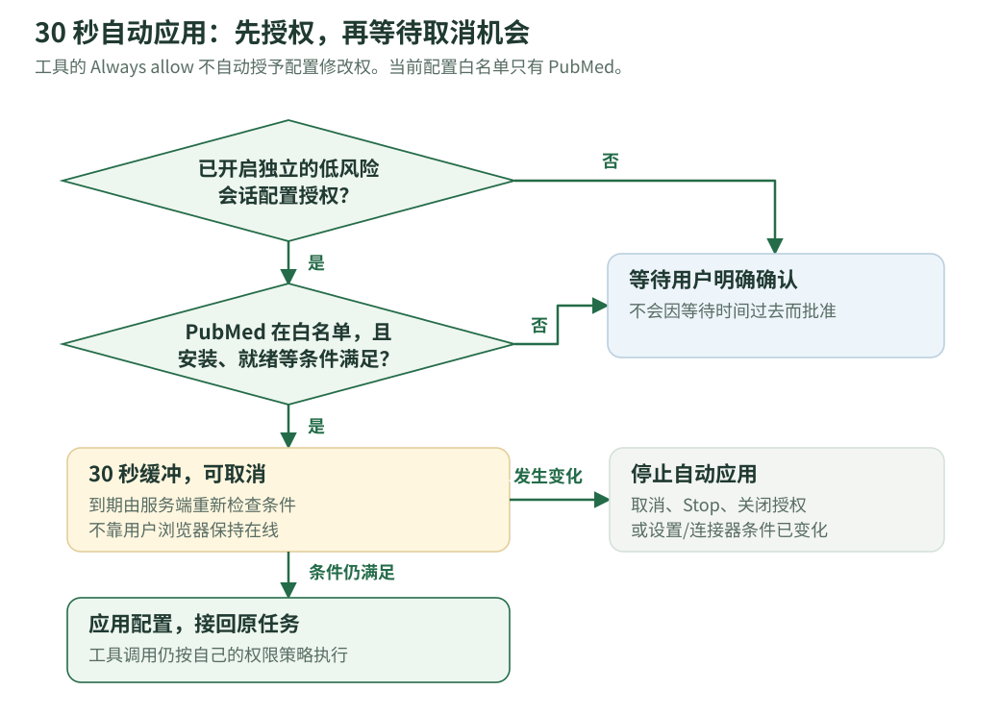
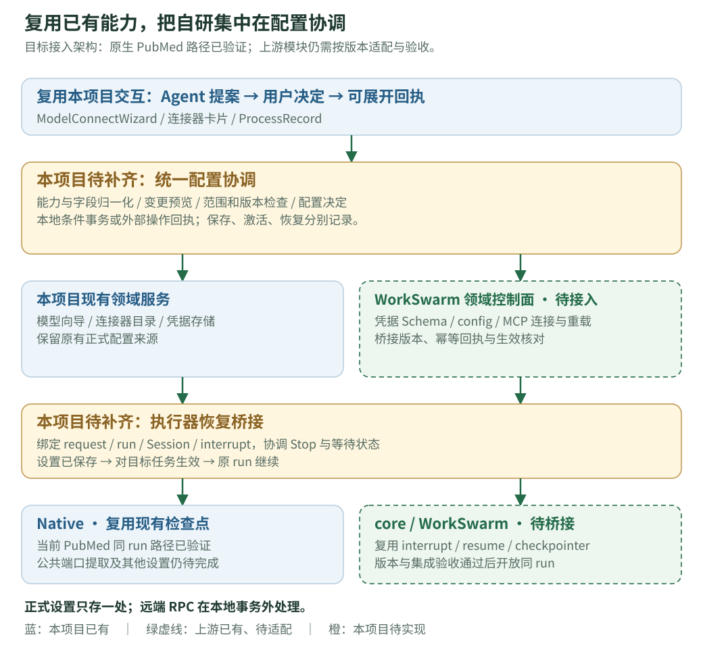

# 对话内按需配置 · 完整设计 v15（复用与接入方案）

**本功能将任务所需的配置变更纳入对话执行链路：Agent 识别配置缺口并提出具体变更，用户确认后由系统应用，原任务继续执行。** 目标是减少查找设置、理解字段和切换上下文的成本，同时保留用户对修改内容与作用范围的控制。

本文面向熟悉 ScienceDiscovery 的项目评审人员，默认读者了解 Agent、Session、run 和连接器等现有机制。文档重点补齐本 feature 的问题背景、交互流程、设计取舍、实现边界和验收依据，无需先阅读 issue 或历史讨论。

- 想先理解体验：读第 1～4 节；想讨论长任务和实现方式：再读第 8～10 节。
- 需要核对交付：读第 2、12、13 节。图中的“目标设计”不代表当前全部完成。
- 技术契约见[完整开发文档 v5](conversational-settings-development.v5.md)，实测记录见[实现与实测 v5](conversational-settings-status.v5.md)，复用依据见[竞品与底座调研 v2](conversational-settings-research.v2.md)。
- 本版将调研落实为接入决策：优先复用现有模型/凭据/配置服务与 core 中断机制，明确领域事务、外部写入、生效与 run 关联由本项目补齐。保留[项目评审版 v14](conversational-settings.v14.md)；新增要求属于待实现合同，不增加已交付能力或扩大授权。
- 文档日期：2026-10-19。当前为隔离分支中的有限实现，不表示已合入主仓；具体交付与验证范围在正文中分别说明。

## 1. 问题背景与设计目标

### 1.1 典型配置缺口与用户成本

用户对 ScienceDiscovery 说：“用 PubMed 找几篇 TP53 相关论文，给我标题和来源。”

假设模型可用、PubMed 连接器已安装且就绪，但当前 Session 尚未启用。现有能力足以完成检索，阻碍任务的是配置缺口，而非新增工具能力的需求。

此时，用户真正想做的是查论文，却要先理解“连接器在哪个设置页”“该改哪一项”“改完影响谁”。不常用的配置尤其难找；离开对话、进入设置再返回，也增加了切换研究上下文的负担。

下面把起点和终点固定下来：模型可用，PubMed 已安装且就绪，仅当前会话未启用；目标是启用后继续原研究任务。对比的重点是**谁承担配置工作**，不是系统一共执行几步。

### 1.2 用户收益与系统分工

**用户少做的是查找和操作，保留的是对具体变更的决定权。** Agent 说明“这一步缺什么、为什么需要、只会改哪里”，系统准备变更、执行获准配置，并接续任务。用户不用先学会设置项叫什么、位于哪里。

| 配置环节 | 原来用户需要做什么 | 对话内配置由谁完成 |
|---|---|---|
| 找到设置入口和字段 | 离开对话，自行查找 | Agent 识别缺项，系统展示具体配置卡 |
| 判断修改内容与范围 | 理解字段，判断影响哪些会话 | 系统明确展示“启用 PubMed，仅当前会话”，用户判断是否同意 |
| 应用配置 | 修改并保存，检查是否生效 | 用户确认后，系统校验并写入 |
| 回到研究任务 | 切回对话，继续任务 | 系统自动恢复原任务的未完成工作 |

在上图的已就绪场景中，用户只需一次配置确认。连接新模型、补 API Key 等情况仍需提供必要信息；真正调用工具也可能另需权限确认。这里没有把体验收益表述为固定点击数或耗时下降。

设置页继续用于集中管理；对话卡解决的是“做任务时，顺手完成必要配置”。已有设置能完成任务时，直接执行，不为了展示功能弹卡。

### 1.3 关键设计选择与理由

| 设计选择 | 为什么这样做 | 对方案的约束 |
|---|---|---|
| 在任务内提出具体变更 | 只增加设置页快捷入口，仍要求用户定位字段、理解影响并手动接回任务 | 提案需同时包含原因、变更内容、作用范围和后续执行方式 |
| 用户确认，系统负责应用 | 降低配置操作成本，同时保留用户对实际变更的控制 | Agent 可提案，不能自行批准；验证和写入由后端执行 |
| 默认优先当前 Session | 常见需求只服务当前任务，不应扩散到其他会话 | 首个模型成为全局默认等例外，必须在确认前明示 |
| 配置成功后恢复同一 run | 避免用户重新提交问题，也避免以新任务掩盖原任务已结束 | 先持久化检查点再开放确认；设置保存与恢复失败分别反馈 |
| 配置授权与工具权限分离 | 启用连接器与实际调用工具是不同的授权对象 | 不复用工具 Always allow 作为配置批准；自动应用需要独立授权 |
| 公共流程加领域适配器 | 复用提案、卡片、决策、回执与恢复，不重复建设整条链路 | 每类设置仍声明字段、校验、作用范围和生效方式；通用层尚未全部交付 |

后文依次展开交付范围、交互与状态、模型引导、作用范围、恢复机制和通用化方案。

## 2. 交付范围与当前实现

这份文档描述一个可扩展的完整方向，当前实现先打通了模型引导和已安装连接器启用。评审时应分别看“体验是否成立”和“现阶段交付到哪里”。

| 用户需求 | 当前状态 | 实现边界 |
|---|---|---|
| 当前会话没有模型，选一个已有模型 | 已接入 | 可直接在对话卡中选择并绑定 |
| 系统还没有任何模型，连接一个模型服务 | 已接入 | 卡内有连接向导；首个模型成为全局默认，确认前需说明影响 |
| 系统已有 PubMed，当前会话未启用 | 已接入 | 主 Agent 可提出启用请求，用户在卡片中确认 |
| 确认后继续同一次研究任务 | 原生执行器的上述连接器流程已实现 | 原任务暂停并恢复，用户不用再说“继续” |
| 用户暂时不在，低风险设置自动处理 | 已接入有限范围 | 独立授权默认关闭；当前白名单只有 PubMed，等待 30 秒后复核 |
| API Key 失效后自动引导修复 | 完整通用流程待接入 | 已有模型向导不等于所有认证错误都能自动修复 |
| MCP 服务、OAuth、代理、超时或 Runner | 通用对话接入待实现 | 每类设置仍要定义输入、验证、影响范围和生效方式 |
| 给一个任意 API URL 或配置路径就自动接入 | 不属于当前能力 | 需要对应的协议或适配器，不能直接变成工具 |

**本次可以证明的核心价值是：主 Agent 为研究任务请求启用 PubMed，用户确认后，同一次任务实际检索并给出结果。** 不能据此声称“所有设置已支持自动配置”。

上游可复用不等于本产品已接入。模型向导、配置领域存储和原生连接器恢复属于本项目已有实现；WorkSwarm 凭据/连接服务与 core 中断恢复属于待适配能力。是否支持某项设置，应按“设置类型 × 执行器 × 依赖版本”判定，而不是按是否存在一个同名接口判定。

## 3. 端到端交互流程

### 3.1 前置条件与任务输入

假设用户已经配置好可用模型，PubMed 连接器已经安装且可用，但当前会话未启用它。用户提交：

> 用 PubMed 检索 3 篇 TP53 相关文献，给出标题、年份和来源。请由主 Agent 自己完成。

这里明确使用主 Agent，是为了把评审场景聚焦在对话配置链路。系统仍允许其他研究任务使用子 Agent。

### 3.2 配置提案、确认与任务接续

| 步骤 | 用户看到的内容或操作 | 系统需要完成的事 |
|---|---|---|
| ① 接收任务 | 正常的研究对话 | 使用现有模型开始执行 |
| ② 发现缺口 | “这个检索需要启用 PubMed” | 确认连接器已安装、可用，只是当前会话未启用 |
| ③ 提出变更 | 显示具体配置卡 | 记录原任务进度，在安全位置暂停 |
| ④ 用户决定 | 点击“确认启用并继续”或“暂不启用” | 复核设置是否变化；确认才写配置，拒绝不写 |
| ⑤ 接回任务 | 卡片收成一行记录，任务继续 | 恢复原任务、提供新增工具；如果工具另需权限，再单独询问 |
| ⑥ 完成研究 | 返回 3 篇文献及来源 | 真正调用 PubMed 后再给最终答复 |

### 3.3 已启用与独立配置指令的分支

如果 PubMed 已经启用，系统直接使用它，不重复弹配置卡。

如果用户只说“帮我打开 PubMed 工具”，这是一条单独的配置指令：系统可确定性解析目标并显示卡片，确认后结束配置操作，不凭空启动一个研究任务。带检索、分析等目标的复合任务仍由模型选择工具；当前不能保证每种表达都会触发同一种提案路径。

## 4. 配置卡片与状态反馈

### 4.1 确认对象与信息结构

一张 PubMed 配置卡应该让用户马上回答三件事：为什么要改、改什么、影响谁。示意文案如下：

> **启用 PubMed 文献检索**
>
> 当前任务需要查询文献；PubMed 已安装，但尚未在当前会话启用。
>
> 将做的变更：把 PubMed 加入本会话的可用连接器。
>
> 影响范围：仅当前会话；其他会话不变。
>
> 下一步：确认后继续刚才的检索。若实际调用另需权限，会单独提示。
>
> **[确认启用并继续]　[暂不启用]**

补齐字段和确认可以一次提交；没有新变化时不再增加同样的确认弹窗。如果后来需要改变地址、范围或验证动作，应先更新卡片，让用户看到变化后再确认。

### 4.2 已处理回执与可追溯记录

用户确认、拒绝或请求失效后，完整操作卡退出，留下类似其他活动记录的一行：“PubMed 已启用 · 仅当前会话”。点击可以展开查看变更、作用范围、决定来源和任务状态；不再出现旧确认按钮。

这样既不会让已完成卡片一直占据对话，又能让用户回看“Agent 到底改过什么”。刷新页面后也应恢复同样的记录，不在轨迹和底部各出现一份。

### 4.3 配置成功不等于研究完成

| 状态文字 | 具体含义 |
|---|---|
| 等待配置 | 原任务保存了进度，正在等本次设置决定 |
| PubMed 已启用 | 设置写入成功；还没有宣称已经检索 |
| 等待工具权限 | 设置已可用，但实际工具调用仍需按权限策略授权 |
| 任务继续/正在检索 | 原任务已恢复执行 |
| 研究结果 | 查询和整理结束，出现最终助手答复 |

卡片使用明确标签、可访问的字段错误和状态提示；键盘能操作、窄屏能看全范围与主按钮，中英文含义一致。不要靠一个“成功”覆盖以上所有阶段。

## 5. 零模型场景与连接引导

零模型场景无法依赖 LLM 发起配置提案，因此由前端与后端直接提供连接入口，并保留待提交的任务草稿。该路径与运行中由 Agent 发起的配置提案分别处理。

### 5.1 页面打开时先让用户表达任务

无模型会话初始显示正常输入区，加一条轻量的“在对话中配置”入口，不自动展开大卡。用户既可主动点击，也可先输入问题再提交。提交时发现缺模型，就保留原草稿、打开同一张卡，不创建必然失败的研究任务。

卡打开时隐藏下方重复入口；关闭后入口恢复、草稿保留。没有输入任务时，配置成功不会发送空任务。切换会话不能把旧卡或旧草稿带到另一会话。

### 5.2 模型继承与首次连接的处理

| 用户当前情况 | 卡片怎么做 | 保存后影响 |
|---|---|---|
| 已有有效默认模型 | 不需要卡，直接执行 | 沿用默认与继承关系 |
| 系统有模型，但本会话缺模型 | 选择已有模型，或连接另一个 | 绑定当前会话，不更改全局默认 |
| 系统完全没有模型 | 直接打开服务商连接向导，不显示空下拉框 | 首个模型设为全局默认，确认前说明继承它的会话也会使用 |

连接向导只收集服务所需的最少信息，例如协议、地址、模型和必要凭据。允许无密钥的本地端点不应被强迫填假 Key；未知模型可在用户允许后查询有限候选，或手填模型 ID。

设置首个全局默认时保留其他全局配置；当前会话已经通过继承取得该模型时，不额外制造一份会话覆盖。

### 5.3 连接验证与错误分类

地址不可达、超时、额度不足、模型不存在和认证失败应分别说明。连接测试成功也不自动证明模型支持图片。认证失效的通用修复、按任务能力主动换模型仍属于后续接入；修复共享服务时优先新建独立连接，避免影响别的会话。

密钥使用专用输入框直达后端凭据存储，不写进普通聊天或发给模型。外部连接测试不携带用户研究内容；可能计费的测试要在确认前说明。

## 6. 地址、路径与凭据输入的接入边界

用户常见的表达是“API 地址在这里，你帮我填一下”或“配置文件在这个路径”。设计需要把这些输入翻译成明确操作，不能把字符串直接当成可执行配置。

| 用户给的信息 | 应当怎样解释 | 当前是否已完整支持 |
|---|---|---|
| 受支持模型服务的 URL | 在已有协议向导中填地址、验证并绑定 | 已有模型连接向导 |
| 已安装的 PubMed 目录项 | 为当前会话启用它 | 已支持 |
| 电脑上的配置文件 | 用文件选择/上传，并说明传到哪个环境 | 通用导入待接入 |
| 服务器上的配置路径 | 明确服务器、文件格式和要读取的字段，只读获准文件 | 待接入；不能把电脑路径当服务器路径 |
| 已保存凭据或环境变量 | 从有限引用中选择，后端解析 | 通用机制待接入 |
| 任意 HTTP 接口或 STDIO 工具 | 先有明确协议/适配器及权限设计 | 不因给出 URL 或命令就自动成为工具 |

后续路径导入不能扫描目录猜密钥或执行文件里的命令；解析符号链接后仍要遵循读取范围。代理、超时、Runner 等设置也需要逐类接入，而不是给 Agent 一个“修改所有设置”的入口。

## 7. 配置作用范围、继承与撤销

### 7.1 “服务登记在系统里”不等于“所有会话都切换”

连接一个新模型服务时，资源可以登记在部署的模型列表里；当前会话是否使用它，是另一项绑定。卡片必须分别说明这两件事。

会话通常沿用项目或全局默认值；只有自己的覆盖值存在时才优先用自己的值。这里的“继承”就是“没有单独设置时用上一级默认”，评审不需要先理解存储结构。

### 7.2 按具体动作说明影响

| 动作 | 用户应看到的范围说明 |
|---|---|
| 为已有会话选择模型 | 仅当前会话使用；其他会话与全局默认不变 |
| 启用已安装 PubMed | 加入当前会话的连接器集合，保留其他已启用项 |
| 零模型首次连接 | 首个模型将成为全局默认；这是需要明示的例外 |
| 后续修改项目/全局设置 | 展示受影响对象，以及本会话是否仍被自己的覆盖值挡住 |
| 仅有系统级的代理/超时/网络设置 | 说明影响整个部署，不伪装成“只改本会话” |

没有真实的单次任务覆盖能力，就不展示“仅本次运行”。历史任务和已排队任务当时已经确定的设置不能被悄悄改写；当前原生恢复只给原任务加入这次批准的连接器。

以后提供撤销时，要恢复“原来没有单独设置”的继承状态，不只是把旧显示值复制回来；也不能顺带删掉其他会话正在用的共享服务。完整通用撤销目前尚未交付。

## 8. 同一 run 的暂停与恢复

### 8.1 检查点与恢复边界

原生执行器在已发出的工具调用完成后，持久化原目标、已提交结果和恢复上下文，再进入等待配置状态。配置决策完成后从检查点恢复，保留原 run ID，不新增用户提问，也不以第二个研究任务模拟继续。

恢复粒度是已持久化的执行进度，不包含任意程序内存栈；对结果未知的外部动作也不提供自动重放保证。

### 8.2 确认过程中，各方的职责

| 角色 | 负责什么 | 不由它决定什么 |
|---|---|---|
| Agent | 判断任务需要什么、提出具体配置需求、接回原目标 | 不能代用户批准提案 |
| 用户 | 看变更与范围，补缺项，确认或拒绝 | 不需要自己寻找设置页或拼写内部配置字段 |
| 后端配置与运行系统 | 校验当前条件，保存设置/记录，重建工具并恢复任务 | 不能只写成功文案而没有实际保存/执行 |

卡片必须等检查点和等待状态都保存后才能供确认。等待期间不输出“请确认后再继续”的最终助手答复；研究任务真正完成时才有最终答复。后续用户消息可以排队，但不应越过前面正在等待配置的任务。

### 8.3 刷新、拒绝和停止怎么处理

刷新不应使任务遗忘正在等待什么；重复确认也不能创建第二次配置或第二个研究任务。拒绝时原任务收到拒绝结果，有安全替代方案就继续，否则解释限制。点击 Stop 后，旧卡和倒计时不能再次唤醒任务。

如果 Stop 先发生，就不能继续提交旧请求；如果配置已经保存后才 Stop，应保留“已保存”的事实，同时停止任务接续，不能谎称刚才的配置从未发生。

当前同一 run 恢复仅覆盖原生执行器的连接器启用路径。JiuwenSwarm 与旧历史仍走关联的后续任务，状态需如实说明。外部操作结果未知时不能自动重做，例如重复上传、付费调用或再次提交远程作业，这类通用保障还需继续完善。

### 8.4 两种执行器共用配置语义，分别接入恢复能力

| 路径 | 复用的执行能力 | 本项目需要补齐 | 对用户的承诺条件 |
|---|---|---|---|
| Native | 现有配置检查点、工具批次边界、原 run 重新调度 | 提取公共恢复端口，扩展适配器生效证据和故障处理 | 当前已验证的 PubMed 路径保留；其他设置逐项验收 |
| JiuwenSwarm | core 的 interrupt/resume、InteractiveInput 和宿主持久化检查点 | 绑定 request/run 与上游 Session/interrupt，重建获准工具，桥接 Stop、事件和恢复回执 | 版本和恢复能力验证通过后，才声明支持同一 run 接续 |

目标 JiuwenSwarm 路径中，底层可以多次 invoke，但产品层必须保留同一个研究 run 和原始提问。旧记录仍按原来的关联任务展示；新能力不支持时在提案前说明生效限制，不能静默换成新任务再显示“原任务已恢复”。

只有配置请求、本地等待状态和执行器检查点都可靠保存后，才开放确认。用户决定后先取得配置生效证据，再交回对应的中断；普通工具权限中断与配置中断分别处理。

## 9. 低风险配置授权与 30 秒自动应用

### 9.1 先有独立授权，才有倒计时

用户可能让 Agent 跑一个长任务，人暂时离开。对非常有限的低风险设置，允许事先开启“自动应用低风险会话配置”，默认是关闭的。

当前白名单只有 PubMed。开启后，符合条件的请求提供 30 秒缓冲和取消入口；服务端到期再复核授权、连接器状态、设置是否被别人改过，以及任务是否已停止，条件仍满足才应用并接回任务。

白名单要逐项审查：公开只读、不增加凭据或费用、不修改项目/全局设置；新的连接器不会自动加入。

### 9.2 评审需要确认的边界

| 情况 | 行为 |
|---|---|
| 只开了工具的 Always allow | 不因此获得配置修改权，仍需人工确认或独立配置授权 |
| 开了低风险配置授权，PubMed 满足条件 | 倒计时到期、复核后应用；浏览器关闭也由服务端负责计时 |
| 新连接器、模型密钥、OAuth、代理、远程执行或全局设置 | 不因等了 30 秒就自动获准 |
| 倒计时中取消、关闭授权、Stop 或条件失效 | 不自动应用，不偷偷改其他设置代替 |

即使自动启用了 PubMed，实际调用仍受工具权限控制。30 秒是用户已经授权后的一段取消机会，不是“沉默等于同意”。

## 10. 通用配置框架与领域接入

### 10.1 公共编排与领域适配器的职责

模型、PubMed、代理需要的字段不同，但都可能经历：说明缺口 → 收集输入 → 展示影响 → 用户决定 → 验证保存 → 让任务使用新配置。这个公共流程可以复用。

各类设置仍有自己的规则。模型适配器知道怎么验证模型地址与凭据；连接器适配器知道如何启用已有目录项；代理适配器需要知道全局影响与生效方式。这些业务判断不能因为表单可复用就省略。

### 10.2 新设置的接入契约与当前缺口

以未来新增“超时设置”为例，开发者应声明：哪个字段、合法范围、影响哪个环境、怎样预览/验证、何时生效。公共服务负责显示卡片、接收决定、记录变化和协调任务，不必再次写整套对话界面。

不过，**当前尚未完成这个通用层**。现有连接器提案、回执和恢复机制可复用；根据字段描述自动生成表单、统一维护可配置能力、接入各类设置等仍需实现。这个例子是扩展方式，不是超时已经可在对话里修改。

### 10.3 公共服务的六项责任

| 要求 ID | 公共层职责 |
|---|---|
| CFG-01 | 知道系统支持哪些设置，只向 Agent 展示相关且脱敏的信息 |
| CFG-02 | 把“想改设置”变成有目标、原因、差异和版本的具体提案 |
| CFG-03 | 收集用户输入与决定；密钥走专用通道；Agent 不能自批 |
| CFG-04 | 按已展示的计划验证，检查并发变化，再保存和记录结果 |
| CFG-05 | 判断新设置何时生效，保存进度并在支持的路径中接回原任务 |
| CFG-06 | 处理重复点击、刷新、冲突、失败和恢复，保留可追溯记录 |

目标中会有通用检查/提案工具；当前主 Agent 使用的实际工具仍是专门的 `propose_connector_enable`。内部接口、状态字段和提交方案放在配套开发文档；产品评审可以直接按上述用户行为和分工讨论。

### 10.4 复用什么，以及如何接入

| 能力 | 复用方式 | 需要我们完成的接入 |
|---|---|---|
| 模型连接与验证 | 直接复用本项目 ModelConnectWizard、模型协议层和正式凭据存储 | 把现有专项卡纳入统一请求与范围预览 |
| 已安装连接器启用 | 直接复用现有目录、effective 设置、提案、回执与 Native 恢复 | 提取公共服务，补版本与适配器合同 |
| 凭据字段与输入 | 采用 WorkBuddy/WorkSwarm 的声明式字段方式；按资源归属接已有凭据服务 | 字段归一化、专用输入通道、草稿生命周期和跨端状态同步 |
| WorkSwarm 模型/MCP 配置 | 通过受控后端接口复用保存、连接、验证和重载能力 | 字段白名单、范围映射、版本冲突、操作回执与生效确认 |
| JiuwenSwarm 暂停恢复 | 复用 core 的中断机制及宿主检查点 | 配置请求与 run 关联、持久化顺序、恢复和 Stop 桥接 |
| 公共交互协议 | 借鉴 Codex/OpenCode 对输入、授权、状态的分层 | 沿用本项目卡片与 ProcessRecord，统一请求快照、事件和处理回执 |

Codex/OpenCode/WorkBuddy 是交互与协议参照，不新增这些产品的运行时依赖。WorkSwarm 的 React 页面可作为组件设计参考，但不能直接搬入其全局 store、路由或账户状态；实际调用通过现有 adapter 边界进行。

### 10.5 本项目必须实现的协调层

1. **能力注册与诊断：**把设置类型、输入、范围、生效方式及后端能力登记成有限目录；给 Agent 的只有脱敏检查和提案能力。
2. **可确认的变更计划：**生成差异与影响范围，绑定版本和验证预算；用户修改范围或基线变化时重新确认。
3. **可靠写入：**本地配置沿用事务存储；远端配置通过持久操作记录、受控提交与结果核对处理。远端返回超时且结果未知时，不能盲目重发或宣称未保存。
4. **配置生效与执行恢复：**分别确认设置已保存、目标任务已加载、原 run 已继续，处理重复决定、Stop 和跨端竞争。
5. **凭据与展示边界：**复用各资源的权威凭据存储，防止明文进入普通 ask_user、模型、事件和日志；按本项目范围刷新设置页与回执。

字段 Schema 可以复用展示，但领域预览、校验、生效与撤销仍要逐类声明。超时、代理、Runner 等新增设置不能只注册一个表单字段就进入自动配置。

### 10.6 依赖版本和生效能力是接入条件

仓库默认 WorkSwarm 标签为 `workswarm0.2.6`，调研也核对了较新的 develop；旧标签已有凭据 Schema 和连接流程，但新版检查点与恢复合同不能直接视为当前部署能力。具体固定提交见开发 v5 第 2.4 节。

每个适配器需要声明当前后端是否支持条件写入、回执查询、工具刷新与中断恢复。缺少同 run 生效能力时，只能明确支持后续任务/重启后生效，或将该能力标为不可用；不能让用户确认一张承诺继续原任务、实际却无法恢复的卡。

## 11. 异常处理与一致性约束

| 评审者可能问 | 预期处理 |
|---|---|
| 用户点了“暂不启用”，是不是任务就没了？ | 不写设置；把拒绝交回原任务，有替代方案就继续，没有则说明限制 |
| 用户点了两次确认呢？ | 第二次读取已处理结果，不再应用或另开任务 |
| 另一窗口已经把设置改了呢？ | 旧预览失效，不能拿旧值覆盖新值；重新展示变化 |
| 卡片出现后用户刷新了呢？ | 从持久记录恢复卡片和任务状态，不只靠浏览器记忆 |
| 配置保存成功，任务却没接起来呢？ | 分别显示“已保存”和“尚未继续”，只重试恢复步骤 |
| 用户点击 Stop 之后又点旧卡呢？ | 不能用旧请求唤醒已经停止的任务 |
| 任务本来就让子 Agent 做检索呢？ | 子 Agent 可沿用自己的预设连接器；没有主 Agent 配置卡不必然是错误 |
| 共享 API Key 改坏了会影响别人吗？ | 当前不提供通用自动修复；目标修复优先新建独立连接并绑定，避免直接改共享密钥 |

凭据、配置路径和网络请求都要受具体范围约束。系统不能把明文 Key、认证 URL 或用户配置文件发给模型；验证不得夹带用户研究材料。用户确认的对象必须具体到变更、范围、目标地址和验证动作，不能是一句笼统的“帮我修好”。

目标通用服务还需补齐跨存储提交、反向变更和不确定副作用处理。当前已经有检查点与重复决定处理，不等于这些通用保障全部完成。

## 12. 验证证据与验收标准

### 12.1 已验证的限定闭环

准备真实模型、尚未启用 PubMed 的会话，以及已安装且可用的 PubMed。要求主 Agent 自己完成一次最多三篇的检索。观察：

1. 提交的是研究任务，不是单独的“打开工具”指令。
2. 出现说明原因和会话范围的配置卡；原任务等待，没有提前最终答复。
3. 确认后卡片收成可展开记录；原任务继续，不要求用户重新发问题。
4. 如有工具权限卡，允许本次检索后出现真实来源结果。
5. 从运行记录确认任务编号前后一致，未新建第二条原始用户提问。

2026-10-16 使用真实 DeepSeek-V4.1-Flash 已通过该限定闭环：单次 `limit: 3` 的 PubMed 检索，最终回复有三篇标题、年份和链接；无子 Agent 或 shell 调用，临时数据已清理。

不限篇数的宽题曾触发约 250 篇检索后尝试寻找大工具输出，停止时尚未形成最终报告。不要把限定用例成功讲成“所有长任务和所有模型已验证”。自动应用、拒绝、重启和 Stop 也需要各自的测试证据。

### 12.2 完整验收清单

下表是设计要求及编号对照，供研发与测试追溯；不是全部已通过的成绩单。

| 要求编号 | 用实际操作描述的验收标准 |
|---|---|
| CFG-T01 | 默认可用时直接运行，不增加配置卡、不重置已有设置 |
| CFG-T02～03 | 支持的模型可在对话连接或选择，使用范围准确，不误改其他会话 |
| CFG-T04 | 错误凭据不替换有效配置；允许无密钥的端点能正常接入 |
| CFG-T05、05a～f | 缺模型入口不靠 LLM；初始无大卡；双入口不重复；草稿只提交一次；首个全局默认明确；认证修复另行接入 |
| CFG-T06～07 | 明文凭据不泄漏、Agent 无批准权；保存位置与作用范围真实 |
| CFG-T08 | 拒绝不写配置，原任务收到拒绝，避免相同缺口循环打扰 |
| CFG-T09～10 | 双击、刷新、重放、重启不重复应用；旧卡不覆盖另一窗口的新设置 |
| CFG-T11 | 原生连接器确认前后是同一任务，保留原提问和已提交结果 |
| CFG-T12～13 | 区分验证/保存/恢复失败；Stop、归档、删除与确认竞态不误唤醒或越域写入 |
| CFG-T14～15 | 通用撤销恢复继承且不删共享资源；键盘、窄屏和中英文可用 |
| CFG-T16 | 独立启用指令能确定性提案；已启用不重复；否定/复合指令不误触发简单解析 |
| CFG-T17～18 | 检查点先于可确认卡，原任务不提前结束；确认后实际调用工具并最终答复 |
| CFG-T19 | 已处理卡收为一行，可展开，刷新不出现重复回执 |
| CFG-T20～21 | 工具 Always allow 与配置授权独立；白名单、30 秒及取消/Stop/冲突竞态正确 |
| CFG-T22 | 保留 Specialist 自有设置；主 Agent 专项用例不委派，配置与工具权限分别验证 |
| CFG-T23 | Schema 转换拒绝未知字段与不支持类型；敏感输入只进入专用凭据通道 |
| CFG-T24 | 外部配置写入有幂等/权威结果核对；超时未知时不重复写入或错误报告未保存 |
| CFG-T25 | JiuwenSwarm 配置决定绑定原 run、Session 和确切中断；错配、迟到响应不能恢复别的任务 |
| CFG-T26 | 按固定依赖与后端能力控制入口；未支持同 run 的设置不承诺立即接续 |
| CFG-T27 | 两种执行器均先提交恢复状态再开放确认；重启后恢复原请求与进度 |
| CFG-T28 | 保存、激活、恢复分别可验证；激活失败不重写已保存配置，凭据和非获准设置不被复制 |

## 13. 评审议题与后续交付

### 13.1 建议的 10 分钟讲解顺序

| 时间 | 讲什么 | 用哪一处内容 |
|---|---|---|
| 第 1～2 分钟 | 为什么研究用户不应自己找设置；一句话定义功能 | 第 1 节与图 1 |
| 第 3～5 分钟 | 用一个 PubMed 任务走完用户操作，展示前后卡片 | 第 3～4 节与图 2～3 |
| 第 6～7 分钟 | 解释为什么是任务中暂停，以及人不在时如何控制 | 第 8～9 节与图 4～5 |
| 第 8～9 分钟 | 公共机制怎样支持更多设置，当前还差哪些部分 | 第 2、10 节与图 6 |
| 第 10 分钟 | 展示一次真实闭环，明确已覆盖和未覆盖的验收 | 第 12 节 |

### 13.2 评审应聚焦的几个决定

重点看：卡片是否足够让用户理解和决定；作用范围是否符合预期；原任务是否真正接回；独立授权和工具权限是否容易混淆；以及通用化的投入与后续接入顺序是否合理。

已有明确规则是：默认能用就不打扰、用户决定具体变更、当前会话优先但首个模型全局默认需明示、原生连接器同任务恢复、PubMed 有限自动应用、保留子 Agent 既有设置。本版增加的是复用策略、外部提交和执行器桥接的目标合同，当前产品行为不变。

### 13.3 后续交付分层

| 阶段 | 主要交付 | 退出条件 |
|---|---|---|
| A 依赖与现有链路核对 | 固定 WorkSwarm/core 组合，形成设置类型与执行器支持表，保留 Native 现有闭环 | 能定位可复用接口与缺口，未达条件的能力明确禁用 |
| B 公共协调提取 | 复用现有卡片/领域存储，统一请求、版本、回执和激活/恢复端口 | 原有模型/PubMed 行为不回退，通用合同有集成证据 |
| C 上游能力桥接 | core 中断接入原 run，选择一个受支持的凭据连接器打通专用通道 | 两种执行器分别完成确认、拒绝、Stop、重启与实际工具调用验证 |
| D 逐类扩展 | 模型修复及更多已支持领域适配器，按生效范围发布 | 每项输入、预览、批准、写入、生效和撤销能力均有证据 |

各阶段存在依赖，但不同执行器可以按已验证能力分别发布。任意 API/文件导入、高影响设置和未知外部副作用继续单独评估。完整开发文档 v5 按工作包列出复用来源、自研项与验收条件，不要求评审拼接历史修订。

工程追溯：本次运行实现核对基线为隔离分支 `codex/conversational-settings-integration` 的 `a88d9283`。本轮只更新文档表达与图解，不改变该实现或增加测试通过范围。
