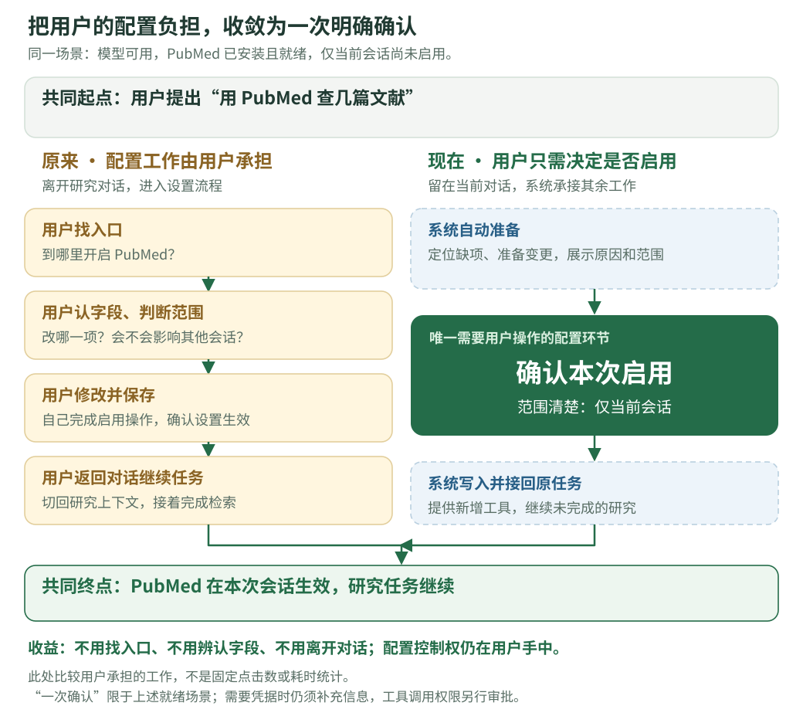
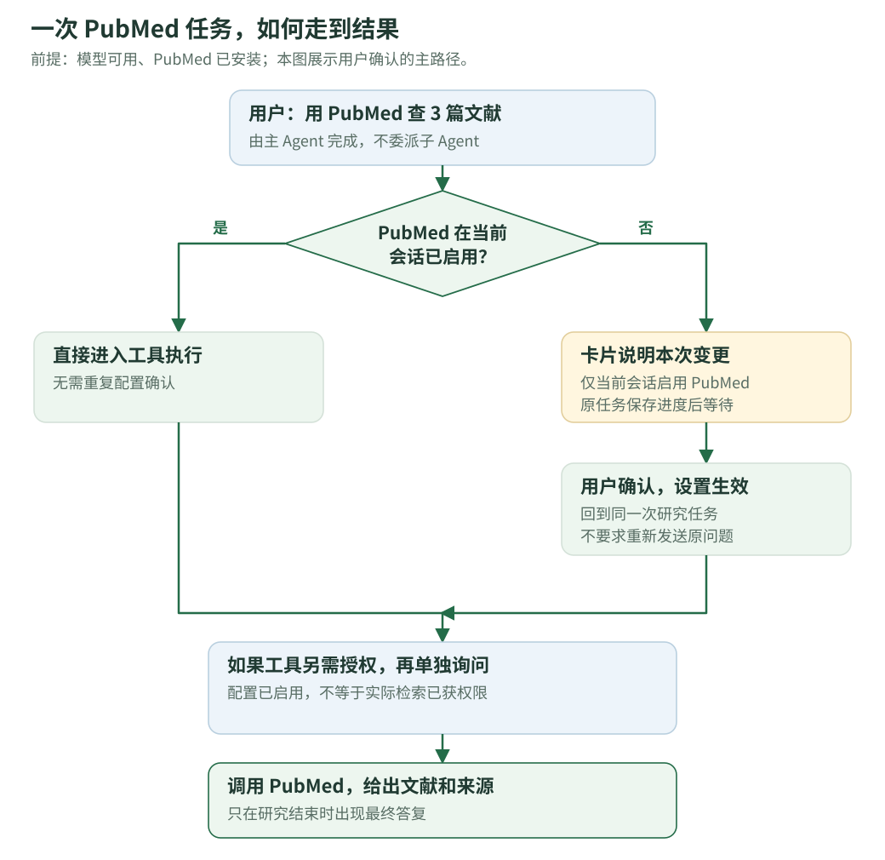
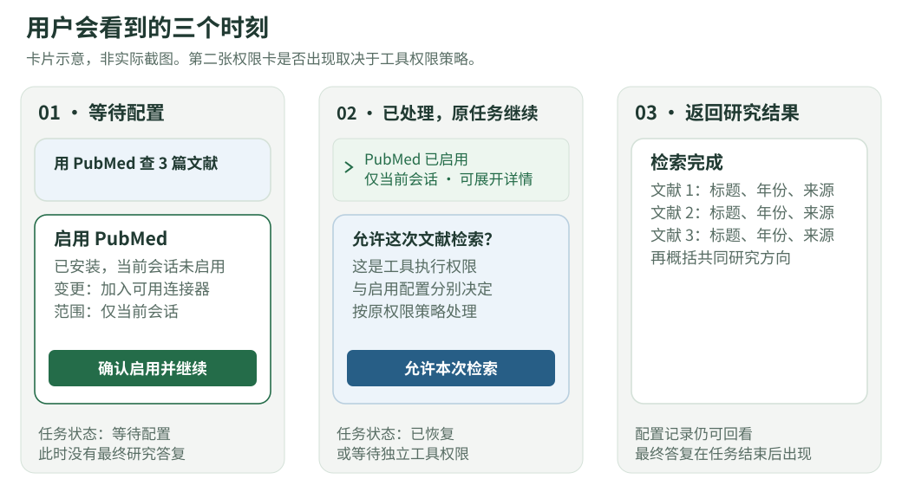
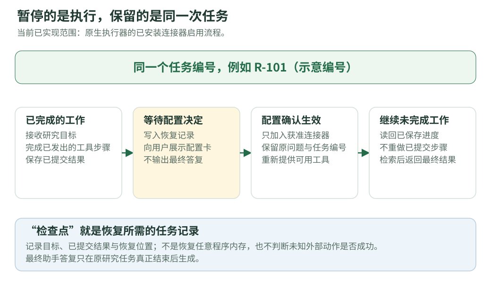
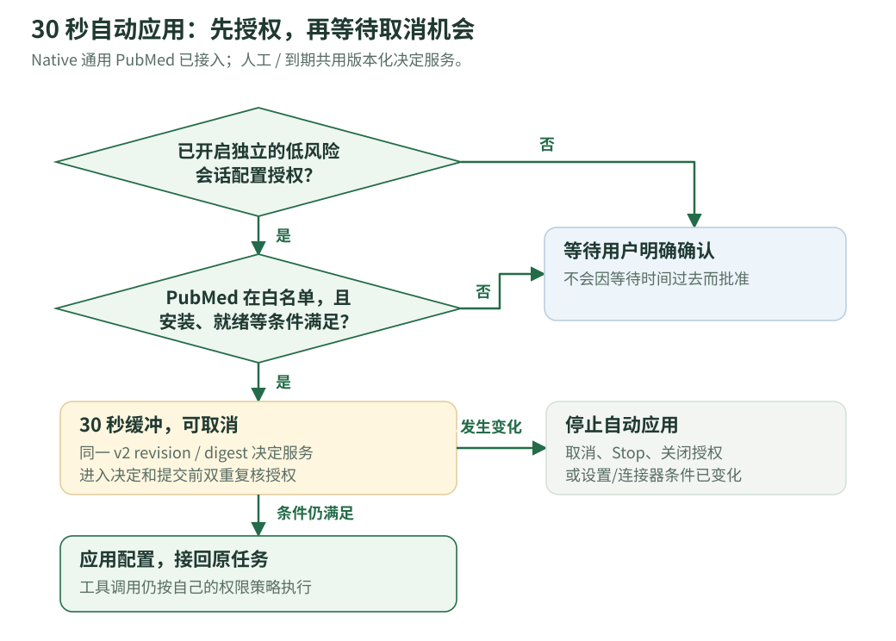
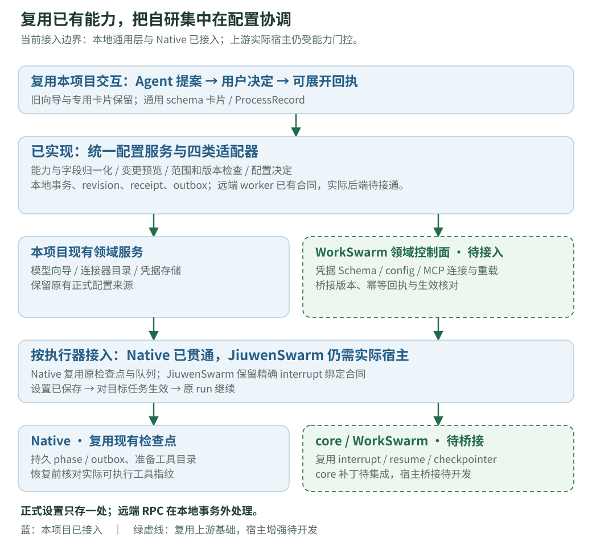

# 对话内按需配置 · 完整设计 v20（合入前审查修订；任务选项、运行级覆盖与七项配置能力）

**本功能将任务所需的配置变更纳入对话执行链路：Agent 识别配置缺口并提出具体变更，用户确认后由系统应用，原任务继续执行。** 目标是减少查找设置、理解字段和切换上下文的成本，同时保留用户对修改内容与作用范围的控制。

本文面向熟悉 ScienceDiscovery 的项目评审人员，默认读者了解 Agent、Session、run 和连接器等现有机制。文档重点补齐本 feature 的问题背景、交互流程、设计取舍、实现边界和验收依据，无需先阅读 issue 或历史讨论。

- 想先理解体验：读第 1～4 节；想讨论长任务和实现方式：再读第 8～10 节。
- 需要核对交付：读第 2、12、13 节；维护者决策与分批开发见第 15 节；本轮交付及证据入口见第 16 节。图中的“目标设计”不代表当前全部完成。
- 对比其他产品的机制与本功能定位，直接读第 14 节；JiuwenSwarm 已有能力与新增开发分析见配套开发文档第 17 节。
- 技术契约见[完整开发文档 v10](conversational-settings-development.v10.md)，实测记录见[实现与实测 v9](conversational-settings-status.v9.md)，来源与固定版本见[竞品与底座调研 v2](conversational-settings-research.v2.md)。
- 本版保留[设计 v18](https://github.com/wyhohyw/sciencediscovery/blob/f58c728b4395ed32f7fa1161636e87c9d6123f5d/docs/zh/explanation/conversational-settings.v18.md)及[历史设计 v17](https://github.com/wyhohyw/sciencediscovery/blob/f58c728b4395ed32f7fa1161636e87c9d6123f5d/docs/zh/explanation/conversational-settings.v17.md)，按 [#278 维护者决策](https://github.com/openJiuwen-ai/sciencediscovery/issues/278#issuecomment-6238467927)更新 P0/P1 已接入内容。代码接线与发布验收分别记录；最终结果见[状态 v9](conversational-settings-status.v9.md)，不能由本次文档更新推定端到端全部通过。
- 文档日期：2026-10-21。当前为隔离分支中的有限实现，不表示已合入主仓；具体交付与验证范围在正文中分别说明。

## 1. 问题背景与设计目标

### 1.1 典型配置缺口与用户成本

用户对 ScienceDiscovery 说：“用 PubMed 找几篇 TP53 相关论文，给我标题和来源。”

假设模型可用、PubMed 连接器已安装且就绪，但当前 Session 尚未启用。现有能力足以完成检索，阻碍任务的是配置缺口，而非新增工具能力的需求。

此时，用户真正想做的是查论文，却要先理解“连接器在哪个设置页”“该改哪一项”“改完影响谁”。不常用的配置尤其难找；离开对话、进入设置再返回，也增加了切换研究上下文的负担。

下面把起点和终点固定下来：模型可用，PubMed 已安装且就绪，仅当前会话未启用；目标是启用后继续原研究任务。对比的重点是**谁承担配置工作**，不是系统一共执行几步。

### 1.2 用户收益与系统分工

**用户少做的是查找和操作，保留的是对具体变更的决定权。** Agent 说明“这一步缺什么、为什么需要、只会改哪里”，系统准备变更、执行获准配置，并接续任务。用户不用先学会设置项叫什么、位于哪里。

| 配置环节 | 原来用户需要做什么 | 对话内配置由谁完成 |
|---|---|---|
| 找到设置入口和字段 | 离开对话，自行查找 | Agent 识别缺项，系统展示具体配置卡 |
| 判断修改内容与范围 | 理解字段，判断影响哪些会话 | 系统明确展示“启用 PubMed，仅当前会话”，用户判断是否同意 |
| 应用配置 | 修改并保存，检查是否生效 | 用户确认后，系统校验并写入 |
| 回到研究任务 | 切回对话，继续任务 | 系统自动恢复原任务的未完成工作 |

在上图的已就绪场景中，用户只需一次配置确认。连接新模型、补 API Key 等情况仍需提供必要信息；真正调用工具也可能另需权限确认。这里没有把体验收益表述为固定点击数或耗时下降。

设置页继续用于集中管理；对话卡解决的是“做任务时，顺手完成必要配置”。已有设置能完成任务时，直接执行，不为了展示功能弹卡。

### 1.3 关键设计选择与理由

| 设计选择 | 为什么这样做 | 对方案的约束 |
|---|---|---|
| 在任务内提出具体变更 | 只增加设置页快捷入口，仍要求用户定位字段、理解影响并手动接回任务 | 提案需同时包含原因、变更内容、作用范围和后续执行方式 |
| 用户确认，系统负责应用 | 降低配置操作成本，同时保留用户对实际变更的控制 | Agent 可提案，不能自行批准；验证和写入由后端执行 |
| 默认优先当前 Session | 常见需求只服务当前任务，不应扩散到其他会话 | 首个模型成为全局默认等例外，必须在确认前明示 |
| 配置成功后恢复同一 run | 避免用户重新提交问题，也避免以新任务掩盖原任务已结束 | 先持久化检查点再开放确认；设置保存与恢复失败分别反馈 |
| 配置授权与工具权限分离 | 启用连接器与实际调用工具是不同的授权对象 | 不复用工具 Always allow 作为配置批准；自动应用需要独立授权 |
| 公共流程加领域适配器 | 复用提案、卡片、决策、回执与恢复，不重复建设整条链路 | 七项适配器已共用服务；其他设置仍声明领域规则与生效方式 |

后文依次展开交付范围、交互与状态、模型引导、作用范围、恢复机制和通用化方案。

## 2. 交付范围与当前实现

本轮已把原有纵向切片扩展为可调用的通用配置框架。当前登记七项明确能力，卡片、选项预览、批准、回执及本地提交规则由公共层处理。新增 P1 只开放 Native，模型及 P1 设置不热切换活动任务。更换一个设置类型仍需对应适配器，不能让 Agent 任意写系统配置。

| 用户需求 | 本轮实现 | 适用边界 |
|---|---|---|
| 选择已有模型 | `model.select`，统一卡片预览并绑定当前会话 | 不热切换正在执行的模型；全局默认与其他会话不变 |
| 接入模型服务 | `model.connect`，专用密钥输入，批准后按已选协议做短连接验证并保存 | 零模型首个默认全局；其余连接登记资源并只绑定当前会话 |
| 修复已有模型凭据 | `model.repair_credential`，先验证隔离候选，再更新指定模型的凭据覆盖 | 不改共享 provider 的密钥；使用该模型的其他会话会受影响，卡片需明示 |
| 启用已安装连接器 | `connector.enable`，合入当前有效集合，保留其他连接器 | 主 Agent 的 Native 请求可暂停并恢复同一 run；不安装新 MCP |
| 撤销已应用变更 | 现有模型选择、连接器启用可创建反向提案 | 校验最新版本，恢复原字段缺失/继承；不删除共享模型或服务 |
| 通用卡片与 Agent 接入 | 声明式字段、独立决定、折叠回执；Agent 只有检查/提案工具 | 不通过普通聊天收密钥；新能力未注册就不可调用 |
| 任务选项与运行级覆盖 | v3 已接可信选项、选项绑定预览和 choiceReceipt；Native 已就绪 MCP 有独立持久 run overlay | 不先写 Session 后回滚；只有实际支持时显示本次使用/已有 Web 替代；最终闭环证据见状态 v9 |
| Skill / Library 选择 | `skill.select`，已安装内容的有限 ID 多选，复用正式 Project/Session 设置 | 仅新排队 run 装配；新库固定批准 head，已继承的 pin/priority/limit 不暗中升级；不安装内容 |
| 思考配置 | `thinking.configure`，核对 API variant 的真实控制字段及模型合法取值 | 仅 Native Session 后续新排队 run；不静默调整非法值，费用和延迟明示 |
| 会话审阅 | `review.configure`，审阅模型/语义审阅与会话 automatic/level；入队冻结后续读取 | 全局 Reviewer Specialist 开关不改；全局关闭时保存的自动偏好仍不启用；旧排队 run 不被新偏好改写 |
| 能力发现与其他设置 | registry 生成七项能力说明和 Agent 参数，inspect 返回脱敏值、继承、候选及后端限制 | 诊断 code 映射已接；没有串联任意工具失败的自动诊断；P2～P4 仅盘点和未支持原因 |
| 30 秒低风险自动应用 | Native 通用 PubMed 请求已接入同一 v2 决定服务；旧专用流程兼容 | 独立会话授权默认关闭；只保留旧 v2/legacy PubMed 语义；新 v3 选项和 P1 不继承倒计时 |
| JiuwenSwarm 同 run 与远端配置 | 有能力握手、门控、绑定及外部 worker 合同 | 实际 core interrupt 宿主、条件写入/权威查询后端尚未贯通，不能宣称双执行器发布 |

旧模型向导与连接器预检仍保留兼容入口，没有为了通用化删除已有体验。新接口与旧请求以明确类型区分；同一个请求不会显示两张卡，也不能借旧单字段决定绕过版本、选项与摘要校验。P1 三项要求 v3；旧四能力的 v2 请求仍按原语义兼容。

**本轮代码完成不等于所有发布验收已经通过。** 当前测试层级及根流程的 WSL 验证结果以[状态 v9](conversational-settings-status.v9.md)为准。2026-10-16 的真实模型结果属于旧切片的历史证据，不代替本轮通用框架的验证。

## 3. 端到端交互流程

### 3.1 前置条件与任务输入

假设用户已经配置好可用模型，PubMed 连接器已经安装且可用，但当前会话未启用它。用户提交：

> 用 PubMed 检索 3 篇 TP53 相关文献，给出标题、年份和来源。请由主 Agent 自己完成。

这里明确使用主 Agent，是为了把评审场景聚焦在对话配置链路。系统仍允许其他研究任务使用子 Agent。

### 3.2 配置提案、确认与任务接续

| 步骤 | 用户看到的内容或操作 | 系统需要完成的事 |
|---|---|---|
| ① 接收任务 | 正常的研究对话 | 使用现有模型开始执行 |
| ② 发现缺口 | “这个检索需要启用 PubMed” | 确认连接器已安装、可用，只是当前会话未启用 |
| ③ 提出变更 | 显示具体配置卡 | 记录原任务进度，在安全位置暂停 |
| ④ 用户决定 | 点击“确认启用并继续”或“暂不启用” | 复核设置是否变化；确认才写配置，拒绝不写 |
| ⑤ 接回任务 | 卡片收成一行记录，任务继续 | 恢复原任务、提供新增工具；如果工具另需权限，再单独询问 |
| ⑥ 完成研究 | 返回 3 篇文献及来源 | 真正调用 PubMed 后再给最终答复 |

### 3.3 已启用与独立配置指令的分支

如果 PubMed 已经启用，系统直接使用它，不重复弹配置卡。

如果用户只说“帮我打开 PubMed 工具”，这是一条单独的配置指令：系统可确定性解析目标并显示卡片，确认后结束配置操作，不凭空启动一个研究任务。带检索、分析等目标的复合任务仍由模型选择工具；当前不能保证每种表达都会触发同一种提案路径。

## 4. 配置卡片与状态反馈

### 4.1 确认对象与信息结构

一张 PubMed 配置卡应该让用户马上回答三件事：为什么要改、改什么、影响谁。示意文案如下：

> **启用 PubMed 文献检索**
>
> 当前任务需要查询文献；PubMed 已安装，但尚未在当前会话启用。
>
> 将做的变更：把 PubMed 加入本会话的可用连接器。
>
> 影响范围：仅当前会话；其他会话不变。
>
> 下一步：确认后继续刚才的检索。若实际调用另需权限，会单独提示。
>
> **[确认启用并继续]　[暂不启用]**

上面保留应用/拒绝的基础示意。当前 v3 卡片已按服务端真实能力展示保存、本次使用、已有 Web 替代和暂不配置；并非每张卡固定出现四个选项。其提供条件和范围见第 15 节，旧图不能代替当前界面实测。

通用卡片先生成服务端预览，用户确认该版本；没有新变化时不再增加同样的确认弹窗。如果后来需要改变地址、范围或验证动作，应先更新卡片，让用户看到变化后再确认。

### 4.2 已处理回执与可追溯记录

用户完成决定，或请求取消/过期形成终态后，原确认按钮退出，留下类似其他活动记录的一行：“PubMed 已启用 · 仅当前会话”。点击可以展开查看变更、作用范围、决定来源和任务状态；不再出现旧确认按钮。需要修正字段或重新预览的 stale/needs_fix 保留可处理提示；已保存但激活/恢复失败可单独重试对应阶段，不再保存同一配置。

这样既不会让已完成卡片一直占据对话，又能让用户回看“Agent 到底改过什么”。刷新页面后也应恢复同样的记录，不在轨迹和底部各出现一份。

### 4.3 配置成功不等于研究完成

| 状态文字 | 具体含义 |
|---|---|
| 等待配置 | 原任务保存了进度，正在等本次设置决定 |
| PubMed 已启用 | 设置写入成功；还没有宣称已经检索 |
| 等待工具权限 | 设置已可用，但实际工具调用仍需按权限策略授权 |
| 任务继续/正在检索 | 原任务已恢复执行 |
| 研究结果 | 查询和整理结束，出现最终助手答复 |

通用卡片另外区分“补充字段、等待确认、验证中、保存中、需要修正”。配置保存后仍保留独立的生效与恢复状态；已保存但激活失败时，不重复保存配置。卡片使用可访问标签、字段错误与状态提示，回执可用键盘展开，中英文含义一致。

## 5. 零模型场景与连接引导

零模型场景无法依赖 LLM 发起配置提案，因此由前端与后端直接提供连接入口，并保留待提交的任务草稿。该路径与运行中由 Agent 发起的配置提案分别处理。

### 5.1 页面打开时先让用户表达任务

无模型会话初始显示正常输入区，加一条轻量的“在对话中配置”入口，不自动展开大卡。用户既可主动点击，也可先输入问题再提交。提交时发现缺模型，就保留原草稿、打开同一张卡，不创建必然失败的研究任务。

卡打开时隐藏下方重复入口；关闭后入口恢复、草稿保留。没有输入任务时，配置成功不会发送空任务。切换会话不能把旧卡或旧草稿带到另一会话。

### 5.2 模型继承与首次连接的处理

| 用户当前情况 | 卡片怎么做 | 保存后影响 |
|---|---|---|
| 已有有效默认模型 | 不需要卡，直接执行 | 沿用默认与继承关系 |
| 系统有模型，但本会话缺模型 | 选择已有模型，或连接另一个 | 绑定当前会话，不更改全局默认 |
| 系统完全没有模型 | 在统一配置卡中打开服务连接表单，不显示空下拉框 | 首个模型设为全局默认，确认前说明继承它的会话也会使用 |

连接表单只收集协议、地址、模型和必要凭据；自定义目标先由用户确认主机，再开放专用密钥输入和连接验证，目标变化要重新确认并清空旧输入。允许无密钥的本地端点不填假 Key。模型 ID 可手填；普通设置页原有有限模型发现仍需单独授权，当前对话卡不自动发现。

设置首个全局默认时保留其他全局配置；当前会话已经通过继承取得该模型时，不额外制造一份会话覆盖。

### 5.3 连接验证与错误分类

地址不可达、超时、额度不足、模型不存在和认证失败应分别说明。连接测试成功也不自动证明模型支持图片。已有模型凭据修复现已通过通用提案接入：候选 Key 先留在加密草稿中，用户批准后验证，通过才写入指定模型的覆盖凭据，保持共享 provider 与其他模型的密钥不变。按任务能力自动诊断并切换模型仍需逐类接入；本轮不热切换运行中的模型。

密钥使用专用输入框直达后端凭据存储，不写进普通聊天或发给模型。外部连接测试不携带用户研究内容；可能计费的测试要在确认前说明。

## 6. 地址、路径与凭据输入的接入边界

用户常见的表达是“API 地址在这里，你帮我填一下”或“配置文件在这个路径”。设计需要把这些输入翻译成明确操作，不能把字符串直接当成可执行配置。

| 用户给的信息 | 应当怎样解释 | 当前是否已完整支持 |
|---|---|---|
| 受支持模型服务的 URL | 在已注册协议表单中填地址，批准后验证并绑定 | 通用连接卡与旧向导均保留 |
| 已安装的 PubMed 目录项 | 为当前会话启用它 | 已支持 |
| 电脑上的配置文件 | 用文件选择/上传，并说明传到哪个环境 | 通用导入待接入 |
| 服务器上的配置路径 | 明确服务器、文件格式和要读取的字段，只读获准文件 | 待接入；不能把电脑路径当服务器路径 |
| 已保存凭据或环境变量 | 从有限引用中选择，后端解析 | 通用机制待接入 |
| 任意 HTTP 接口或 STDIO 工具 | 先有明确协议/适配器及权限设计 | 不因给出 URL 或命令就自动成为工具 |

后续路径导入不能扫描目录猜密钥或执行文件里的命令；解析符号链接后仍要遵循读取范围。代理、超时、Runner 等设置也需要逐类接入，而不是给 Agent 一个“修改所有设置”的入口。

## 7. 配置作用范围、继承与撤销

### 7.1 “服务登记在系统里”不等于“所有会话都切换”

连接一个新模型服务时，资源可以登记在部署的模型列表里；当前会话是否使用它，是另一项绑定。卡片必须分别说明这两件事。

会话通常沿用项目或全局默认值；只有自己的覆盖值存在时才优先用自己的值。这里的“继承”就是“没有单独设置时用上一级默认”，评审不需要先理解存储结构。

### 7.2 按具体动作说明影响

| 动作 | 用户应看到的范围说明 |
|---|---|
| 为已有会话选择模型 | 仅当前会话使用；其他会话与全局默认不变 |
| 启用已安装 PubMed | 加入当前会话的连接器集合，保留其他已启用项 |
| 零模型首次连接 | 首个模型将成为全局默认；这是需要明示的例外 |
| 修复一个模型的凭据 | 改该模型的独立覆盖，影响使用该模型的会话；不改共享 provider 的其他模型 |
| 后续修改项目/全局设置 | 展示受影响对象，以及本会话是否仍被自己的覆盖值挡住 |
| 仅有系统级的代理/超时/网络设置 | 说明影响整个部署，不伪装成“只改本会话” |

Native 已就绪 MCP 已增加独立运行级覆盖：绑定当前研究任务、批准方案、revision/digest、检查点与 Stop generation，不写回 Session/Project/Global 设置。模型、P1 和新凭据没有据此获得临时使用能力；没有真实单次任务覆盖的场景不展示该选项。历史任务和已排队任务当时已经确定的设置不能被悄悄改写；当前原生恢复只给原任务加入这次批准的连接器。

现有模型选择与连接器启用已支持创建反向提案，恢复“原来没有单独设置”的继承状态，而不只是复制旧显示值。反向提案仍需预览、批准与最新资源版本检查；不删除共享服务。模型新连接与凭据修复不因此自动具备撤销能力。

## 8. 同一 run 的暂停与恢复

### 8.1 检查点与恢复边界

原生执行器在已发出的工具调用完成后，持久化原目标、已提交结果和恢复上下文，再进入等待配置状态。配置决策完成后从检查点恢复，保留原 run ID，不新增用户提问，也不以第二个研究任务模拟继续。

恢复粒度是已持久化的执行进度，不包含任意程序内存栈；对结果未知的外部动作也不提供自动重放保证。

### 8.2 确认过程中，各方的职责

| 角色 | 负责什么 | 不由它决定什么 |
|---|---|---|
| Agent | 判断任务需要什么、提出具体配置需求、接回原目标 | 不能代用户批准提案 |
| 用户 | 看变更与范围，补缺项，确认或拒绝 | 不需要自己寻找设置页或拼写内部配置字段 |
| 后端配置与运行系统 | 校验当前条件，保存设置/记录，重建工具并恢复任务 | 不能只写成功文案而没有实际保存/执行 |

卡片必须等检查点和等待状态都保存后才能供确认。等待期间不输出“请确认后再继续”的最终助手答复；研究任务真正完成时才有最终答复。后续用户消息可以排队，但不应越过前面正在等待配置的任务。

### 8.3 刷新、拒绝和停止怎么处理

刷新不应使任务遗忘正在等待什么；重复确认也不能创建第二次配置或第二个研究任务。拒绝时原任务收到拒绝结果，有安全替代方案就继续，否则解释限制。点击 Stop 后，旧卡和倒计时不能再次唤醒任务。

本轮会持久化请求过期和 Stop 的结果，撤回倒计时并释放该请求的活动去重占位。独立配置请求过期后可以重新提案；关联研究任务的请求过期后，原 run 仍保留检查点并处于暂停状态，不自动拒绝、不继续，也不生成最终答复。当前尚不支持在同一旧检查点上替换过期提案，界面应说明需要先 Stop 再重试，不能把它描述成已支持原地重新规划。

同 run 生效目前只开放已就绪的 MCP 工具源。内置 Web 的装配方式不同，本轮仅能为后续运行配置，不开放中途切换的承诺。

如果 Stop 先发生，就不能继续提交旧请求；如果配置已经保存后才 Stop，应保留“已保存”的事实，同时停止任务接续，不能谎称刚才的配置从未发生。

当前同一 run 恢复仅覆盖原生执行器的连接器启用路径。JiuwenSwarm 与旧历史仍走关联的后续任务，状态需如实说明。外部操作结果未知时不能自动重做，例如重复上传、付费调用或再次提交远程作业，这类通用保障还需继续完善。

### 8.4 两种执行器共用配置语义，分别接入恢复能力

| 路径 | 复用的执行能力 | 本项目接入状态 | 对用户的承诺条件 |
|---|---|---|---|
| Native | 现有配置检查点、工具批次边界、原 run 重新调度 | 已接公共等待端口、持久阶段/outbox、准备及核对可执行工具目录 | 本轮代码支持连接器同 run；最终 WSL 与真实模型证据分别列明 |
| JiuwenSwarm | core 的 interrupt/resume、InteractiveInput 和宿主持久化检查点 | 绑定 request/run 与上游 Session/interrupt，重建获准工具，桥接 Stop、事件和恢复回执 | 版本和恢复能力验证通过后，才声明支持同一 run 接续 |

目标 JiuwenSwarm 路径中，底层可以多次 invoke，但产品层必须保留同一个研究 run 和原始提问。旧记录仍按原来的关联任务展示；新能力不支持时在提案前说明生效限制，不能静默换成新任务再显示“原任务已恢复”。

只有配置请求、本地等待状态和执行器检查点都可靠保存后，才开放确认。用户决定后先取得配置生效证据，再交回对应的中断；普通工具权限中断与配置中断分别处理。

## 9. 低风险配置授权与 30 秒自动应用

### 9.1 先有独立授权，才有倒计时

用户可能让 Agent 跑一个长任务，人暂时离开。对非常有限的低风险设置，允许事先开启“自动应用低风险会话配置”，默认是关闭的。

当前旧策略白名单只有 PubMed。历史 v2 通用提案与旧专用流程保留独立授权后的 30 秒缓冲和拒绝入口；新主 Agent 和主动入口生成 v3 选择请求，明确撤回旧计时元数据并要求用户决定，不用旧授权选择保存、本次使用或替代方案。到期由服务端处理，不依赖浏览器在线；工具 Always allow 不会打开这项配置授权。

通用请求到期时使用同一 v2 revision/previewDigest 决定服务，不调用旧单字段写入。人工与自动决定在同一请求队列内排序；进入决定和正式提交前分别复核授权与 Stop，仍须通过资源版本、连接器就绪和插件策略检查。无效或旧版本的点击不能改变自动决定来源。

白名单要逐项审查：公开只读、不增加凭据或费用、不修改项目/全局设置；新的连接器不会自动加入。

### 9.2 评审需要确认的边界

| 情况 | 行为 |
|---|---|
| 只开了工具的 Always allow | 不因此获得配置修改权，仍需人工确认或独立配置授权 |
| 原有专用 PubMed 流程已开低风险配置授权，且满足条件 | 倒计时到期、复核后应用；浏览器关闭也由服务端负责计时 |
| 历史 v2 Native PubMed 提案 | 独立授权后可倒计时；人工和到期决定共用版本化服务 |
| 新 v3 PubMed 选项及全部 P1 请求 | 不继承旧倒计时或工具 Always allow；人工选方案并确认 |
| 新连接器、模型密钥、OAuth、代理、远程执行或全局设置 | 不因等了 30 秒就自动获准 |
| 倒计时中取消、关闭授权、Stop 或条件失效 | 不自动应用，不偷偷改其他设置代替 |

即使自动启用了 PubMed，实际调用仍受工具权限控制。30 秒是用户已经授权后的一段取消机会，不是“沉默等于同意”。

## 10. 通用配置框架与领域接入

### 10.1 公共编排与领域适配器的职责

模型、PubMed、代理需要的字段不同，但都可能经历：说明缺口 → 收集输入 → 展示影响 → 用户决定 → 验证保存 → 让任务使用新配置。这个公共流程可以复用。

各类设置仍有自己的规则。模型适配器知道怎么验证模型地址与凭据；连接器适配器知道如何启用已有目录项；代理适配器需要知道全局影响与生效方式。这些业务判断不能因为表单可复用就省略。

### 10.2 新设置的接入契约与当前缺口

以未来新增“超时设置”为例，开发者应声明：哪个字段、合法范围、影响哪个环境、怎样预览/验证、何时生效。公共服务负责显示卡片、接收决定、记录变化和协调任务，不必再次写整套对话界面。

不过，**本轮已实现公共层并接入七项适配器**。新增同类设置可以复用版本化请求、字段表单、决定、回执与提交协调；领域自身的校验、验证预算和生效方式仍需实现。超时仍是扩展方式示例，尚未注册为可修改能力。

### 10.3 公共服务的六项责任

| 要求 ID | 公共层职责 |
|---|---|
| CFG-01 | 知道系统支持哪些设置，只向 Agent 展示相关且脱敏的信息 |
| CFG-02 | 把“想改设置”变成有目标、原因、差异和版本的具体提案 |
| CFG-03 | 收集用户输入与决定；密钥走专用通道；Agent 不能自批 |
| CFG-04 | 按已展示的计划验证，检查并发变化，再保存和记录结果 |
| CFG-05 | 判断新设置何时生效，保存进度并在支持的路径中接回原任务 |
| CFG-06 | 处理重复点击、刷新、冲突、失败和恢复，保留可追溯记录 |

当前 registry 在登记时附上受信任能力说明、有限字段和生效元数据，供 `inspect_configuration` 和 `propose_configuration` 自动生成目录及参数。通用工具不再手写四/七类参数并集；P1 normalizer 复用同一字段定义，再做已安装 ID、模型取值和 scope 的领域校验。识别只接已有目录及诊断 code 映射，没有宣称任意真实失败都已自动定位并提案。

主 Agent 已获得 `inspect_configuration` 与 `propose_configuration`，同时保留原有 `propose_connector_enable` 兼容路径。Agent 不能批准、读取草稿句柄或写入正式凭据；普通用户决定经过独立接口。内部合同与真实端口见开发 v9，第 18 节列出各工作包状态。

### 10.4 复用什么，以及如何接入

| 能力 | 复用方式 | 需要我们完成的接入 |
|---|---|---|
| 模型连接与验证 | 复用本项目模型协议层和正式凭据存储；设置页保留原向导 | 对话内选择/连接使用统一请求、范围预览、专属主机同意及持久回执 |
| 已安装连接器启用 | 直接复用现有目录、effective 设置、提案、回执与 Native 恢复 | 提取公共服务，补版本与适配器合同 |
| 凭据字段与输入 | 采用 WorkBuddy/WorkSwarm 的声明式字段方式；按资源归属接已有凭据服务 | 字段归一化、专用输入通道、草稿生命周期和跨端状态同步 |
| WorkSwarm 模型/MCP 配置 | 通过受控后端接口复用保存、连接、验证和重载能力 | 字段白名单、范围映射、版本冲突、操作回执与生效确认 |
| JiuwenSwarm 暂停恢复 | 复用 core 的中断机制及宿主检查点 | 配置请求与 run 关联、持久化顺序、恢复和 Stop 桥接 |
| 公共交互协议 | 借鉴 Codex/OpenCode 对输入、授权、状态的分层 | 沿用本项目卡片与 ProcessRecord，统一请求快照、事件和处理回执 |

Codex/OpenCode/WorkBuddy 是交互与协议参照，不新增这些产品的运行时依赖。WorkSwarm 的 React 页面可作为组件设计参考，但不能直接搬入其全局 store、路由或账户状态；实际调用通过现有 adapter 边界进行。

### 10.5 本项目负责的协调层

1. **能力注册与诊断：**把设置类型、输入、范围、生效方式及后端能力登记成有限目录；给 Agent 的只有脱敏检查和提案能力。
2. **可确认的变更计划：**生成差异与影响范围，绑定版本和验证预算；用户修改范围或基线变化时重新确认。
3. **可靠写入：**本地配置沿用事务存储；远端配置通过持久操作记录、受控提交与结果核对处理。远端返回超时且结果未知时，不能盲目重发或宣称未保存。
4. **配置生效与执行恢复：**分别确认设置已保存、目标任务已加载、原 run 已继续，处理重复决定、Stop 和跨端竞争。
5. **凭据与展示边界：**复用各资源的权威凭据存储，防止明文进入普通 ask_user、模型、事件和日志；按本项目范围刷新设置页与回执。

字段 Schema 可以复用展示，但领域预览、校验、生效与撤销仍要逐类声明。超时、代理、Runner 等新增设置不能只注册一个表单字段就进入自动配置。

### 10.6 依赖版本和生效能力是接入条件

仓库默认 WorkSwarm 标签为 `workswarm0.2.6`，调研也核对了较新的 develop；旧标签已有凭据 Schema 和连接流程，但新版检查点与恢复合同不能直接视为当前部署能力。具体固定提交见开发 v9 第 2.4 节。

每个适配器需要声明当前后端是否支持条件写入、回执查询、工具刷新与中断恢复。缺少同 run 生效能力时，只能明确支持后续任务/重启后生效，或将该能力标为不可用；不能让用户确认一张承诺继续原任务、实际却无法恢复的卡。

## 11. 异常处理与一致性约束

| 评审者可能问 | 预期处理 |
|---|---|
| 用户点了“暂不启用”，是不是任务就没了？ | 不写设置；把拒绝交回原任务，有替代方案就继续，没有则说明限制 |
| 用户点了两次确认呢？ | 第二次读取已处理结果，不再应用或另开任务 |
| 另一窗口已经把设置改了呢？ | 旧预览失效，不能拿旧值覆盖新值；重新展示变化 |
| 卡片出现后用户刷新了呢？ | 从持久记录恢复卡片和任务状态，不只靠浏览器记忆 |
| 配置保存成功，任务却没接起来呢？ | 分别显示“已保存”和“尚未继续”，只重试恢复步骤 |
| 用户点击 Stop 之后又点旧卡呢？ | 不能用旧请求唤醒已经停止的任务 |
| 任务本来就让子 Agent 做检索呢？ | 子 Agent 可沿用自己的预设连接器；没有主 Agent 配置卡不必然是错误 |
| 共享 API Key 改坏了会影响别人吗？ | 本轮只验证隔离候选，再写入指定模型覆盖；共享 provider 与其他模型密钥保持不变 |

凭据、配置路径和网络请求都要受具体范围约束。系统不能把明文 Key、认证 URL 或用户配置文件发给模型；验证不得夹带用户研究材料。用户确认的对象必须具体到变更、范围、目标地址和验证动作，不能是一句笼统的“帮我修好”。

本地领域提交已与请求、应用回执和激活 outbox 共用事务；模型选择/连接器反向提案已接入。远端跨存储提交及 JiuwenSwarm 精确中断仍受宿主能力约束；未知外部副作用不自动重放。

## 12. 验证证据与验收标准

### 12.1 历史限定闭环与本轮验收

准备真实模型、尚未启用 PubMed 的会话，以及已安装且可用的 PubMed。要求主 Agent 自己完成一次最多三篇的检索。观察：

1. 提交的是研究任务，不是单独的“打开工具”指令。
2. 出现说明原因和会话范围的配置卡；原任务等待，没有提前最终答复。
3. 确认后卡片收成可展开记录；原任务继续，不要求用户重新发问题。
4. 如有工具权限卡，允许本次检索后出现真实来源结果。
5. 从运行记录确认任务编号前后一致，未新建第二条原始用户提问。

历史切片在 2026-10-16 使用真实 DeepSeek-V4.1-Flash 通过该限定闭环：单次 `limit: 3` 的 PubMed 检索，最终回复有三篇标题、年份和链接；无子 Agent 或 shell 调用，临时数据已清理。

本轮新增的通用领域、HTTP、凭据、阶段恢复与前端测试证据见状态 v9；WSL 完整检查由根流程回填，不以旧真实模型用例推定通过。

不限篇数的宽题曾触发约 250 篇检索后尝试寻找大工具输出，停止时尚未形成最终报告。不要把限定用例成功讲成“所有长任务和所有模型已验证”。自动应用、拒绝、重启和 Stop 也需要各自的测试证据。

### 12.2 完整验收清单

下表是设计要求及编号对照，供研发与测试追溯；不是全部已通过的成绩单。

| 要求编号 | 用实际操作描述的验收标准 |
|---|---|
| CFG-T01 | 默认可用时直接运行，不增加配置卡、不重置已有设置 |
| CFG-T02～03 | 支持的模型可在对话连接或选择，使用范围准确，不误改其他会话 |
| CFG-T04 | 错误凭据不替换有效配置；允许无密钥的端点能正常接入 |
| CFG-T05、05a～f | 缺模型入口不靠 LLM；初始无大卡；双入口不重复；草稿只提交一次；首个全局默认明确；指定模型凭据修复经隔离验证 |
| CFG-T06～07 | 明文凭据不泄漏、Agent 无批准权；保存位置与作用范围真实 |
| CFG-T08 | 拒绝不写配置，原任务收到拒绝，避免相同缺口循环打扰 |
| CFG-T09～10 | 双击、刷新、重放、重启不重复应用；旧卡不覆盖另一窗口的新设置 |
| CFG-T11 | 原生连接器确认前后是同一任务，保留原提问和已提交结果 |
| CFG-T12～13 | 区分验证/保存/恢复失败；Stop、归档、删除与确认竞态不误唤醒或越域写入 |
| CFG-T14～15 | 通用撤销恢复继承且不删共享资源；键盘、窄屏和中英文可用 |
| CFG-T16 | 独立启用指令能确定性提案；已启用不重复；否定/复合指令不误触发简单解析 |
| CFG-T17～18 | 检查点先于可确认卡，原任务不提前结束；确认后实际调用工具并最终答复 |
| CFG-T19 | 已处理卡收为一行，可展开，刷新不出现重复回执 |
| CFG-T20～21 | 工具 Always allow 与配置授权独立；白名单、30 秒及取消/Stop/冲突竞态正确 |
| CFG-T22 | 保留 Specialist 自有设置；主 Agent 专项用例不委派，配置与工具权限分别验证 |
| CFG-T23 | Schema 转换拒绝未知字段与不支持类型；敏感输入只进入专用凭据通道 |
| CFG-T24 | 外部配置写入有幂等/权威结果核对；超时未知时不重复写入或错误报告未保存 |
| CFG-T25 | JiuwenSwarm 配置决定绑定原 run、Session 和确切中断；错配、迟到响应不能恢复别的任务 |
| CFG-T26 | 按固定依赖与后端能力控制入口；未支持同 run 的设置不承诺立即接续 |
| CFG-T27 | 两种执行器均先提交恢复状态再开放确认；重启后恢复原请求与进度 |
| CFG-T28 | 保存、激活、恢复分别可验证；激活失败不重写已保存配置，凭据和非获准设置不被复制 |
| CFG-T29 | 自然语言需求、明确缺口和结构化错误关联到已注册能力；可用默认不弹卡，不把网络错误一概当成配置问题 |
| CFG-T30 | Agent 候选选项经服务端核实；改变选项、作用范围或替代路径使旧确认失效；不能借选项提交任意补丁或命令 |
| CFG-T31 | 运行级覆盖确实不修改会话/项目/全局设置；拒绝、崩溃、终止和后续任务不会继承或泄漏该覆盖 |
| CFG-T32 | 选择替代路径、暂不配置和主动关闭分别返回确定结果；原任务从检查点继续，不为相同缺口循环询问 |
| CFG-T33 | Skill、思考配置和会话审阅逐项验证合法字段、范围、继承和真实生效时机，不虚假承诺热切换 |
| CFG-T34 | Web 服务及凭据使用真实后端支持矩阵，批准后验证；错误候选不替换有效配置，密钥不经模型通道 |
| CFG-T35 | 全局代理/超时/配额如实展示全局影响；没有临时能力时不显示 run-only，拒绝不更改系统限制 |
| CFG-T36 | 工具 Always allow 不替配置选择；扩展卡不继承旧 PubMed 倒计时授权，显式授权必须绑定具体选项及范围 |

## 13. 评审议题与后续交付

### 13.1 建议的 10 分钟讲解顺序

| 时间 | 讲什么 | 用哪一处内容 |
|---|---|---|
| 第 1～2 分钟 | 为什么研究用户不应自己找设置；一句话定义功能 | 第 1 节与图 1 |
| 第 3～5 分钟 | 用一个 PubMed 任务走完用户操作，展示前后卡片 | 第 3～4 节与图 2～3 |
| 第 6～7 分钟 | 解释为什么是任务中暂停，以及人不在时如何控制 | 第 8～9 节与图 4～5 |
| 第 8～9 分钟 | 公共机制怎样支持更多设置，当前还差哪些部分 | 第 2、10 节与图 6 |
| 第 10 分钟 | 展示一次真实闭环，明确已覆盖和未覆盖的验收 | 第 12 节 |

### 13.2 评审应聚焦的几个决定

重点看：卡片是否足够让用户理解和决定；作用范围是否符合预期；原任务是否真正接回；独立授权和工具权限是否容易混淆；以及通用化的投入与后续接入顺序是否合理。

已有明确规则是：默认能用就不打扰、用户决定具体变更、当前会话优先但首个模型全局默认需明示、原生连接器同任务恢复、PubMed 有限自动应用、保留子 Agent 既有设置。v17 记录四适配器基线，v18 定义选项和扩展目标；v19 已接 v3 可信选择、Native 运行级覆盖、替代/关闭以及三个 P1 领域，最终验证分别见状态 v9；远端提交和 JiuwenSwarm 精确中断保留明确的接入门槛。

### 13.3 当前交付与后续分层

| 阶段 | 本轮状态 | 下一步退出条件 |
|---|---|---|
| A 依赖与能力核对 | 已记录安装组合，新增真实握手与不支持门控 | 新宿主继续按固定组合与能力证据开放 |
| B 本地公共协调 | 七适配器、注册驱动目录/参数、v3 卡片与 choiceReceipt、Native overlay/选择恢复已接入 | 最终 WSL、崩溃/重启、浏览器和真实模型结果见状态 v9；不能用旧结果替代 |
| C 上游能力桥接 | 基础合同已实现；core 提交顺序补丁待集成；宿主桥接待开发 | 自研条件写入、凭据所属服务桥接及 core interrupt 贯通后分别验收 |
| D 逐类扩展 | 模型选择、连接、修复与连接器已接入；其他设置未注册 | 新类型逐项提供领域验证、范围、生效及撤销证据 |

扩展顺序以第 15.5 节为准：通用选项和能力发现先行，再逐类接入；DEV-CFG-08/09 的真实宿主桥接作为另一条开发线推进。各阶段存在依赖，但不同执行器可以按已验证能力分别发布。任意 API/文件导入、高影响设置和未知外部副作用继续单独评估。完整开发文档 v10 按工作包列出复用来源、自研项与验收条件，第 17 节集中分析 JiuwenSwarm 已有能力与新增开发，第 18 节汇总本轮完成、合同验证、待集成补丁和待开发宿主。

工程追溯：本轮代码位于隔离分支 `codex/conversational-settings-review-fixes`；当前提交标识与最终 WSL 证据由发布记录回填。旧 `a88d9283` 只作为 2026-10-16 纵向切片的历史基线。

## 14. 产品方案对比与本功能定位

### 14.1 对比范围

围绕同一个问题比较：任务需要某项尚未就绪的能力时，产品如何请求输入或授权、应用配置，再继续任务。比较依据为 2026-10-19 调研中的官方文档与固定源码基线，不是对各产品全部设置项的功能排名。

### 14.2 Codex、OpenCode、WorkBuddy 与本方案

| 产品/方案 | 已确认的相关机制 | 对本方案的启发 | 适用边界 |
|---|---|---|---|
| Codex | App Server 分别提供结构化输入、MCP elicitation、操作审批和配置读写；请求带关联身份并有 resolved 通知 | 输入、授权和配置修改分层；以请求状态驱动卡片完成与清理 | 协议具备这些接口，不代表桌面全部设置都已有统一的 Agent 配置卡 |
| OpenCode | question 使用通用 Form 等待答案，再把结果交回执行；配置文件可由 Agent 修改，权限策略独立处理 | 抽取共享交互层，供领域工具使用；表单与具体业务写入分离 | 普通问答答案会回到模型，不能作为密钥通道；文件修改本身不提供领域影响预览或任务热生效保证 |
| WorkBuddy | 任务中需要未连接的连接器时显示引导卡；授权完成自动继续当前任务；凭据表单由连接器 Schema 声明 | 直接参照“按需引导—完成连接—继续任务”的体验，并采用字段声明方式 | 已公开连接器体验；未据此确认所有设置都支持，也不推定其内部 run ID、事务和重启恢复语义 |
| ScienceDiscovery 当前 | 七项有限适配器、registry 驱动发现/参数、v3 选项卡与回执、专用凭据草稿、Native 同 run 工具核对与 run overlay | 在原有切片上共用配置服务，复用领域存储和运行队列 | JiuwenSwarm 实际 interrupt 宿主及外部条件写入仍未贯通；旧专用入口继续兼容 |
| ScienceDiscovery 后续 | 接通支持条件写入的远端控制面、JiuwenSwarm 精确中断与更多领域适配器 | 沿用已实现公共层扩展，不复制正式配置和凭据 | 依赖固定组合及实际宿主支持；双执行器真实验收后才开放对应承诺 |

来源：[Codex 官方协议](https://learn.chatgpt.com/docs/app-server)、[OpenCode question](https://github.com/anomalyco/opencode/blob/ba06ff9e0bf2dcefbbbc3a1d6094f3572d77c84e/packages/core/src/tool/plugin/question.ts)与[配置文档](https://opencode.ai/v2/docs/config/)、[WorkBuddy 任务中按需连接](https://www.workbuddy.cn/docs/workbuddy/From-Beginner-to-Expert-Guide/Function-Description/Connector)与[凭据字段规范](https://open.workbuddy.cn/docs/connector)、[本项目实现与实测](conversational-settings-status.v9.md)。

WorkBuddy 已经公开覆盖了相近的连接器体验，因此本功能应按成熟交互模式落地。我们的交付价值在于适配 ScienceDiscovery 的模型/连接器体系、Session 继承、科研长任务与双执行器，并把用户批准的变更可靠地接回任务；不把“显示一张卡片”当作产品独有优势。

### 14.3 对比后采用的设计选择

| 设计问题 | 本方案采用的做法 | 对实现的要求 |
|---|---|---|
| 是否每个设置各写一套卡片 | 复用请求生命周期和声明式字段，保留必要的领域专用组件 | 新设置声明字段、范围、预览、验证、生效与撤销，公共层提供决定和回执 |
| 缺能力时是否让用户重新发起任务 | 运行中持久暂停，在支持的路径确认后继续同一 run | 配置已保存、已对任务生效、任务已继续分别验证；不支持时提前说明 |
| 如何处理凭据 | 使用专用表单与权威凭据服务，只向 Agent 暴露可用状态 | 不复用普通 question/ask_user 的答案通道传密钥 |
| 如何减少长任务等待 | 保留独立授权后的 PubMed 白名单与 30 秒取消窗口 | 不把其他产品的全局完全访问或工具 always allow 转换为配置批准 |
| 是否全部重做底层机制 | Native 沿用既有检查点；JiuwenSwarm 优先复用 core 和已有控制面 | 通过适配补齐 request/run/interrupt 关联、作用范围、版本与外部操作回执 |

产品对比用于解释方案取舍；具体复用来源、JiuwenSwarm 中已有什么以及我们还要开发什么，见[开发文档第 17 节](conversational-settings-development.v10.md)。

## 15. 维护者决策对齐与后续开发计划

### 15.1 决策来源与当前实现边界

依据 [#278 的 zy95-12 维护者回复（2026-10-18）](https://github.com/openJiuwen-ai/sciencediscovery/issues/278#issuecomment-6238467927)，本功能不仅要提供配置表单，还要把用户的选择交回任务执行链路。这里采用原始人工回复，而非机器人摘要作为产品依据。

| 已接受的产品要求 | 当前实现 | 仍需核对或补齐 |
|---|---|---|
| 任务内提出具体变更，完成后继续 | Native 已有七项有限能力；连接器四类选择结果回到原 run；JiuwenSwarm 仍缺实际宿主 | 保留现有基础，选项的选择结果也必须进入持久检查点恢复 |
| Agent 为当前阻碍提出可选方案 | v3 使用服务端生成的可信方案，逐项核对能力、范围及可用性 | Agent 目前提交已注册能力/目标，服务端生成有限选项；任意替代路径与 Agent 自定义方案不开放 |
| 保存应用、仅本次/不长期保存、拒绝并走替代路径 | Native ready MCP 已接 Session 保存、run overlay、已存在 Web 替代、暂不配置；其他设置按能力提供方案 | 最终闭环、重启/崩溃与真实模型行为分别记录；无真实支持的选项不展示 |
| Always allow 不跳过或自动关闭配置卡 | 当前使用独立配置授权，不复用工具授权 | 维持权限分离；维护者未认可 30 秒策略，不将其描述为维护者决策 |
| 密钥走专用字段，不进入对话和模型记录 | 本地模型已有专用加密草稿 | 新适配器继续复用受控凭据通道；聊天误贴的脱敏另行补齐，不能宣称已覆盖任意密钥 |

本功能仍由 #278 承载，不再为同一配置卡与接续体验新建重复 issue。历史 issue 中的关联接续与当前 Native 原 run 恢复需按实际执行器分别说明；不通过悄悄换一个任务来宣称已实现暂停。

### 15.2 一张卡片承载具体选择

以“检索三篇 TP53 文献”为例，PubMed 已安装且就绪，当前会话尚未启用。目标卡片可以提供：

| 用户选项 | 实际动作与影响 | 提供条件 |
|---|---|---|
| 为当前会话启用 PubMed 并继续 | 保存会话覆盖，当前任务按支持的路径生效，后续任务也可使用 | 当前已有能力；后端继续核对版本、工具与恢复状态 |
| 仅本次任务使用 PubMed | 仅增加本次任务的获准工具覆盖，不修改会话设置 | 已接 Native ready MCP：独立持久 overlay、批准绑定与真实工具装配；最终验收结果见状态 v9 |
| 改用已有 Web 搜索 | 不启用 PubMed，把选择和检索约束交回 Agent，说明来源与覆盖差异 | 当前执行器确有可用 Web 工具；若还缺配置/凭据，不伪装成可直接执行 |
| 暂不配置 | 不应用配置，也不擅自选择另一种来源 | 原任务得到明确拒绝；能继续其他工作就继续，否则解释阻碍 |

Agent 可建议选项，但不能声称某个未启用的工具已获准。后端返回稳定选项标识和真实影响；用户切换选项后看到该选项的具体预览再提交。配置卡使用“应用并继续”“仅本次使用”等文案，工具权限卡仍单独处理实际操作授权。

主动点击“暂不配置”或关闭按钮都应形成用户决定，关闭前明确提示“暂不配置并返回任务”；刷新、断线、切换会话、折叠记录不等同于拒绝。真正的 Stop 取消任务，不能当作选择替代方案。

### 15.3 仅本次任务与会话配置的区别

“会话级”会影响同一 Session 的后续任务；“仅本次任务”不能这样实现，也不能先写会话配置、任务结束后再回滚。后者会在并发任务和用户后续编辑时覆盖合法变化。

运行级覆盖应作为任务执行输入单独持久化，并绑定原任务、批准选项和版本。基础快照保留历史，新覆盖仅按已批准的能力参与真实工具装配；排队的其他任务不受影响。当前任务需关联接续时，只有明确属于同一研究任务的后续运行才能继承，不能扩散至普通下一条用户请求。临时凭据也需要隔离的加密生命周期，不能因为“不长期保存”而在聊天或浏览器持久保存。

不是所有设置都支持临时使用。例如部署级代理和进程超时，若底层只有系统级接口，就只提供真实的全局变更和替代路径，说明不支持临时覆盖。模型运行中切换仍需专用安全边界，不能由新选项自动获得热切换能力。

### 15.4 如何发现配置缺口

完整目标识别层组合三种证据：用户明确要求修改；任务所需能力与脱敏配置目录之间的缺口；工具返回可归因的结构化错误。Agent 负责结合任务判断是否需要修改，系统负责确认动作确实受支持。

例如用户说“本次使用深度思考”，先核对所选模型是否存在对应控制字段；要求 PubMed 时，先区分已启用、已安装未启用、尚未安装。认证失败应定位到具体资源；一般网络失败、无检索结果和额度耗尽不能一概解释成“缺 API Key”。检查目录不能偷偷发起网络探测，验证请求必须纳入获准计划。

本轮能力注册已经统一生成 Agent 可见说明和参数约束；表单复用受限字段视图，避免新增适配器时手改通用提案工具参数清单。当前只有结构化诊断 code 到能力的有限映射；尚未将任意真实工具/服务失败自动接入诊断。领域的取值规则、继承、验证、费用影响与生效实现仍需逐类开发；不引入通用任意写配置接口。

### 15.5 分批交付与支持矩阵

P0 和 P1 已进入本轮 Native 产品调用路径，最终验证结果见状态 v9；P2～P4 与真实 JiuwenSwarm 宿主仍未完成。每类设置分别登记“可识别、可提案、可写入、何时生效、在哪个后端验证”，不以单个“支持”勾选掩盖差异。

| 批次/开发线 | 范围 | 交付条件 |
|---|---|---|
| P0 公共合同与能力发现 | 全量设置盘点；注册生成目录/Agent 参数；可信选项、拒绝与替代结果；先完成 Native 已就绪连接器的运行级覆盖 | 无需“请弹卡/确认后继续”的提示；选项、预览、写入/临时生效和原任务恢复完整闭环 |
| P1 会话与项目设置 | 已安装 Skill/Skill Library 选择、思考模式与强度、审阅模型和会话自动审阅/级别 | 复用现有领域配置；模型能力与继承合法，按真实时机生效；不因支持保存就宣称当前任务可立即使用 |
| P2 服务配置 | 当前后端支持的 Web 搜索/抓取服务与 API Key，已有 MCP 连接参数及凭据修复 | 按实际后端支持矩阵开放；专用凭据、受控验证、失败保留有效配置、共享影响明确 |
| P3 系统与环境 | 代理、超时、配额、记忆图谱、Idea Tree 和 Runner 环境 | 先核对字段归属与生效时机；全局、费用及外部服务影响单独展示，默认人工确认 |
| P4 新连接与导入 | 新 MCP 注册/安装、OAuth、受控路径导入、SSH/宿主环境接入 | 复用已有授权和领域服务；补齐专用验证与权限；不执行 Agent 随意提供的安装命令 |
| J 真实 JiuwenSwarm 接入 | DEV-CFG-08 条件写入/回执与 DEV-CFG-09 精确中断恢复 | 可与前述适配器开发并行；每项能力在真实宿主验收后才开放，不沿用 Native 的测试结论 |

本轮已接 P0 合同及 P1 三组设置，设置盘点与完整字段矩阵内嵌于开发 v9 第 20 节。后续在当前能力验收后继续 P2～P4；P0 不要求把全部设置都做成可写适配器。高影响项和未来新增项默认人工确认，不继承已有 PubMed 自动应用授权。

### 15.6 评审与验收重点

新增 CFG-T29～36 见第 12 节，细分工作包见开发 v9 第 19 节。评审演示应使用普通研究需求，并核对选择后的真实效果：保存后设置页一致；仅本次使用不污染下一任务；替代路径确实可用并继续原目标；拒绝不循环询问；Stop、刷新、并发修改与重启不重复应用或错误恢复。

只有用户明确、独立授权的具体低风险配置才可能进入自动策略。现有 PubMed 30 秒机制是本项目此前接受的有限策略，并非 #278 维护者认可的通用默认行为；新选项不能复用旧授权直接自动提交。

## 16. 本轮交付边界与证据入口

本节区分源码已接入、测试入口已存在和最终验证结果。不得由文档更新、单元测试或历史模型结果推定新 P0/P1 已全部验收。最终结果见[状态 v9](conversational-settings-status.v9.md)，开发任务与完整设置矩阵见[开发 v9 第 19～20 节](conversational-settings-development.v10.md)。

### 16.1 已接入的产品能力

| 交付 | 用户可见行为 | 明确边界 |
|---|---|---|
| v3 可信方案与预览 | 选中具体方案后预览再确认；receipt 记录选择种类、范围及是否写入正式配置 | 方案来自有限服务端目录；P1 仅 v3；旧四能力 v2/legacy 保持原语义，旧决定不能批准新选项 |
| Native 仅本次连接器 | 原 run 实际装配获准 MCP 增量；Session/Project/Global、其他排队及下一任务不变 | 只支持已安装就绪 MCP，无新凭据临时生命周期，不热切换模型 |
| 已有 Web 替代与暂不配置 | 原任务得到选中的现有路径或拒绝，不新建用户消息；同一 need 不循环弹卡 | Web 必须在原 run 实际工厂中可用并通过设置版本复核；不会额外批准网络或工具 |
| 关闭、折叠与刷新 | 有意关闭提交暂不配置；已处理卡收为一行可展开记录 | 刷新、断线、切换会话与折叠不代替用户决定，Stop 是取消 |
| 注册驱动发现和七项适配器 | 说明、参数、脱敏值/来源/候选及不支持原因来自有限注册；P1 复用正式设置 | 真实失败自动诊断尚未全链路接入；P2～P4 只有盘点，不生成假成功卡 |
| P1 真实时机 | Skill 支持 Project/Session；思考与审阅支持 Session；新排队 run 使用新配置 | 不改活动或原有排队快照；审阅 automatic/level 单独入队冻结，全局 Reviewer 开关仍为实时总闸 |

### 16.2 审阅、版本和权限的特殊边界

会话审阅偏好原来由后台实时读取，本轮增加了入队时的 sessionReviewer 快照。自动审阅通过产物 turnId 与子 Agent 的 parentTurnId 精确找到来源 root Run，持久 sourceRunId、按来源/level 分批，并读取原快照。来源已绑定却丢失时失效收束，不借当前会话的模型或偏好继续；无来源的历史产物、无新增快照的旧 Run 和手动审阅保留原兼容规则，不从时间猜来源。全局关闭在异步 admission 之后、执行器调用前再次检查。

Skill Library 新选择固定批准的 head；继承的已有固定版本、priority 和 limit 不会因为当前 head 更新而暗中升级。思考配置必须有真实协议控制字段且取值合法。以上保存不代表当前任务热生效。

v3 默认人工决定，旧 PubMed 的 30 秒预授权不迁移为新方案授权。工具 Always allow、Smart Approval、安装命令或网络权限仍独立处理。

### 16.3 验证入口与尚未完成的部分

| 证据入口 | 验证内容 | 记录方式 |
|---|---|---|
| request-service / HTTP / 前端测试 | 选项篡改、revision/digest、幂等、旧协议拒绝、关闭和回执 | 最终结果见状态 v9 |
| Native choice / 原 run 集成 / 崩溃恢复测试 | 保存、run-only、替代、拒绝、Stop、重启及实际工具装配 | 最终结果见状态 v9；进程故障不等于浏览器刷新 |
| P1 领域与新 run 装配测试 | 正式存储/继承、库版本、模型能力、冻结快照及真实后续执行装配 | 最终结果见状态 v9 |
| Reviewer source binding 与原审阅套件 | 子 Agent 精确归属、合批隔离、来源丢失、异步全局 gate | 最终结果见状态 v9 |
| 真实 LLM 与浏览器 | 自然语言是否选择正确工具、选项是否出现、确认后同任务继续及折叠效果 | 按真实/脚本模型、离线/真实工具及 Runner 分开记录；未执行不写通过 |

真实 JiuwenSwarm 的宿主条件写入、core 中断绑定与工具刷新仍待完成；Native 证据不能替代。任意真实工具故障自动诊断、P2 Web/MCP 修复、P3 系统环境、P4 新 MCP/OAuth/受控路径导入继续属于后续工作。

## 17. 合入前审查修订（2026-10-21）

本节修正 v19 中过宽的恢复检查和不充分的端点授权，优先于前文旧描述。审阅基线 `f58c728b` 保留于 `codex/conversational-settings-integration`；当前整合分支为 `codex/conversational-settings-review-fixes`，基于上游 main `7ee6c1d0`。整合和下述修改需完成验证才能称为已交付。

| 编号 | 修订后的行为与验收 |
|---|---|
| CFG-R01 | 原任务恢复只比较冻结工具集合、获准增量、目标及实际使用连接器的传输/凭据/OAuth/策略代际；无关模型默认、无关 MCP 安装不得阻止恢复。目标变化必须拒绝；原 run、Stop、断点和工具 witness 校验保留。正式写入 CAS 与恢复依赖证明分开。 |
| CFG-R02 | 受信任预设服务按协议和精确端点识别；自定义端点必须由用户通过独立接口明确确认标准化目标，Agent 参数不能伪造确认。卡片在输入密钥和发起验证前显著展示主机。确认绑定请求、版本与端点，端点变化使其失效。公网或未识别为本机/私网的 HTTP 端点禁止携带凭据；已识别本机/私网网关只有经独立用户确认才允许 HTTP 携带凭据。分类仅依据标准化主机字面量，不表示 DNS 解析证明、加密或自动可信；卡片必须明确提示 HTTP 明文传输密钥的风险。无凭据探测也受目标授权约束，不自动跟随重定向。 |
| CFG-R03 | 撤销移除连接器不要求它仍 installed/ready；只有恢复后实际新增启用的连接器需要就绪。恢复字段缺失与继承语义保持；不开放 Agent 自造撤销字段。长合法连接器集合可撤销。 |
| CFG-R04 | 中间预览成功立即接收新 revision；后续凭据上传失败可原地重试，不能因旧版本产生额外 409。输入密钥只保存在当前表单内存，目标变化清除，普通 revision 更新不卸载组件或丢失键盘焦点。 |
| CFG-R05 | 提案过期仍保留原任务的暂停和队列次序，界面明确说明需要 Stop 才能结束这项任务；不能静默跳过原任务或自动创建替代 run。 |
| CFG-R06 | 无模型时保留无需 LLM 的确定性入口，但对话引导必须走统一请求、幂等、批准和持久回执；避免同屏两套模型卡。首次全局默认的影响必须明示。用户研究草稿只提交一次。 |
| CFG-R07 | 已保存后的提交状态必须有明确的成功、失败或等待新配置结果；校验失败和所有提前返回路径不能永久显示提交中。任务已开始接续时仍持续协调回执，直到后端返回完成、失败或停止等终态；不得依赖用户刷新消除“继续运行中”。 |
| CFG-R08 | 项目/全局写入后通知所有受影响的会话插件；已冻结的活动 run 不热切换。模型凭据修复按实际引用范围通知。 |
| CFG-R09 | 所有配置能力均有持久对话回执，可折叠展开；并发列表与单条更新按版本合并，旧列表不能冲掉刚创建的卡片。 |
| CFG-R10 | 后台恢复使用持久待办和到期索引、有限批次；每秒不得遍历所有活跃会话和全部历史请求。重启后和无浏览器时仍能恢复。 |
| CFG-R11 | 区分凭据忙和过期；未知模型不承诺所有思考档位；同一合法服务端点复用 provider 而不改共享密钥；中文选项标题可区分。 |
| CFG-R12 | 在最新 main 上验证整合结果，仅保留当前完整设计、开发、研究、矩阵和实测文档及单页 HTML；旧版通过原分支和 Git 历史追溯。完整 WSL 构建和回归、真实模型浏览器端到端通过后交付。用户已明确允许跳过 Docker/SSH 外部环境测试。 |
| CFG-R13 | 配置发现返回可信的已安装连接器目录：精确 ID、名称、就绪状态、原任务实际启用状态、当前保存状态、相关策略许可和支持的生效方式。能力存在不等于任意目标就绪；不可用原因必须明确。Agent 不能靠猜测 ID 或只阅读子 Agent 预设来识别资源。端到端脚本必须从发现结果选择资源，不能硬编码目标绕过发现缺口。 |

真实验收须至少覆盖：无关设置并发变化后原任务继续；目标变化被拦截；离线/已卸载连接器撤销；自定义主机未确认时不能验证或发送密钥；确认后端点变化拒绝；凭据上传失败后不刷新重试；统一无模型入口；确认后同 run 完成；Stop 不被自动恢复。测试数据按创建的精确 ID 清理。
