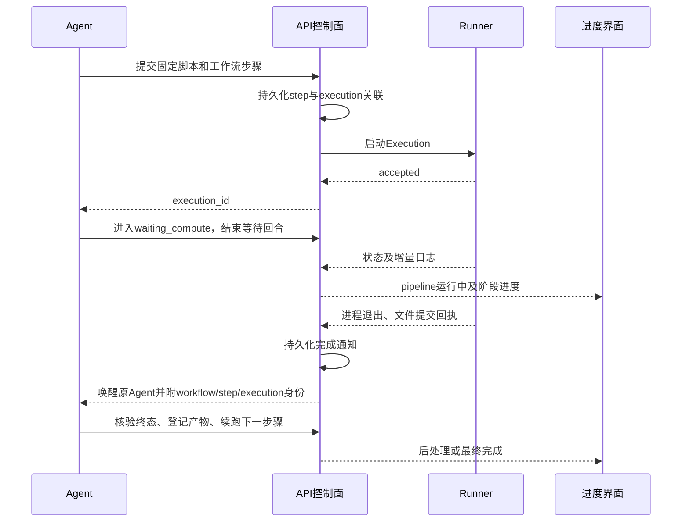

# NPU Skill 调用与事件驱动监控设计 v0.1

后续版本：[v0.2：加入本地/远程 Runner 完整执行契约](./npu-skill-execution-monitoring.v0.2.md)。本页保留原设计内容。

- 状态：**Draft / 待评审**；本文不代表新增功能已经实现。
- 日期：2026-09-17。
- 官方代码基线：`openJiuwen/sciencediscovery main@c1ab6327c6b2812e9fab26e62333b2c5ac118f3e`。
- 本地应用基线：`codex/e2e-dev-4710@420d545`；Protenix skill `1.3.2`。
- 本次范围：设计文档及 131 服务器的现状验证；不部署本设计、不替换运行中服务。
- 实测记录：[131 基线验证报告](./npu-skill-execution-monitoring.131-validation.2026-09-17.md)。

## 1. 结论与评审重点

推荐以 **Runner 沙箱 NPU + 受管理 Shell Execution** 作为新版抗体 skill 的默认路径；保留 Broker 作为独立的旧部署兼容方案，不在同一作业内自动切换后端。

我们本地 skill 已完成主要调用迁移，接下来需要补齐控制面的任务身份、异步续跑、进度和交付契约。不能只把 `run_npu_job` 替换为 `run_shell`，也不能只删掉“保持当前回合”的提示词。

建议确认以下四项设计取舍：

1. Execution 与 pipeline 的关联在控制面持久化，不再依赖启动后另开 Shell 写 checkpoint。
2. 先修正工作流状态和续跑，再允许 Agent 结束等待回合；后台计算不因回合结束而停止。
3. 执行状态、科学阶段进度、硬件状态分开呈现，目录和硬件读数都不能判定成功。
4. 以“计算完成 + 文件提交确认 + 科学验收 + 产物登记”作为最终交付条件。

## 2. 背景与已核实差异

| 项目 | 官方基线 | 本地应用基线 | 本设计处理 |
|---|---|---|---|
| NPU 访问 | 已选芯片透传到 Runner 沙箱，逐芯片探测、执行前复查 | 已接入 | 沿用 |
| 抗体 skill | 同名 Protenix skill 仍为 Broker only | `run_shell(scriptPath, background=true)` | 以本地新版为迁移起点 |
| 环境选择 | `environment_id`，实际 revision 用于追溯 | 已接入 | 沿用，禁止用 revision 作为执行选择项 |
| 执行生命周期 | Execution 独立于等待回合；状态、增量日志、取消 | 已接入 | 沿用 |
| 后台完成通知 | 所属 Agent 的持久通知与唤醒 | 增加前台短任务通知抑制 | 保留此行为并验证重复通知 |
| 多阶段等待 | 支持异步通知 | 完整流程仍要求每 30 秒等状态 | 在续跑和 UI 验收后替换 |
| pipeline checkpoint | 无通用 pipeline 关联契约 | 启动后写 `sandbox_job.json`，会等待写锁 | 改为控制面关联 |
| 产物登记 | 普通 Shell 不自动登记；远端先 transfer | 分支增加自动登记与 manifest 优先级 | 明确能力差异，避免重复或漏登记 |
| 模型资产与缓存 | 不保证具有我们分支的特定模型挂载 | 分支注入资产路径并处理可写缓存 | 迁移时逐项验证，不能只更新 skill |

参考原有设计：[完成通知 v0.2](./sandbox-wake-continuation.v0.2.md)、[进度 UI v0.2](./npu-pipeline-progress-ui.v0.2.md)、[Execution 生命周期](./execution-workspaces.md)。

本文提议替代 v0.2 的 `LAUNCH-001`（必须保持同一回合）及根据不完整目录猜测运行状态的规则。**在本设计获准并完成实现、验收前，原规则仍是现有应用行为。** 旧设计文件保留，不覆盖历史。

### 2.1 131 实测对设计的约束

2026-09-17 的基线检查确认：131 当前运行 `78fa0d7` 命名的旧部署包，API/Runner 在 `18450/18451`，附带 Protenix skill 仍为 Broker only；部署产物没有新版 `execution-manager.js`、`shell-executions.js`。因此 **131 不能仅更新 skill 就切换路线**，需要先并行准备独立的新版本测试实例。

在不更改该部署的独立目录中，官方基线的两个 Execution 模块测试套件 15/15 通过；MindSpore 2.7.2 最小矩阵算子在隔离沙箱和主仓 baseline seccomp 下成功，且宿主进程表确认沙箱 `davinci0` 实际使用物理卡 4。卡 6 当时被沙箱探针拒绝，尽管宿主显示健康、无计算进程。

仍需解决两类环境差异：现有托管环境为 Python 3.12，本地新版 skill 要求 3.11；算子探针虽通过，仍有 UID 名称解析及 CANN 日志目录诊断，需要在真实 Runner 构造中检查。不得据此宣称完整模型链或新监控方案已通过。详情和证据见验证报告。

## 3. 目标与范围

### 3.1 目标

- NPU-EXEC-001：模型通过固定 skill 包脚本在所选 Runner 沙箱中执行。
- NPU-EXEC-002：模型只使用分配给沙箱的芯片编号和可见资产。
- NPU-ID-001：提交、状态、日志、续跑与产物始终关联同一个真实 Execution。
- NPU-MON-001：长任务等待不产生 sleep Shell，也不依赖 LLM 高频轮询。
- NPU-MON-002：UI 能区分 Agent 空闲、计算运行中、后处理和最终交付。
- NPU-REC-001：通信中断、重启和重复通知不会自动重复提交模型作业。
- NPU-ART-001：终态与交付分别确认；本地、远端产物都有明确登记流程。

### 3.2 非目标

本期不修改模型算法、科学阈值、AF3/Protenix 选择或既定产物格式；不安装驱动/CANN/Slurm；不新增分布式调度；不保证 Runner 重启后计算进程继续存在；不因接入 NPU 而放宽整个宿主目录可见性。

## 4. 调用与资产契约

### 4.1 提交前检查

1. 固定 `runner_id` 与该 Runner 的 `environment_id`，检查所需工具和后台 Execution 能力。
2. 托管环境中验证 Python、模型依赖和版本。更新依赖后重新探测，运行期间不更新同一环境。
3. 从 Runner 设置取得已选芯片；在同形态沙箱验证可见设备并执行最小真实张量算子。`import mindspore` 不能替代设备运算验证。
4. 检查 PDB、hotspot、设计数、运行名和输出冲突。输入只使用本 Workspace 的路径。
5. 检查模型代码、权重、数据库、HMMER 的沙箱可见路径和权限；缓存写入 Workspace 或指定临时目录，不能写只读模型树。
6. 本次 execution 记录实际环境 revision、skill 包 hash、输入/配置摘要和芯片映射，便于重现。

测试与模型运行的资源预算分开：最小算子测试应显式约束显存并保持短时有界；完整模型使用经过验证的资源配置。最小算子通过不免除该 skill 的 Python/依赖版本检查。

### 4.2 NPU 编号

宿主选择 `{4, 6}` 时，沙箱设备编号是 `{0, 1}`。skill 配置使用后者；平台记录前者与映射。必须按数字设备节点枚举，不能将 `/dev/davinci_manager` 计入芯片数。

多 die 设备使用宿主 chip logic id 作为设备身份。模型脚本不能混用板卡编号、宿主 logic id 与沙箱编号；不根据默认值自行使用八张卡。

### 4.3 启动方式

现有工具调用形态保留：

```text
run_shell(
  runner_id=<selected-runner>,
  environment_id=<selected-environment>,
  scriptPath="$SCIENCEDISCOVERY_SKILLS_DIR/antibody-protenix-pipeline/scripts/run_sandbox_pipeline.sh",
  arguments=["--config", "antibody_pipeline/config.json", "--mode", "full"],
  background=true
)
```

该 shell 内的主进程应以前台方式执行并等待其子进程；“后台”由 ExecutionManager 管理。不得在脚本中用 `nohup`、脱离进程组或末尾 `&` 提前返回成功。`wait_ms` 只是调用等待预算，不是模型超时；`background=true` 时无需再设置等待预算。

Broker-only 部署继续运行固定旧版 skill；缺少新能力时报告部署不兼容，不静默转成宿主 Shell。

## 5. 控制面身份与提交恢复

### 5.1 新增 WorkflowRun 与 Execution 关联

建议新增轻量工作流记录，以下是**拟议内部模型，并非现有工具参数**：

```text
WorkflowRun:
  id, sessionId, agentId, runnerId, workspaceId
  skillId, skillPackageHash, configPath, configDigest, runName
  mode, phase, createdAt, updatedAt

WorkflowStep:
  workflowId, stepKey, attempt, submissionKey
  executionId, submissionState, continuationState
  environmentId, resolvedRevisionId
  selectedHostDevices, sandboxDeviceMapping
  finalizationState, artifactManifestRef
```

`phase` 取 `preparing / waiting_compute / postprocessing / awaiting_action / completed / failed / cancelled`。不要覆盖底层 Execution 状态。

工具层拟增加可选的 `workflow_id`、`workflow_step` 引用（名称需实现时与 schema 统一），仅关联当前 Agent 有权使用的流程步骤。已有普通 `run_shell` 调用保持兼容；step 的身份应由控制面创建/校验，不让 Agent 任意声明其他 Session 的 ID。

### 5.2 提交次序与幂等

1. 配置和输入在提交前完成写入。
2. 控制面事务建立 step 提交意图、预分配 execution ID 与 submission key，并保存与 workflow 的关联。
3. 向 Runner 提交同一 execution ID，记录 `accepted` 或 `unknown`。
4. 即使响应丢失，也保留上述关联，通过原 ID 向原 Runner 查询；**不因超时重发模型命令**。
5. `(workflowId, stepKey, attempt)` 唯一。重新尝试必须产生新 attempt，并有明确的修复原因与重试意图；正常重复通知只恢复旧 attempt。

`sandbox_job.json` 改为可选的导出/兼容文件，不再由启动后的第二个 Shell 写入。旧记录可在可信 Execution 归属核对后迁入关联表；缺少映射时显示待确认，不选择 Session 中“任意正在运行的 Shell”冒充 pipeline。

### 5.3 unknown 的处理

主仓执行状态是 `queued / running / completed / failed / cancelled / unknown`，不是 Broker 的 `succeeded / interrupted`。

当前 API 重启会把未完成记录标为 unknown；现有 `execution_status` 不等于已经具备完整的重启 reconcile。新增 reconcile 应从原 Runner 查询原 ID、校验 owner 和已提交回执，再更新本地观察。Runner 自身也 unknown、找不到记录或不可达时，保留不确定状态并提示检查，不能推断未执行或自动重试。

## 6. 事件驱动监控与多阶段续跑

### 6.1 正常流程



### 6.2 Agent 与 Runtime 职责

- Runtime 管理进程存活、状态观察、日志持久化、通知和 UI 更新。
- Agent 在提交、阶段检查、错误处理、完成后验收时介入；不通过 sleep 保活。
- 短操作可以 `execution_status(wait_ms<=30000)`；长 pipeline 默认不持续循环。
- 必要时设置关联 execution 的一次性 timer，例如 5 分钟无新阶段检查。timer 是提醒，不是命令；同一步骤最多一个待触发提醒，终态取消它。
- 只有阶段改变、新错误、需要用户处理或交付时发对话更新。正常无变化只更新面板。

### 6.3 续跑幂等

通知只能唤醒所属 Agent。忙碌时保存在队列；确认已持久送入上下文后才确认消费。完成通知携带原工作流及步骤，不能靠最新文件名猜测。

状态迁移通过事务/CAS 领取 `continuationState`；重复通知不得二次创建 codon/制造步骤或重复登记同一产物版本。崩溃在“下游已提交、续跑标志未写回”之间时，使用 step 唯一键和已持久化 execution 关联恢复，不能再次提交。

前台短 probe/config 已经在工具结果中被观察到时不应再次唤醒。晚到的其他 Execution 通知不得终结当前 pipeline。

### 6.4 Stop 与取消

- 停止 Agent、关闭唤醒门，与取消计算区分呈现；保留平台已有 Stop/Archive 语义。
- “取消 pipeline”调用真实 `execution_cancel`，显示 cancelling，直到进程及子进程退出且终态确认。
- timer_cancel 只取消提醒，不取消计算。
- 已停止/归档的 Session 不自动续跑；用户恢复后汇总未读状态，不重放命令，也不复活旧 timer。

## 7. 进度与 UI

### 7.1 三类事实

| 类型 | 来源 | 允许结论 |
|---|---|---|
| 执行生命周期 | Execution + 文件/provenance 回执 | 排队、运行、退出、结果是否确认 |
| 科学步骤进度 | 受归属约束的结构化 stdout 事件 | RFdiffusion/MPNN/Protenix/筛选/codon 的数量与阶段 |
| 硬件遥测 | Runner DCMI，必要时 npu-smi fallback | 该芯片的利用率、显存、温度、功率 |

硬件数据不是按任务独占的使用量；不把空闲芯片读数解释为任务卡死。缺少事件时显示“进度暂不可用”，不能将不完整目录推断成永久运行。

### 7.2 结构化进度（拟议）

pipeline stdout 输出带稳定前缀的单行 JSON，例如：

```text
SD_PIPELINE_EVENT {"version":1,"seq":12,"stage":"protenix","state":"running","done":2,"total":4,"timestamp":"2026-09-17T08:00:00Z"}
```

控制面从 Execution 日志通道附加身份，不信任脚本自报的 session/execution ID。解析器限制行长、字段、阶段和计数范围；坏事件不改变任务终态。按 `(executionId, seq)` 去重，保留服务端接收时间以避免跨主机时钟影响排序。

原始日志仍由 `execution_logs` 的 `cursor / nextCursor` 分页读取；解析器应持续消费并在日志截断前保存最近进度，无法恢复缺失事件时标记 gap，不编造数量。

### 7.3 UI 行为

- Agent 回合空闲但 workflow 为 waiting_compute：显示“计算运行中，完成后继续”，不显示整项任务已完成。
- Execution completed 但验收/后处理未结束：显示“整理结果”或下一阶段。
- unknown：显示“状态待确认”，允许用户查看日志和处理；禁止靠遗留目录锁死输入框。
- 只有 workflow completed 才呈现最终交付。
- 复用现有进度面板，新增控制面关联为主数据源；先保留有界 HTTP 轮询，后续再按需转 SSE。这里的事件驱动指免除 LLM 等待轮询，不要求重写全部前端订阅。

## 8. 结果与产物

Execution `completed` 只是第一道门。交付还需要：结果回执/provenance 已确认；期望设计数量与模型输出相符；报告存在且质量字段可解析；所需最终产物登记成功。

进度事件的 `complete`、文件出现或 shell stdout 中的“成功”都不能绕过上述门槛。零候选通过科学筛选可以是正常结果，但不等同于缺报告或结构映射失败。

推荐步骤：

1. 查询 Execution 终态及已提交结果。
2. 从本次运行的 manifest 获取产物清单，拒绝越界路径、其他 run 的旧文件和未提交快照。
3. 远端结果先通过 `workspace_transfer` 拉回所属本地 Workspace，逐项核对成功。
4. 已有自动登记扩展时核对其回执；主仓普通 Shell 则显式 `declare_artifact`，每批不超过 50 个。通过路径/版本身份避免重复登记。
5. 优先交付科学报告、筛选数据、最终 DNA（若本流程包含 codon）和 manifest；大量中间文件提供索引，不能把 Broker 的“前 50 个”误当作通用总量限制。
6. 计算成功但传输/登记失败时进入 postprocessing/awaiting_action，仅重试交付，不重新计算。

## 9. 修改范围与实施顺序

| 阶段 | 修改内容 | 主要位置 | 出口条件 |
|---|---|---|---|
| P0 | 能力/版本核对、unknown 分支、卡号与资产检查、产物契约 | 各抗体 SKILL.md、入口脚本、部署说明 | 单设计沙箱链路可运行，旧部署明确隔离 |
| P1 | WorkflowRun/step 关联、提交意图和 reconcile | schema、shell-executions、workspace bindings、store | 写锁不阻塞身份保存，unknown 不重放 |
| P2 | 结构化进度、面板状态、幂等唤醒续跑 | manager/脚本、notifications、runs、npu-pipeline、Web | 回合结束后 UI 不误报，下一阶段只启动一次 |
| P3 | 更新 skill 默认等待方式、冻结包导入、文档和回归 | skill library、SKILL.md、bootstrap、测试 | 启用版本与包 hash 一致、完成全部验收 |

先建立 P1/P2 的保障，再删除现有 LAUNCH-001 长轮询要求。不要整批复制主仓 Broker skill 覆盖本地新版；也不要整批替换服务目录来解决单个兼容问题。

部署发布应保留旧 skill revision 和旧服务配置；回退只影响后续新任务。已经接受的 Execution 继续按原 ID 观察，不能为回退而启动重复作业。

## 10. 131 验证计划

测试使用 `lujiale@8.92.7.131` 的独立测试目录/Session；沿用已有依赖和资产。先记录源码与部署版本、skill 包版本/hash、Runner 端口、环境和卡资源。禁止使用“测试通过”代替没有实际执行的验收项。

本次设计阶段执行可安全运行的基线探测；下面涉及新 schema、UI 和 reconcile 的项目，在实现后验收。不会为了模拟故障重启共享生产服务。

| 编号 | 场景 | 预期 |
|---|---|---|
| T01 | 131 部署、工具和 skill 版本核对 | 记录实际版本和主仓/本地差异 |
| T02 | 单张空闲卡沙箱设备和最小张量算子 | 使用所选物理卡、沙箱编号从 0 开始、真实运算成功 |
| T03 | 可用时选择非连续宿主芯片 | 沙箱只有对应连续编号，未选芯片不可见 |
| T04 | 后台命令长于 wait_ms，随后状态和日志查询 | 等待返回不杀进程，查询不占写锁，cursor 不重复消费 |
| T05 | pipeline 运行期间写 checkpoint 的旧路径复现 | 验证排队；新控制面关联无此延迟 |
| T06 | 后台完成通知与前台短任务 | 后台可唤醒，短任务不重复唤醒，通知准确关联步骤 |
| T07 | 单设计完整模型链 | 数量、终态、manifest、产物回执通过；记录耗时和卡映射 |
| T08 | 子阶段模型故障 | 不虚报成功，不自动重复提交，保留失败阶段和短日志 |
| T09 | 取消有子进程的测试 Execution | 所有本次子进程退出，确认终态后才显示已取消 |
| T10 | 在隔离实例中模拟 API/Runner 重启、响应丢失 | 查询原 ID；无法确认时 unknown，不自动重放 |
| T11 | 重复完成通知、唤醒中途失败 | 下游步骤仅提交一次，未完成通知可继续处理 |
| T12 | 远端传输部分失败、超过 50 个产物 | 逐项可重试，不重算，最终产物和索引可访问 |
| T13 | Agent 回合结束但计算继续 | UI 仍显示计算中；完成后继续必要后处理 |
| T14 | Stop/Archive 后完成、随后恢复 | 不越过唤醒门；恢复不重放任务或旧 timer |

## 11. 评审后交付物

批准后按 P0→P3 实施；每阶段保留设计需求到测试编号的对应关系。完成时交付版本化设计、框架/skill 差异、部署前后版本与包 hash、131 实测证据和未覆盖项。当前文档不预先声称全流程或恢复能力已经验收通过。
