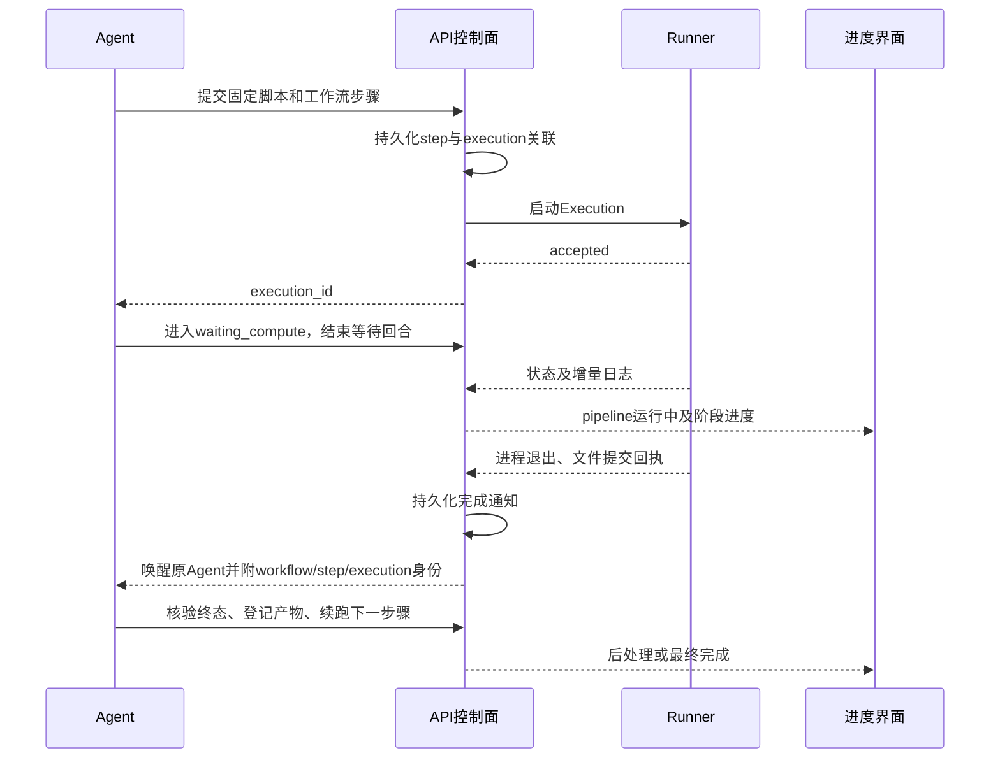

# NPU Skill 本地/远程执行与事件驱动监控设计 v0.3

> 后续版本：[v0.4](./npu-skill-execution-monitoring.v0.4.md)。以最新主仓能力为贡献基线，收敛首阶段到 skill/脚本迁移，通用资源挂载和其他框架扩展按实际阻塞单独评估。本文作为历史设计保留。

- 状态：**Draft / 待评审**；本文不代表新增功能已经实现。
- 日期：2026-09-17。
- 官方代码基线：`openJiuwen/sciencediscovery main@c1ab6327c6b2812e9fab26e62333b2c5ac118f3e`。
- 本地参考实现：`codex/e2e-dev-4710@420d545`；Protenix skill `1.3.2`，不代表用户指定备份分支的现状。
- 本次迁移审查基线：`yuheng_wang/sciencediscovery backup/4910-running-20260916@bc41e28c4a0ae9f3e623d8ff7db4b793f9a9708b`；Protenix 为 Broker only，GND skill `1.2.0` 使用沙箱 Shell Execution。
- 上一版：[v0.2](./npu-skill-execution-monitoring.v0.2.md)，原文保留。
- 审查依据：[4910 分支 skill 审查](./npu-skill-review.4910-bc41e28.2026-09-17.md)。
- 本次范围：参考 GND 的调用方式迁移 Protenix 启动、等待与交付层；延续 v0.2 的远程执行契约。只更新设计，不修改模型实现或部署服务。
- 实测记录：[131 基线验证报告](./npu-skill-execution-monitoring.131-validation.2026-09-17.md)。

## 1. 结论与评审重点

推荐以 **本地或远程 Runner 沙箱 NPU + 受管理 Shell Execution** 作为新版抗体 skill 的统一路径。本地控制面的 Agent 可连接 131 等远程服务器，把输入传到远端 Workspace，使用远端环境/NPU 运行，完成后回传结果。保留 Broker 作为独立的旧部署兼容方案，不在同一作业内自动切换后端。

v0.3 相对 v0.2：明确区分官方主仓、本地参考实现和用户指定的 4910 备份分支；新增 §2.2～2.3 复用边界、§4.10～4.11 资源和流水线适配契约，以及 T24～T29 验收项。保留已有远程连接层和 v0.2 远程验收方案。

本地参考实现已经做过调用迁移，但 4910 分支的 Protenix 仍需迁移。该分支的 GND 仅作为托管调用范例：采用冻结脚本、后台 Execution 和现有状态/日志/完成通知接口。保留 Protenix 的多阶段模型脚本、科学参数和筛选逻辑，适配启动与监控层；补齐控制面任务身份、远程流转和交付。不能只替换工具名或复制 GND 整套文件。

建议确认以下五项设计取舍：

1. Execution 与 pipeline 的关联在控制面持久化，不再依赖启动后另开 Shell 写 checkpoint。
2. 先修正工作流状态和续跑，再允许 Agent 结束等待回合；后台计算不因回合结束而停止。
3. 执行状态、科学阶段进度、硬件状态分开呈现，目录和硬件读数都不能判定成功。
4. 以“计算完成 + 文件提交确认 + 科学验收 + 产物登记”作为最终交付条件。
5. skill 显式选择已授权的目标 Runner，输入/结果显式传输；远程是正式运行模式，不是缺少本地算力后的临时绕行。

## 2. 背景与已核实差异

| 项目 | 官方基线 | 本地应用基线 | 本设计处理 |
|---|---|---|---|
| NPU 访问 | 已选芯片透传到 Runner 沙箱，逐芯片探测、执行前复查 | 已接入 | 沿用 |
| 抗体 skill | 同名 Protenix skill 仍为 Broker only | `run_shell(scriptPath, background=true)` | 本地实现作代码参考；4910 的 Protenix 按 GND 调用模式适配，逐项核实依赖 |
| 环境选择 | `environment_id`，实际 revision 用于追溯 | 已接入 | 沿用，禁止用 revision 作为执行选择项 |
| 执行生命周期 | Execution 独立于等待回合；状态、增量日志、取消 | 已接入 | 沿用 |
| 后台完成通知 | 所属 Agent 的持久通知与唤醒 | 增加前台短任务通知抑制 | 保留此行为并验证重复通知 |
| 多阶段等待 | 支持异步通知 | 完整流程仍要求每 30 秒等状态 | 在续跑和 UI 验收后替换 |
| pipeline checkpoint | 无通用 pipeline 关联契约 | 启动后写 `sandbox_job.json`，会等待写锁 | 改为控制面关联 |
| 产物登记 | 普通 Shell 不自动登记；远端先 transfer | 分支增加自动登记与 manifest 优先级 | 明确能力差异，避免重复或漏登记 |
| 模型资产与缓存 | 不保证具有我们分支的特定模型挂载 | 分支注入资产路径并处理可写缓存 | 迁移时逐项验证，不能只更新 skill |
| 远程连接 | 已支持 SSH 自动部署 Runner 或配置的直连端点 | skill 示例仍偏向 `local` | 复用平台连接，移除 skill 的本地优先假设 |
| 远端 skill 包 | 控制面按冻结包分发、验证后挂载 | 模型入口使用包内脚本 | 保留平台分发，不由 Agent 手工 SCP 脚本 |
| 数据流转 | 独立 Workspace；`workspace_transfer` 显式映射 | 未形成完整远程 skill 操作契约 | 补齐准备、传输、执行、回收全过程 |

参考原有设计：[完成通知 v0.2](./sandbox-wake-continuation.v0.2.md)、[进度 UI v0.2](./npu-pipeline-progress-ui.v0.2.md)、[Execution 生命周期](./execution-workspaces.md)。

本文提议替代原进度/续跑设计 v0.2 的 `LAUNCH-001`（必须保持同一回合）及根据不完整目录猜测运行状态的规则。**在本设计获准并完成实现、验收前，原规则仍是现有应用行为。** 旧设计文件保留，不覆盖历史。

### 2.1 131 实测对设计的约束

2026-09-17 的基线检查确认：131 当前运行 `78fa0d7` 命名的旧部署包，API/Runner 在 `18450/18451`，附带 Protenix skill 仍为 Broker only；部署产物没有新版 `execution-manager.js`、`shell-executions.js`。因此 **131 不能仅更新 skill 就切换路线**。推荐在较新控制面中通过已有“远程机器/Runner”连接能力，使用独立远端数据目录准备新版 Runner；无需替换旧部署，也无需在 131 另装整套 API/Web。

在不更改该部署的独立目录中，官方基线的两个 Execution 模块测试套件 15/15 通过；MindSpore 2.7.2 最小矩阵算子在隔离沙箱和主仓 baseline seccomp 下成功，且宿主进程表确认沙箱 `davinci0` 实际使用物理卡 4。卡 6 当时被沙箱探针拒绝，尽管宿主显示健康、无计算进程。

仍需解决两类环境差异：现有托管环境为 Python 3.12，本地新版 skill 要求 3.11；算子探针虽通过，仍有 UID 名称解析及 CANN 日志目录诊断，需要在真实 Runner 构造中检查。不得据此宣称完整模型链或新监控方案已通过。详情和证据见验证报告。

### 2.2 4910 分支的迁移边界

用户贴出的 Protenix `SKILL.md` 与审查快照一致：标题为 `Broker only`，模型通过 `run_npu_job` 提交，`Never use ... run_shell ... device passthrough` 禁止沙箱模型启动。这里的 `host_bridge` 与 NPU Broker 是不同机制，不能把禁止前者理解成已经弃用 Broker。

GND `SKILL.md` 已使用 `run_shell(scriptPath, background=true)`，通过 `execution_status/logs` 和完成通知观察同一计算，符合目标方向。但其实现不等于完整远程运行契约，也不构成 Protenix 已迁移的证据。

此次实现只涉及 Protenix skill、bootstrap、直接调用它的编排规则以及支撑本设计所必需的框架能力。4910 分支的其他产品改动不在移植或审查范围。不能整分支合并来引入 GND 调用方式。编码前固定实际目标提交并重核接口，本文中的提交是审查证据，不表示要修改该备份分支。

### 2.3 从 GND 复用什么、补齐什么

| 项目 | 决策 | Protenix 适配要求 |
|---|---|---|
| 冻结包入口 + `scriptPath` | 复用方式 | 使用 Protenix 自身入口和参数，不复制 GND 推理脚本 |
| 后台提交及 Execution ID | 复用接口 | 提交一次，控制面持久关联流程；不为等待创建第二个执行 |
| 状态、增量日志、完成通知 | 复用已有机制 | 补 `unknown`、通知归属、去重和验收；不新造 sleep 等待器 |
| `runner_id=local` 示例 | 替换 | 使用明确选定的本地/远程 Runner，环境与 Workspace 同目标 |
| 宿主模型变量自动注入假设 | 不照搬 | 资源必须经过 Runner 配置、沙箱只读挂载、变量注入及真实预检 |
| 启动后写工作区 checkpoint | 替换 | 控制面保存关联，工作区 JSON 仅作为导出镜像 |
| `completed` 后自动出现 Artifacts | 按能力核对 | 不能假定主仓或远端自动登记；回传后显式登记或验证已有回执 |
| GND 多记录 FASTA、固定输出名等输入/输出实现 | 不移植 | 不属于 Protenix 调用层复用；GND 本身缺陷保留在独立审查记录中 |

Protenix 保留抗原/framework/hotspot 校验、原始链与残基编号、设计数量、筛选和 codon 科学规则。仅允许为沙箱路径、解释器、缓存、执行状态和产物身份作必要适配；不借迁移改变科学阈值、算法或模型选择。

## 3. 目标与范围

### 3.1 目标

- NPU-EXEC-001：模型通过固定 skill 包脚本在所选 Runner 沙箱中执行。
- NPU-EXEC-002：模型只使用分配给沙箱的芯片编号和可见资产。
- NPU-ID-001：提交、状态、日志、续跑与产物始终关联同一个真实 Execution。
- NPU-MON-001：长任务等待不产生 sleep Shell，也不依赖 LLM 高频轮询。
- NPU-MON-002：UI 能区分 Agent 空闲、计算运行中、后处理和最终交付。
- NPU-REC-001：通信中断、重启和重复通知不会自动重复提交模型作业。
- NPU-ART-001：终态与交付分别确认；本地、远端产物都有明确登记流程。
- NPU-ASSET-001：目标 Runner 将获准模型资产只读挂载并注入沙箱路径；缺资源在提交模型前明确失败。
- NPU-MIG-001：复用 GND 托管调用方式，保留 Protenix 科学流程；skill、bootstrap、调用方的启动与等待规则一致。
- NPU-REMOTE-001：根据用户目标和当前 Session 的实际可用目录选择本地/远程 Runner，所有相关工具显式带目标身份。
- NPU-REMOTE-002：输入准备、环境、skill 冻结包、NPU 和执行均在同一目标 Runner 上核对。
- NPU-REMOTE-003：输入/产物通过平台显式传输并验证提交回执，失败只重试相应传输，不重新计算。
- NPU-REMOTE-004：断线、重连、切换 UI 目标不更改已提交 Execution 的归属，不自动重复提交或回退本地。

### 3.2 非目标

本期不修改模型算法、科学阈值、AF3/Protenix 选择或既定产物格式；不安装驱动/CANN/Slurm；不新增分布式调度；不保证 Runner 重启后计算进程继续存在；不因接入 NPU 而放宽整个宿主目录可见性。

## 4. 调用与资产契约

### 4.1 提交前检查

1. 固定 `runner_id` 与该 Runner 的 `environment_id`，检查所需工具和后台 Execution 能力。
2. 托管环境中验证 Python、模型依赖和版本。更新依赖后重新探测，运行期间不更新同一环境。
3. 从 Runner 设置取得已选芯片；在同形态沙箱验证可见设备并执行最小真实张量算子。`import mindspore` 不能替代设备运算验证。
4. 检查 PDB、hotspot、设计数、运行名和输出冲突。输入只使用本 Workspace 的路径。
5. 检查模型代码、权重、数据库、HMMER 的沙箱可见路径和权限；缓存写入 Workspace 或指定临时目录，不能写只读模型树。
6. 本次 execution 记录实际环境 revision、skill 包 hash、输入/配置摘要和芯片映射，便于重现。

测试与模型运行的资源预算分开：最小算子测试应显式约束显存并保持短时有界；完整模型使用经过验证的资源配置。最小算子通过不免除该 skill 的 Python/依赖版本检查。

### 4.2 NPU 编号

宿主选择 `{4, 6}` 时，沙箱设备编号是 `{0, 1}`。skill 配置使用后者；平台记录前者与映射。必须按数字设备节点枚举，不能将 `/dev/davinci_manager` 计入芯片数。

多 die 设备使用宿主 chip logic id 作为设备身份。模型脚本不能混用板卡编号、宿主 logic id 与沙箱编号；不根据默认值自行使用八张卡。

### 4.3 启动方式

沿用现有工具 schema，使用本地参考实现的入口形态。以下 Protenix 包入口须在迁移后存在且已打入冻结包；4910 备份分支当前不具备该入口，不能仅复制这段调用就声称可运行：

```text
run_shell(
  runner_id=<selected-runner>,
  environment_id=<selected-environment>,
  scriptPath="$SCIENCEDISCOVERY_SKILLS_DIR/antibody-protenix-pipeline/scripts/run_sandbox_pipeline.sh",
  arguments=["--config", "antibody_pipeline/config.json", "--mode", "full"],
  background=true
)
```

该 shell 内的主进程应以前台方式执行并等待其子进程；“后台”由 ExecutionManager 管理。不得在脚本中用 `nohup`、脱离进程组或末尾 `&` 提前返回成功。`wait_ms` 只是调用等待预算，不是模型超时；`background=true` 时无需再设置等待预算。

Broker-only 部署继续运行固定旧版 skill；缺少新能力时报告部署不兼容，不静默转成宿主 Shell。

### 4.4 远程连接沿用产品能力

支持两种部署形态，skill 使用同一个运行契约：

| 模式 | 控制面与 Agent | 模型执行 | 用户需要准备 |
|---|---|---|---|
| 本地 | 当前 ScienceDiscovery 安装 | `runner_id="local"` 的沙箱 | 本机科学环境、模型资产、可用 NPU |
| 远程 | 当前 ScienceDiscovery 安装 | 目录中选定的远程 Runner 沙箱 | 产品内已配置的连接、远端环境/模型资产、可用 NPU |

平台负责 SSH 身份、主机指纹校验、隧道和 Runner 生命周期；SSH 自动部署按架构选择含 Node 的 Runner SEA，经 SFTP 传输并核验 SHA-256。使用已配置直连 Runner 时沿用现有端点。两者都不能被 skill 改造成 `run_shell("ssh ... nohup ...")`。远端仍需沙箱、系统库和 NPU 驱动条件；缺少条件应报告环境未就绪。

连接信息在产品设置中维护，不写进科学配置或脚本。用户说“在 131 跑”时，将它解析为目录里对应的真实 Runner ID；`131`、IP、SSH alias 都不自动等于 Runner ID。若目录中没有可用目标，报告应连接/启用哪台机器，不猜 ID、不创建未经指定的新连接。

这些是主仓已有能力；实现参考 `services/api/src/agent-run/workspace-bindings.ts` 的 `resolveExecutionTarget/prepareExecutionTarget`、`packages/executor/src/runner-client.ts` 的 `prepareSkillPackages`，以及主仓部署说明的 SSH 自动部署章节。

### 4.5 Runner 选择与环境作用域

选择顺序：用户明确指定的服务器 → 当前流程已绑定的 Runner → Session 可用目录中唯一符合任务条件的 Runner。多个候选且没有明确偏好时询问目标。不要因为 `local` 可用就覆盖用户的远程意图，也不要默认远程只有一个候选。

Project 默认值和 Session 覆盖关系交给平台解析；skill 读取本次工具目录/运行上下文的实际可用 Runner，不再自行取 Project 名单交集。工具 schema 已表明：允许本地时省略 `runner_id` 会使用 local，因此 skill 必须显式传参，避免选了远端却在本地检查或启动。

`environment_list`、`environment_create/install`、依赖探测、配置写入、模型启动均指定同一 `runner_id`。环境身份使用 `(runner_id, environment_id)`，相同名称或相同字符串 ID 不代表跨机器同一环境。不得把本地 conda/venv、`C:\...` 或本地 `/opt/science-env` 的宿主路径传给远端。

科学环境在远端准备并按该 Runner 的权限更新。NPU 选卡从该远端 Runner 的设置解析，沙箱内使用其自身的 0..N-1 编号。正在运行的流程不因用户切换界面里的 Runner 选择而迁移到其他机器。

### 4.6 文件准备与冻结 skill 包

各 Runner 的 Workspace 独立；相同相对路径不意味着同一个文件。提交前先保存源/目标 Workspace ID，通过 `workspace_transfer(operation="workspaces")` 发现有权访问的实际 ID。远端 Workspace 尚未物化时由平台准备或经目标 Runner 的轻量预检建立，不自行拼接宿主工作区根路径。

输入处理分为两种情况：

- 输入在控制面所属本地 Workspace：显式传输抗原 PDB、用户指定 framework、epitope 数据及必要配置；等待 required inputs 的逐文件提交确认后才能启动。
- 输入已由同一流程在目标远端 Workspace 生成：核对归属、路径和已提交快照后直接复用，不先下载再上传。其他 Session/Agent 的文件仍需通过受权 Workspace 传输，不能引用其他任务的宿主绝对路径。

配置可以在目标 Runner 上由一次短 `run_shell` 写入，也可以在本地生成后与输入一起上传；记录唯一配置摘要。所有准备写入都在模型 launch 前结束。

新版本统一使用 `workspace_transfer`，每次 `files` 映射不超过 50 项，默认 `conflict="reject"`；后端可展开所声明目录，结果仍逐文件核对。`sync_remote_workspace` 是已有兼容工具，只在旧契约下明确使用，不与新 transfer 记录混作同一状态。

冻结的 skill 包由控制面自动同步到目标 Runner 并以只读方式挂载。`scriptPath` 始终使用 `$SCIENCEDISCOVERY_SKILLS_DIR/...`，不复制脚本、不假定远端 `/skills` 或主机路径。skill 包不包含大型模型权重/数据库；这些资产在远端配置和验证，不能随每个任务反复传输。

### 4.7 远程端到端调用示意

以下均为已有工具的参数形态；尖括号表示运行时发现的值，不可原样调用。

```text
environment_list(runner_id="<remote-runner-id>")
workspace_transfer(operation="workspaces")
workspace_transfer(
  operation="start",
  source_workspace_id="<source-workspace-id>",
  target_workspace_id="<remote-workspace-id>",
  files=[{"source_path":"inputs/antigen.pdb",
          "target_path":"antibody_pipeline/inputs/antigen.pdb"}],
  conflict="reject"
)
workspace_transfer(operation="status", transfer_id="<input-transfer-id>")

# 输入传输全部确认后，在目标 Runner 上完成依赖检查、config 写入及验证。
run_shell(
  runner_id="<remote-runner-id>",
  environment_id="<remote-environment-id>",
  scriptPath="$SCIENCEDISCOVERY_SKILLS_DIR/antibody-protenix-pipeline/scripts/run_sandbox_pipeline.sh",
  arguments=["--config","antibody_pipeline/config.json","--mode","full"],
  background=true
)
execution_status(execution_id="<returned-execution-id>")
execution_logs(execution_id="<returned-execution-id>", cursor=<saved-log-cursor>)

# 终态及验收确认后：目标远端 → 所属本地 Workspace，显式回传最终结果。
workspace_transfer(operation="start", source_workspace_id="<remote-workspace-id>",
  target_workspace_id="<local-workspace-id>", files=[<explicit-result-mappings>], conflict="reject")
# 等待回传逐文件 completed，再在本地 declare_artifact。
```

`execution_status/logs/cancel` 不需要再次传 `runner_id`，控制面从 Execution 记录路由至原 Runner。环境和启动工具中的 Runner 必须显式填写，而监控时不能虚构工具不接受的参数。

### 4.8 多阶段驻留与回收

设计、筛选、codon 默认在同一远端 Runner/Workspace 连续执行，避免大体积结构中间文件往返传输。复用同一环境的前提是阶段依赖相容；需要另一环境时仍在同一 Runner 上显式选择并记录。

阶段必须跨 Runner 时，先结束前一 Execution 并完成已提交输入的 transfer，再建立新的 step 与目标身份；禁止直接把上一机器的工作区路径作为下一机器的输入。

最终报告、筛选 CSV、DNA/FASTA 和 manifest 默认回传到本地，用户需要的结构文件按清单回传；其他中间文件留在远端并明确其位置、访问方式及尚未回传状态。不自动清理远端运行目录，不把远端 URI 当作已可供本地 Artifact 查看器访问的文件。

### 4.9 131 的远程验收拓扑

推荐路径为：**较新版本本地控制面 → 产品远程连接 → 131 独立 Runner/数据目录 → 远端 NPU 沙箱**。原 `18450/18451` 服务保持现状。若当前控制面还缺少我们分支的模型资产挂载扩展，应使用带该扩展的匹配 Runner 构建，不能只凭版本号新旧判断兼容。

先验证连接、环境列举和小文件双向传输，再验证冻结 skill 包与算子，然后运行一条单设计链，最后验证完成续跑/结果登记。上一轮直接 SSH 登录 131 运行的模块和硬件测试只是基础验证，**不属于产品远程连接链路的验收**。

### 4.10 Runner 资源注入与预检

不能把宿主 `export MODEL_DIR=...` 当作沙箱已可用。Runner 的清空环境行为保留；模型专用变量必须显式注入，所指目录必须被授权挂载。

1. 按 `(runner_id, workload/skill)` 维护模型代码、权重、数据库和 HMMER 等资源绑定；仅使用 operator 配置的具体目录，不挂整个宿主 `/home` 或 `/mnt`。
2. Runner 将资源只读挂载到确定的沙箱位置，并注入入口脚本约定的变量。宿主路径和沙箱路径分别记录，远程时不得沿用本地机器绑定。
3. 使用所选托管环境解释器运行；不能照搬旧 Broker 将其他 Python 版本 site-packages 拼入宿主解释器的方式。模型缓存、临时文件和日志使用明确的可写位置。
4. launch 前在相同 Runner、环境和沙箱配置中验证资源存在、可读，关键依赖可导入、缓存可写、模型 checkpoint/配置可识别以及最小设备计算可执行。预检记录实际绑定身份，不能只在宿主检查路径存在。
5. 缺变量、缺挂载、只读模型目录被当作缓存、远端资源缺失时给出具体错误，不改走 Broker/host_bridge，也不擅自下载或更换权重。

这是需要核实/补齐的框架契约。本地参考分支的资产扩展可以作为候选实现，但必须逐项检查；4910 GND skill 中“已注入”的文字不能代替实现与验收。

### 4.11 Protenix 脚本适配与规则替换

默认将 RFdiffusion → ProteinMPNN → Protenix → screening → codon 保留为一个前台流水线进程，由一个托管 Execution 管理。阶段日志用于显示进度，不要求每个科学阶段都重新唤醒 Agent 或创建 Execution。独立的后续制造/后处理步骤才按 §6 建立新的 workflow step。

新增或复用一个薄入口，完成科学配置验证、Runner 注入资源解析、沙箱卡号与解释器适配，然后调用既有 Protenix manager/阶段脚本。子阶段失败必须传出非零退出码，取消要覆盖本次子进程；不得用 GND 的模型代码替代 Protenix，也不得为了适配重写整套科学流程。

| 旧 Broker 规则 | 新版规则 |
|---|---|
| 禁止一切 `run_shell`/device passthrough 模型执行 | 允许所选 Runner 通过受管理沙箱运行固定 skill 脚本；设备只由 Runner 设置与授权映射提供，Agent 不自行构造 bwrap/device 挂载 |
| `run_npu_job` + allowlisted Broker workload | `run_shell(scriptPath, background=true)`；缺少能力时报告不兼容 |
| `broker_job.json` 为恢复依据 | 控制面 workflow/step/Execution 关联为依据，文件仅作镜像 |
| Broker status/logs + 100 秒 sleep TICK | 直接观察计算 Execution，短等状态或由完成通知恢复 |
| `succeeded` 后必须调用 Broker `result` | `completed` 后检查已提交回执、科学结果、传输和产物登记 |
| `npus` 为宿主物理设备列表 | 使用 Runner 提供的沙箱编号；保留并审计宿主映射 |

新版继续禁止 `host_bridge`、`host_launch_request.json`、自行 `nohup` 和脱离 Execution 生命周期的模型进程。更新 `AGENT_BOOTSTRAP.md` 与上层组合 skill，消除 `run_python` TICK、Broker-only 和“禁止所有 run_shell 模型调用”的残留指令。旧 Broker skill 留在独立版本中，不同时向同一模型任务提供相冲突的两套规则。

## 5. 控制面身份与提交恢复

### 5.1 新增 WorkflowRun 与 Execution 关联

建议新增轻量工作流记录，以下是**拟议内部模型，并非现有工具参数**：

```text
WorkflowRun:
  id, sessionId, agentId, runnerId, workspaceId
  sourceWorkspaceId, resultWorkspaceId, inputTransferIds, resultTransferIds
  skillId, skillPackageHash, configPath, configDigest, runName
  mode, phase, createdAt, updatedAt

WorkflowStep:
  workflowId, stepKey, attempt, submissionKey
  executionId, submissionState, continuationState
  runnerId, workspaceId, environmentId, resolvedRevisionId
  selectedHostDevices, sandboxDeviceMapping
  finalizationState, artifactManifestRef
```

`phase` 取 `preparing / waiting_compute / postprocessing / awaiting_action / completed / failed / cancelled`。不要覆盖底层 Execution 状态。

远程传输使用独立 transfer 状态；preparing 可投影为“上传输入”，postprocessing 可投影为“回传结果”。执行/传输身份不能混用。持久化日志 cursor、输入快照/hash、结果逐项回执；远端 CAS 回执带 Runner 作用域，不能被当成本地 CAS 对象读取。

工具层拟增加可选的 `workflow_id`、`workflow_step` 引用（名称需实现时与 schema 统一），仅关联当前 Agent 有权使用的流程步骤。已有普通 `run_shell` 调用保持兼容；step 的身份应由控制面创建/校验，不让 Agent 任意声明其他 Session 的 ID。

### 5.2 提交次序与幂等

1. 配置和输入在提交前完成写入。
2. 控制面事务建立 step 提交意图、预分配 execution ID 与 submission key，并保存与 workflow 的关联。
3. 向 Runner 提交同一 execution ID，记录 `accepted` 或 `unknown`。
4. 即使响应丢失，也保留上述关联，通过原 ID 向原 Runner 查询；**不因超时重发模型命令**。
5. `(workflowId, stepKey, attempt)` 唯一。重新尝试必须产生新 attempt，并有明确的修复原因与重试意图；正常重复通知只恢复旧 attempt。

`sandbox_job.json` 改为可选的导出/兼容文件，不再由启动后的第二个 Shell 写入。旧记录可在可信 Execution 归属核对后迁入关联表；缺少映射时显示待确认，不选择 Session 中“任意正在运行的 Shell”冒充 pipeline。

### 5.3 unknown 的处理

主仓执行状态是 `queued / running / completed / failed / cancelled / unknown`，不是 Broker 的 `succeeded / interrupted`。

当前 API 重启会把未完成记录标为 unknown；现有 `execution_status` 不等于已经具备完整的重启 reconcile。新增 reconcile 应从原 Runner 查询原 ID、校验 owner 和已提交回执，再更新本地观察。Runner 自身也 unknown、找不到记录或不可达时，保留不确定状态并提示检查，不能推断未执行或自动重试。

远程 SSH 隧道断开表示观察链路不可用，不等于计算终止。重连仍查询原 Runner/Execution，保留日志 cursor 和 transfer ID；目标暂不可达时显示“连接中断，执行状态待确认”。取消请求无法送达时显示“取消未确认”，不能报告已停止。现有主仓已支持部分 detached 生命周期，但“断线后自动恢复观察”仍需结合实际 API unknown 行为验收，不能宣称已有完整恢复保证。

输入传输 interrupted/unknown 时检查目标已提交文件后显式重试缺失部分；结果传输失败也只恢复传输。禁止为修复网络或下载失败重新启动模型，禁止改为 local 执行。

## 6. 事件驱动监控与多阶段续跑

### 6.1 正常流程



### 6.2 Agent 与 Runtime 职责

- Runtime 管理进程存活、状态观察、日志持久化、通知和 UI 更新。
- 远程模式下，Runtime 经原连接获取远端 Execution 状态并在控制面生成完成通知；远端模型脚本不持有模型 API/SSH 凭据，也不自行唤醒另一 Agent。
- Agent 在提交、阶段检查、错误处理、完成后验收时介入；不通过 sleep 保活。
- 短操作可以 `execution_status(wait_ms<=30000)`；长 pipeline 默认不持续循环。
- 必要时设置关联 execution 的一次性 timer，例如 5 分钟无新阶段检查。timer 是提醒，不是命令；同一步骤最多一个待触发提醒，终态取消它。
- 只有阶段改变、新错误、需要用户处理或交付时发对话更新。正常无变化只更新面板。

### 6.3 续跑幂等

通知只能唤醒所属 Agent。忙碌时保存在队列；确认已持久送入上下文后才确认消费。完成通知携带原工作流及步骤，不能靠最新文件名猜测。

状态迁移通过事务/CAS 领取 `continuationState`；重复通知不得二次创建 codon/制造步骤或重复登记同一产物版本。崩溃在“下游已提交、续跑标志未写回”之间时，使用 step 唯一键和已持久化 execution 关联恢复，不能再次提交。

前台短 probe/config 已经在工具结果中被观察到时不应再次唤醒。晚到的其他 Execution 通知不得终结当前 pipeline。

### 6.4 Stop 与取消

- 停止 Agent、关闭唤醒门，与取消计算区分呈现；保留平台已有 Stop/Archive 语义。
- “取消 pipeline”调用真实 `execution_cancel`，显示 cancelling，直到进程及子进程退出且终态确认。
- timer_cancel 只取消提醒，不取消计算。
- 已停止/归档的 Session 不自动续跑；用户恢复后汇总未读状态，不重放命令，也不复活旧 timer。

## 7. 进度与 UI

### 7.1 三类事实

| 类型 | 来源 | 允许结论 |
|---|---|---|
| 执行生命周期 | Execution + 文件/provenance 回执 | 排队、运行、退出、结果是否确认 |
| 科学步骤进度 | 受归属约束的结构化 stdout 事件 | RFdiffusion/MPNN/Protenix/筛选/codon 的数量与阶段 |
| 硬件遥测 | Runner DCMI，必要时 npu-smi fallback | 该芯片的利用率、显存、温度、功率 |

硬件数据不是按任务独占的使用量；不把空闲芯片读数解释为任务卡死。缺少事件时显示“进度暂不可用”，不能将不完整目录推断成永久运行。

### 7.2 结构化进度（拟议）

pipeline stdout 输出带稳定前缀的单行 JSON，例如：

```text
SD_PIPELINE_EVENT {"version":1,"seq":12,"stage":"protenix","state":"running","done":2,"total":4,"timestamp":"2026-09-17T08:00:00Z"}
```

控制面从 Execution 日志通道附加身份，不信任脚本自报的 session/execution ID。解析器限制行长、字段、阶段和计数范围；坏事件不改变任务终态。按 `(executionId, seq)` 去重，保留服务端接收时间以避免跨主机时钟影响排序。

原始日志仍由 `execution_logs` 的 `cursor / nextCursor` 分页读取；解析器应持续消费并在日志截断前保存最近进度，无法恢复缺失事件时标记 gap，不编造数量。

### 7.3 UI 行为

- Agent 回合空闲但 workflow 为 waiting_compute：显示“计算运行中，完成后继续”，不显示整项任务已完成。
- Execution completed 但验收/后处理未结束：显示“整理结果”或下一阶段。
- unknown：显示“状态待确认”，允许用户查看日志和处理；禁止靠遗留目录锁死输入框。
- 只有 workflow completed 才呈现最终交付。
- 远程面板显示目标机器、Runner、上传/计算/回传阶段和连接状态；链路失联保留最后观测时间，过期遥测不得伪装为实时值。
- 复用现有进度面板，新增控制面关联为主数据源；先保留有界 HTTP 轮询，后续再按需转 SSE。这里的事件驱动指免除 LLM 等待轮询，不要求重写全部前端订阅。

## 8. 结果与产物

Execution `completed` 只是第一道门。交付还需要：结果回执/provenance 已确认；期望设计数量与模型输出相符；报告存在且质量字段可解析；所需最终产物登记成功。

进度事件的 `complete`、文件出现或 shell stdout 中的“成功”都不能绕过上述门槛。零候选通过科学筛选可以是正常结果，但不等同于缺报告或结构映射失败。

推荐步骤：

1. 查询 Execution 终态及已提交结果。
2. 从本次运行的 manifest 获取产物清单，拒绝越界路径、其他 run 的旧文件和未提交快照。
3. 远端结果先通过 `workspace_transfer` 拉回所属本地 Workspace，逐项核对成功。
4. 已有自动登记扩展时核对其回执；主仓普通 Shell 则显式 `declare_artifact`，每批不超过 50 个。通过路径/版本身份避免重复登记。
5. 优先交付科学报告、筛选数据、最终 DNA（若本流程包含 codon）和 manifest；大量中间文件提供索引，不能把 Broker 的“前 50 个”误当作通用总量限制。
6. 计算成功但传输/登记失败时进入 postprocessing/awaiting_action，仅重试交付，不重新计算。

## 9. 修改范围与实施顺序

| 阶段 | 修改内容 | 主要位置 | 出口条件 |
|---|---|---|---|
| P0 | 按 GND 调用模式适配 Protenix 薄入口；Runner 选择、输入准备、资源挂载注入、unknown、卡号和产物契约 | Protenix SKILL.md/入口、必要 Runner 资产绑定、部署说明 | 单设计链通过；科学规则保持；产品远程输入、冻结包与资源检查打通 |
| P1 | WorkflowRun/step 关联、目标与 transfer 身份、提交意图和 reconcile | schema、shell-executions、workspace bindings、store | 写锁不阻塞身份保存，远程 unknown 不重放 |
| P2 | 结构化进度、面板状态、幂等唤醒续跑 | manager/脚本、notifications、runs、npu-pipeline、Web | 回合结束后 UI 不误报，下一阶段只启动一次 |
| P3 | 更新 skill 默认等待方式、冻结包导入、文档和回归 | skill library、SKILL.md、bootstrap、测试 | 启用版本与包 hash 一致、完成全部验收 |

P0 可先验证托管调用与模型兼容性；P1/P2 完成前，测试由有界状态观察覆盖，不发布“提交后结束回合即可完整续跑”的承诺。先建立 P1/P2 保障，再在 P3 切换 skill 默认等待策略。GND 的结束回合建议不能直接作为多阶段 Protenix 已具备幂等续跑的证据。不要整批复制主仓 Broker skill、GND 包或 4910 的其他产品变更。

skill 更新覆盖 `antibody-protenix-pipeline`、`antibody-rfantibody`、`antibody-codon-transformer`、`antibody-rfantibody-codon` 和调用这些 skill 的组合流程。移除“通常 local / 没 local 才选唯一远端”的规则，统一引用一份 Runner 选择与传输契约；更新示例、bootstrap 和 library 冻结版本，不能只改一个 SKILL.md。`environment_list(runner_id="local")` 等示例必须替换为所选目标，不可残留在远程流程中。

部署发布应保留旧 skill revision 和旧服务配置；回退只影响后续新任务。已经接受的 Execution 继续按原 ID 观察，不能为回退而启动重复作业。

## 10. 131 验证计划

测试使用 `lujiale@8.92.7.131` 的独立测试目录/Session；沿用已有依赖和资产。先记录源码与部署版本、skill 包版本/hash、Runner 端口、环境和卡资源。禁止使用“测试通过”代替没有实际执行的验收项。

本次设计阶段执行可安全运行的基线探测；下面涉及新 schema、UI 和 reconcile 的项目，在实现后验收。不会为了模拟故障重启共享生产服务。

| 编号 | 场景 | 预期 |
|---|---|---|
| T01 | 131 部署、工具和 skill 版本核对 | 记录实际版本和主仓/本地差异 |
| T02 | 单张空闲卡沙箱设备和最小张量算子 | 使用所选物理卡、沙箱编号从 0 开始、真实运算成功 |
| T03 | 可用时选择非连续宿主芯片 | 沙箱只有对应连续编号，未选芯片不可见 |
| T04 | 后台命令长于 wait_ms，随后状态和日志查询 | 等待返回不杀进程，查询不占写锁，cursor 不重复消费 |
| T05 | pipeline 运行期间写 checkpoint 的旧路径复现 | 验证排队；新控制面关联无此延迟 |
| T06 | 后台完成通知与前台短任务 | 后台可唤醒，短任务不重复唤醒，通知准确关联步骤 |
| T07 | 单设计完整模型链 | 数量、终态、manifest、产物回执通过；记录耗时和卡映射 |
| T08 | 子阶段模型故障 | 不虚报成功，不自动重复提交，保留失败阶段和短日志 |
| T09 | 取消有子进程的测试 Execution | 所有本次子进程退出，确认终态后才显示已取消 |
| T10 | 在隔离实例中模拟 API/Runner 重启、响应丢失 | 查询原 ID；无法确认时 unknown，不自动重放 |
| T11 | 重复完成通知、唤醒中途失败 | 下游步骤仅提交一次，未完成通知可继续处理 |
| T12 | 远端传输部分失败、超过 50 个产物 | 逐项可重试，不重算，最终产物和索引可访问 |
| T13 | Agent 回合结束但计算继续 | UI 仍显示计算中；完成后继续必要后处理 |
| T14 | Stop/Archive 后完成、随后恢复 | 不越过唤醒门；恢复不重放任务或旧 timer |
| T15 | 产品现有连接入口连接 131 的隔离 Runner | runner_id 来源真实，连接/架构/健康符合预期，不改旧部署 |
| T16 | 本地和远端都有同名环境、多个可选 Runner | 所有预检/启动使用选定远端，不因同名或省略参数落回本地 |
| T17 | 本地输入上传、远端已有输入复用及路径冲突 | 先核对传输回执再启动；同目标复用不多传；冲突不覆盖 |
| T18 | 远端首次使用冻结 skill 包、重复使用和包 hash 不符 | 平台同步/复用，执行包身份一致；同步失败不启动 |
| T19 | 产品远程链路执行单设计并回传结果 | 真实远端环境/NPU执行；本地可查看已登记产物 |
| T20 | 隧道断开后重连、提交回执丢失 | 原 ID 恢复观察或保持 unknown；不重复计算、不回退 local |
| T21 | 计算完成后断线、部分结果传输失败 | 仅重试传输，已完成模型不再启动，交付仍待确认 |
| T22 | 模型运行中切换 UI 目标或移除访问许可 | 原作业归属不变；当前权限决定可观察/可取消范围，不错误路由 |
| T23 | 显式拆分模式下，远端设计完成后唤醒并执行独立 codon/后处理 | 继承原 Runner/Workspace/step，续跑一次；完整流水线已完成的 codon 不再重跑 |
| T24 | Runner 只设宿主变量但未注入/挂载、缺远端权重、缓存指向只读树 | 在 launch 前分别给出明确错误；不启动模型、不换后端 |
| T25 | GND 模式适配后的 Protenix 单设计链与固定科学输入核对 | 阶段顺序、模型/参数/阈值和输出 schema 保持；记录种子及配置摘要，不强求随机模型逐字节相同 |
| T26 | skill、bootstrap、组合调用方的完整指令检查 | 新版不残留 Broker 提交、sleep TICK、固定 local 或禁止托管沙箱模型执行的冲突规则 |
| T27 | 实际返回 queued/running/completed/failed/cancelled/unknown | 每种状态均有明确行为；未知状态不重放，不套用 Broker succeeded/interrupted |
| T28 | 同 Workspace 连续不同 run、旧结果遗留、多个通知到达 | 本次产物由 execution/run/快照身份确认；冲突显式处理，不把旧文件当新结果 |
| T29 | 当前能力组合：主仓普通 Shell、带自动登记扩展、远端 Workspace | 分别执行显式登记、核对已有回执、先回传再登记；不因缺自动登记重算 |

T15～T23 是 v0.2 新增远程验收项，T24～T29 是 v0.3 新增迁移验收项，当前全部待执行。既有 15 个模块测试、SSH 直连矩阵验证和 GND 无模型解析探针均不能替代上述验收。

## 11. 评审后交付物

批准后按 P0→P3 实施；每阶段保留设计需求到测试编号的对应关系。完成时交付版本化设计、框架/skill 差异、部署前后版本与包 hash、131 实测证据和未覆盖项。当前文档不预先声称全流程或恢复能力已经验收通过。
