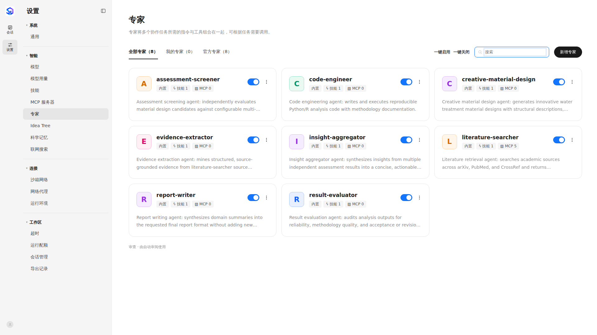
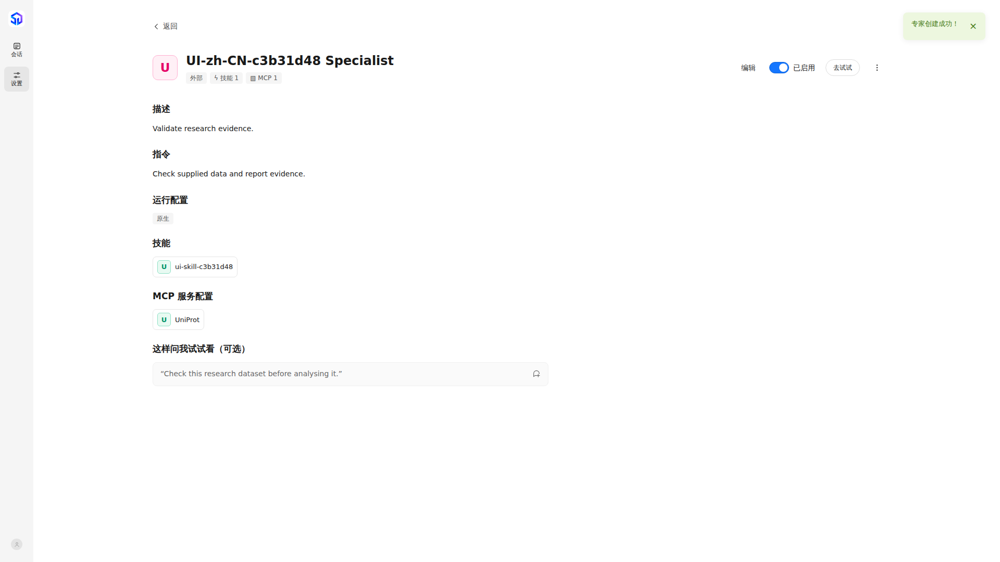
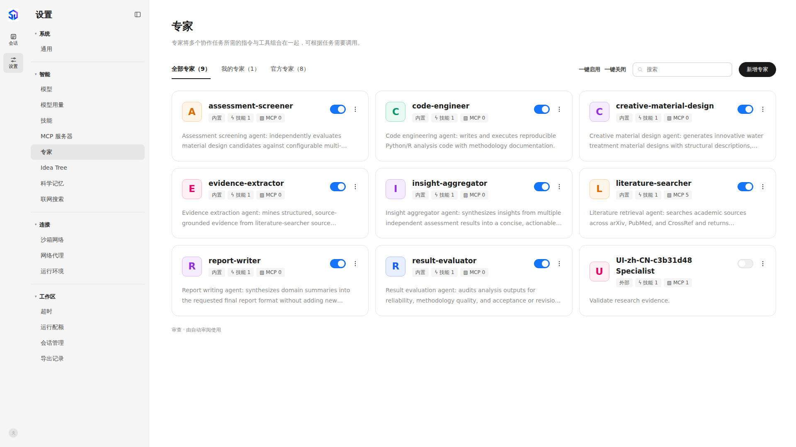
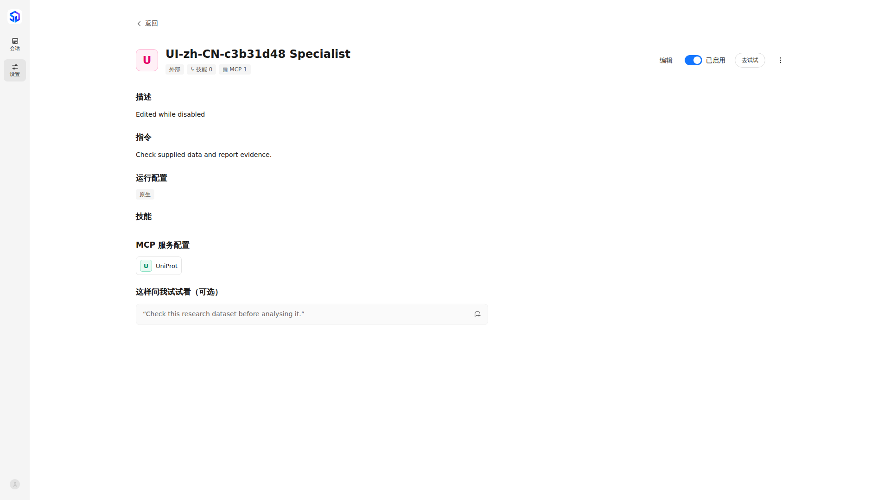
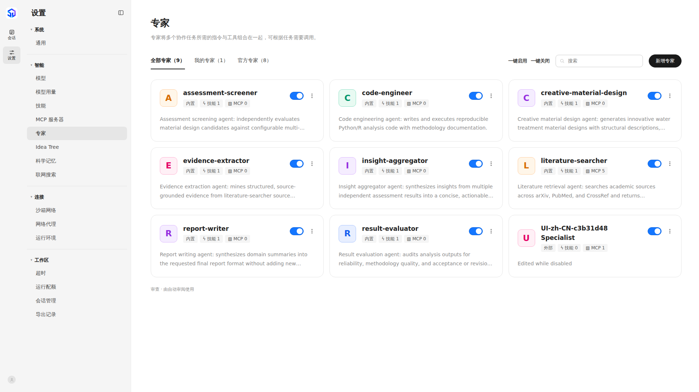
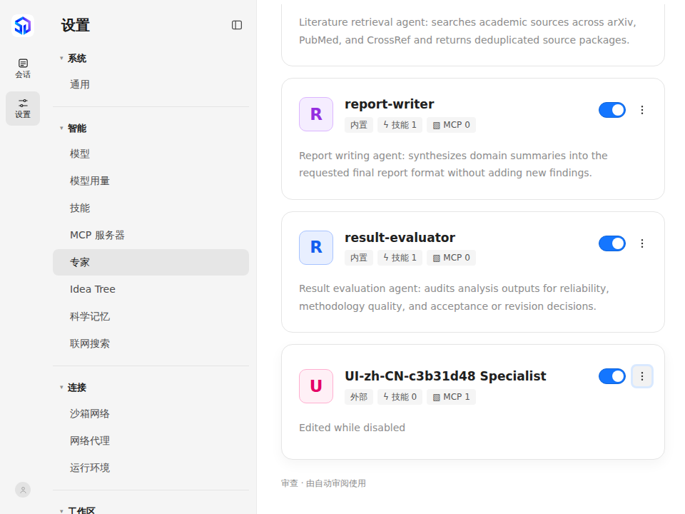
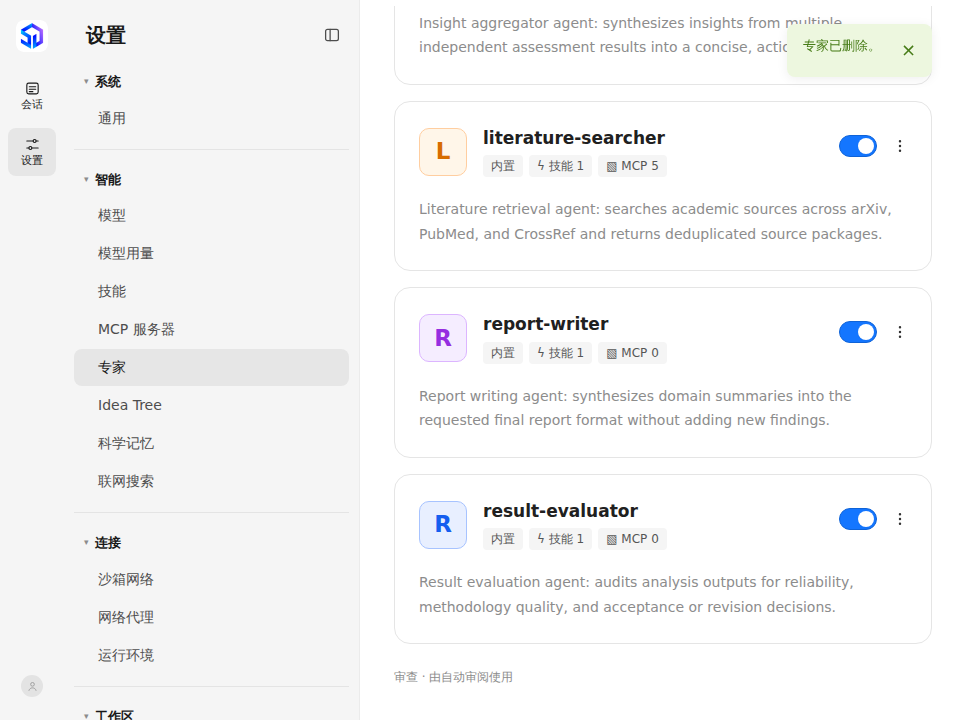

# 旅程报告 · zh-CN: manage Specialist cards and trial drafts

| 项 | 值 |
|---|---|
| 结果 | **PASS** |
| 被测 SHA | `8e648e8f80221641e43504e571a73dc1641c8104` |
| 规格文件 | `test/journey-desktop-specialist-toggle.spec.ts` |
| 用例 | zh-CN: manage Specialist cards and trial drafts |
| 分组 | mocked (@isolation:global @fixture:standard @category:e2e @os:linux @arch:amd64 @model:mock @status:reviewed @mocked) |
| 开始 | 2026-11-26T08:58:59.203Z |
| 结束 | 2026-11-26T09:00:27.296Z |
| 耗时 | 88.1s |
| 步骤 | 8 / 8 通过 |

## 场景目标

Create, configure, inspect and safely try a custom Specialist without executing a model.

## 前置条件

- Actual isolated API and compiled Desktop
- zh-CN
- Owned data and loopback model only

## 步骤总览

| # | 用户步骤 | 用户应看到 | 结果 | 耗时 | 截图 |
|---|---|---|---|---|---|
| 1 | 1. Inspect catalog controls | Source tabs, search and the primary create action are available. | ✅ 通过 | 20.8s | [01-1-Inspect-catalog-controls.png](01-1-Inspect-catalog-controls.png) |
| 2 | 2. Create with capability drawers and examples | Only confirmed drawer selections are saved; prompt examples stay separate from instructions. | ✅ 通过 | 6.7s | [02-2-Create-with-capability-drawers-and-exa.png](02-2-Create-with-capability-drawers-and-exa.png) |
| 3 | 3. Preserve and explicitly clear a disabled current binding | The bound name, state, full narrow hint and inactive selected option remain truthful. | ✅ 通过 | 23.5s | [03-3-Preserve-and-explicitly-clear-a-disabl.png](03-3-Preserve-and-explicitly-clear-a-disabl.png) |
| 4 | 4. Recover a toggle failure and exercise bulk actions | A failed write stays off, retry succeeds, and fixed Reviewer has no switch. | ✅ 通过 | 4.4s | [04-4-Recover-a-toggle-failure-and-exercise-.png](04-4-Recover-a-toggle-failure-and-exercise-.png) |
| 5 | 5. Toggle and repair after removing a selected skill | A stale skill does not prevent disabling; explicit removal preserves the remaining MCP selection. | ✅ 通过 | 13.1s | [05-5-Toggle-and-repair-after-removing-a-sel.png](05-5-Toggle-and-repair-after-removing-a-sel.png) |
| 6 | 6. Try an example without starting a Run | A new inbox Session binds the role and only prefills the editable composer. | ✅ 通过 | 12.3s | [06-6-Try-an-example-without-starting-a-Run.png](06-6-Try-an-example-without-starting-a-Run.png) |
| 7 | 7. Inspect builtins and narrow actions | Built-ins have read-only details; custom actions stay reachable at 960px. | ✅ 通过 | 1.7s | [07-7-Inspect-builtins-and-narrow-actions.png](07-7-Inspect-builtins-and-narrow-actions.png) |
| 8 | 8. Cancel then pointer-confirm deletion | Cancel preserves the role; confirmation removes it from the real API. | ✅ 通过 | 3.4s | [08-8-Cancel-then-pointer-confirm-deletion.png](08-8-Cancel-then-pointer-confirm-deletion.png) |

## 步骤详情

### 1. 1. Inspect catalog controls

- **用户应看到**：Source tabs, search and the primary create action are available.
- **结果**：✅ 通过（20.8s）



**关键日志**

```text
network: GET https://api.github.com/repos/openJiuwen-ai/sciencediscovery failed: net::ERR_BLOCKED_BY_CLIENT.Inspector
console: [error] Failed to load resource: net::ERR_BLOCKED_BY_CLIENT.Inspector @ https://api.github.com/repos/openJiuwen-ai/sciencediscovery
```

### 2. 2. Create with capability drawers and examples

- **用户应看到**：Only confirmed drawer selections are saved; prompt examples stay separate from instructions.
- **结果**：✅ 通过（6.7s）



**关键日志**

_无 console 错误/警告，无失败请求。_

### 3. 3. Preserve and explicitly clear a disabled current binding

- **用户应看到**：The bound name, state, full narrow hint and inactive selected option remain truthful.
- **结果**：✅ 通过（23.5s）



**关键日志**

```text
network: GET http://127.0.0.1:4178/src/assets/brand/app-mark.png failed: net::ERR_ABORTED
network: GET http://127.0.0.1:4178/src/assets/landing/mascot.png failed: net::ERR_ABORTED
network: GET http://127.0.0.1:4178/src/assets/icons/migration.svg failed: net::ERR_ABORTED
network: GET https://api.github.com/repos/openJiuwen-ai/sciencediscovery failed: net::ERR_BLOCKED_BY_CLIENT.Inspector
console: [error] Failed to load resource: net::ERR_BLOCKED_BY_CLIENT.Inspector @ https://api.github.com/repos/openJiuwen-ai/sciencediscovery
```

### 4. 4. Recover a toggle failure and exercise bulk actions

- **用户应看到**：A failed write stays off, retry succeeds, and fixed Reviewer has no switch.
- **结果**：✅ 通过（4.4s）


**关键日志**

```text
network: PUT http://127.0.0.1:4178/api/specialists/d4abb31d-cd21-4add-95d4-b891b42e4005 failed: net::ERR_FAILED
console: [error] Failed to load resource: net::ERR_FAILED @ http://127.0.0.1:4178/api/specialists/d4abb31d-cd21-4add-95d4-b891b42e4005
```

### 5. 5. Toggle and repair after removing a selected skill

- **用户应看到**：A stale skill does not prevent disabling; explicit removal preserves the remaining MCP selection.
- **结果**：✅ 通过（13.1s）



**关键日志**

```text
network: GET https://api.github.com/repos/openJiuwen-ai/sciencediscovery failed: net::ERR_BLOCKED_BY_CLIENT.Inspector
console: [error] Failed to load resource: net::ERR_BLOCKED_BY_CLIENT.Inspector @ https://api.github.com/repos/openJiuwen-ai/sciencediscovery
```

### 6. 6. Try an example without starting a Run

- **用户应看到**：A new inbox Session binds the role and only prefills the editable composer.
- **结果**：✅ 通过（12.3s）



**关键日志**

```text
network: GET https://api.github.com/repos/openJiuwen-ai/sciencediscovery failed: net::ERR_BLOCKED_BY_CLIENT.Inspector
console: [error] Failed to load resource: net::ERR_BLOCKED_BY_CLIENT.Inspector @ https://api.github.com/repos/openJiuwen-ai/sciencediscovery
```

### 7. 7. Inspect builtins and narrow actions

- **用户应看到**：Built-ins have read-only details; custom actions stay reachable at 960px.
- **结果**：✅ 通过（1.7s）



**关键日志**

_无 console 错误/警告，无失败请求。_

### 8. 8. Cancel then pointer-confirm deletion

- **用户应看到**：Cancel preserves the role; confirmation removes it from the real API.
- **结果**：✅ 通过（3.4s）



**关键日志**

_无 console 错误/警告，无失败请求。_

## 运行元数据（来自 E2E-META）

| 项 | 值 |
|---|---|
| 类型 | - |
| 模型 | - |
| 凭据 | - |
| 成本与副作用 | - |

